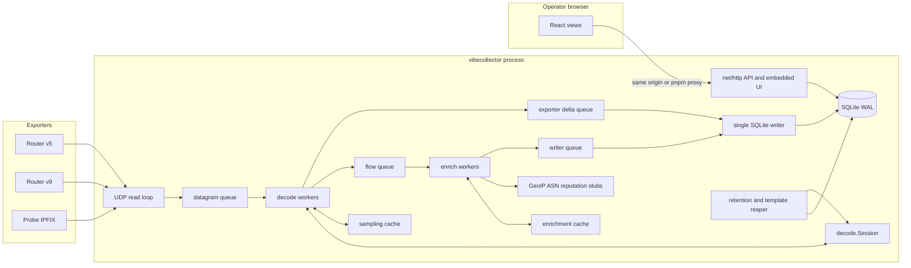
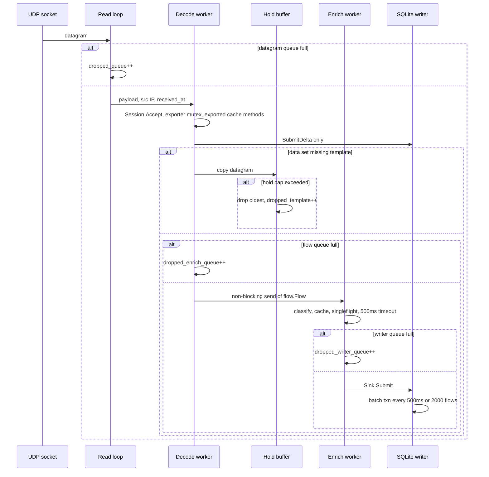
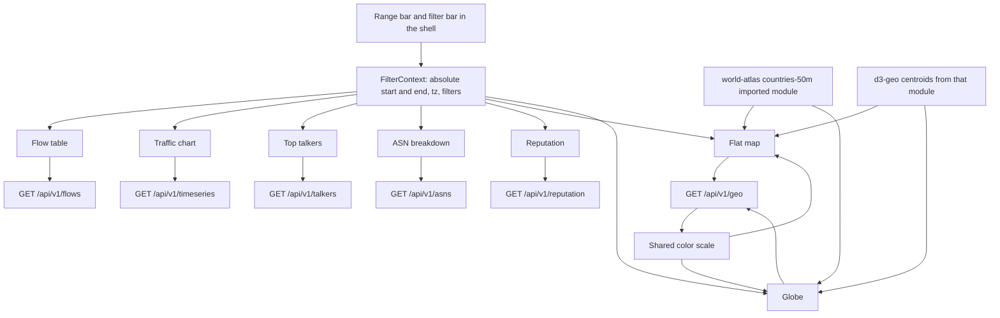

# VibeCollector Design

| | |
| --- | --- |
| **Author** | TBD |
| **Date** | 2026-11-09 |
| **Status** | Draft |
| **Audience** | Implementers of the greenfield collector |
| **Requirements** | [`AGENTS.md`](/home/jeff/git/vibecollector/AGENTS.md) |
| **Operator docs today** | [`docs/overview.md`](/home/jeff/git/vibecollector/docs/overview.md), [`docs/usage.md`](/home/jeff/git/vibecollector/docs/usage.md) |

This document is the implementation plan. It does not describe code that already exists. The repository on `dev` has no daemon and no UI yet. Where this plan and `AGENTS.md` disagree, `AGENTS.md` wins and the plan must be updated. Operator prose in `docs/` describes the behavior this plan builds. Each later pull request fills only the keys and sentences that pull request makes true. The whole TOML table is not dumped into `docs/usage.md` up front.

---

## Overview

VibeCollector is a single-host NetFlow collector. One Go process binds a UDP socket, decodes NetFlow v5, NetFlow v9 (RFC 3954), and IPFIX (RFC 7011), normalizes each export into a canonical flow, optionally enriches the endpoints, and writes SQLite. The same process serves a JSON API and, in production, the built React UI. Development runs the UI with pnpm and proxies the API. There is no relay, no second database, and no tile server.

The design target is **2,000 flows/s sustained** and a **30-second burst of 10,000 flows/s** on one machine. While the writer drains at 2,000 flows/s, that burst leaves **240,000** decoded flows queued. The flow queue (200,000) plus the writer queue (80,000) hold that excess. The datagram queue does not. Raw flows are kept for **6 hours** (about 26 GiB at the sustained rate). One-minute and five-minute rollups are kept for **30 days** (about 8 GiB) and are what the charts, the map, and the globe read when the active filters are columns of those rollups. The socket read loop never calls enrichment or SQLite. Providers ship as stubs that return a typed "not configured" result and do no network I/O.

---

## Background and Motivation

Routers already reduce packets to flows. VibeCollector stores those summaries so an operator can answer, for one time range, who talked to whom, how much, on which ports, and what GeoIP, ASN, and reputation say about the addresses. `docs/overview.md` fixes the product shape: the collector is the UDP receiver, SQLite is the copy the UI reads, sampled counters stay sampled, and non-global addresses are not sent to providers.

`docs/usage.md` already tells the operator several things the implementation must make true:

- Default UDP port **2055**, address configurable. IANA assigns IPFIX to **4739/UDP** (and TCP and SCTP). **9995/UDP** is the Debian `nfcapd` default. **9996/UDP** is commonly cited as an alternate; no single vendor default was verified for it. Both are valid values of the one listen field. sFlow is out of scope.
- After a restart, template tables start empty. Decoding resumes when the exporter sends templates again. Data that arrives with no template is counted and discarded once a small hold buffer fills.
- The HTTP service is bound to localhost unless the operator means to expose it. A reverse proxy is the intended access control in front of a non-local bind.
- The UI shares one time range and one filter set. A calendar day is midnight to midnight in a selected timezone, default UTC.
- The map and the globe draw the same rolled-up countries and paths, not one mark per flow. With the GeoIP stub they still render, with empty traffic layers.

Sentences in `docs/usage.md` that this plan changes, in the pull request that makes the behavior real:

- Top talkers today says the view "ranks sources, destinations, and ports." The talker rollup ranks sources and destinations. The talkers PR replaces that sentence. It does not add a port ranking.
- Enrichment today says to "enable" a provider in configuration. There is no enable flag. The enrichment PR replaces that sentence with: a stub is replaced by a client in code; the `[enrich.geoip]`, `[enrich.asn]`, and `[enrich.reputation]` tables are reserved and have no effect.
- Templates today say to use a stable source address and that templates are kept per exporter and observation domain. They do not yet say that two devices behind one source address must use distinct observation domain IDs. The template PR adds that sentence. This plan does not cite it as already documented.

What is painful if left unspecified, and what this plan pins down: header layouts and sequence units differ per version; v9 framing follows each FlowSet Length; template identity ignores the ephemeral source port; sysUpTime is not wall time; shared filters that are not rollup columns are answered from raw flows or rejected; heavy-hitter flushes replace a bucket; the retention delete budget stays above the ingest rate; SQLite will not store line-rate raw flows for long; a map that plots flows will lock the browser; a provider stub that accidentally dials the network leaks every address.

---

## Goals and Non-Goals

### Goals

- One static binary (`CGO_ENABLED=0`) that receives UDP, writes SQLite, serves `/api/v1/*`, and serves the built UI from an embedded filesystem.
- Correct v5, v9, and IPFIX over UDP, including template replacement, IPFIX withdrawal, sequence-gap accounting in the right units, sampling labels, and absolute UTC timestamps.
- One enrichment interface, three stubs, local scope classification, per-provider TTL, singleflight, bounded caches.
- A React UI, pnpm only, whose seven views share one range and one filter set. The flat map and the globe are two clients of one geographic aggregate.
- Schema changes only through numbered SQLite migrations.

### Non-Goals

- sFlow, NetFlow v1/v7/v8, packet capture, PCAP, or deep packet inspection.
- Alerting, paging, thresholds, or email.
- Multi-node clustering, remote storage, Kafka, or a second collector process.
- Multiplying sampled packet or byte counters into the stored totals. An estimated total may be labeled and computed at read time only.
- Real GeoIP, ASN, or reputation vendor clients, SDKs, license files, or credentials. Stubs only. The maintainer writes clients later against the same interface.
- Tile servers, map CDNs, geocoding APIs, and a day/night earth terminator or shader.
- Multi-user accounts, SSO, OAuth, or per-user audit. One optional shared bearer token, injected by a reverse proxy. No browser token entry point.
- TLS inside the daemon. Termination belongs on the reverse proxy `docs/usage.md` already points at.
- Hot reload of configuration. Restart applies a new file.
- Persisting template state across process restarts.
- Long-range charts that stay correct under filters the rollups do not key. Those requests use raw flows inside the retention window or return 400.
- A port ranking on the top-talkers view.
- An exporter ACL on the UDP socket. Reachability of the listen port is the operator's firewall.

---

## Key Decisions

**Language is Go (module `github.com/majestrate/vibecollector`, Go 1.23+).** One goroutine reads UDP; others decode, enrich, and write. `net/http` plus `embed.FS` serves the API and the UI without a second runtime. `CGO_ENABLED=0` with `modernc.org/sqlite` produces a static binary. Rust can do the same job but the HTTP and SQLite story either pulls in C (`rusqlite` with bundled SQLite) or adds a second framework for no throughput we need at 2,000 flows/s. Python's `netflow` package can parse, but CPython is not a single static binary, the GIL makes "the socket never blocks" a discipline problem, and that package's last release is 2023-08-20. The comparison is in Alternatives Considered. Every snippet in this document is Go.

**The decoder is in-tree, not goflow2 and not a CGO parser.** Packages: `internal/decode/v5`, `internal/decode/v9`, `internal/decode/ipfix`, dispatched by `internal/decode.Dispatch` on the first big-endian uint16. Template lifetime is product policy (replace on redefine, withdraw on IPFIX withdrawal, drop on exporter silence) and does not match a generic library TTL. Library facts that were checked, and the gaps, are in Alternatives Considered. Hand-waving "we will parse NetFlow" is not the plan: the byte layouts below are the spec, and golden datagrams lock them.

**SQLite driver is `modernc.org/sqlite` (BSD-3, pure Go, driver name `sqlite`).** `mattn/go-sqlite3` is faster and needs cgo, which gives up the static binary. If the writer benchmark in the ingest PR cannot sustain 2,000 flows/s of the real row width, switching drivers is a contained change that does not move SQL. It is a risk mitigation, not an open choice. Pragmas that do not stick in the file (`synchronous`, `busy_timeout`, `cache_size`, `foreign_keys`, `temp_store`) are set on the DSN so every pooled connection applies them. `go.mod` pins `modernc.org/sqlite` at v1.62.0 (the version checked for this plan) and pins `modernc.org/libc` to the exact version that module's `go.mod` requires.

**Templates are memory-only.** `docs/usage.md` already says they start empty on restart. A template persisted across a restart can outlive an IPFIX withdrawal that happened while the process was down and will mis-decode until the next full redefine. v9 exporters must refresh templates (RFC 3954 §7 item 3 and §9). IPFIX-over-UDP exporters retransmit templates (RFC 7011 §8.4). The hold buffer covers the gap after startup. Enrichment caches are memory-only too.

**Exporter identity is source IP plus observation domain, not source port.** v9 domain is the 32-bit source ID. IPFIX domain is the observation domain ID. v5 has no templates; its sequence key is source IP plus `engine_type` and `engine_id`. RFC 7011 §8.4's collector tuple also includes the exporter source UDP port, the collector IP, and the collector destination UDP port. This process is the only collector, so those three are not part of the key. NAT collision is called out under template state.

**v9 packets are framed by each FlowSet's Length until the UDP payload is consumed.** RFC 3954 §5.1 defines Count as the total number of records in the Export Packet (template records + options template records + data records + options data records). Section 11.1 sets Count to 7 on a packet that contains 4 FlowSets (1 template record + 3 data records + 1 options template record + 2 options data records). Cisco Collection Engine 5.0.3 Table B-24 says Count is the number of flow sets and disagrees with that example. Wireshark does not use Count as a loop bound. The walk does not stop at Count. A payload that ends before `count` FlowSets is not malformed for that reason. A Count that disagrees with the record sum increments `count_disagrees` and the packet is kept.

**Raw retention default is 6 hours. Rollup retention default is 30 days.** Traffic, ASN, talker, and reputation grains are **1 minute**. Geographic grain is **5 minutes**. Grains are schema, not config. Retention durations are config. The sweeper's `flows` budget is **40 batches of 5,000 rows per minute** (200,000), above the 120,000 rows/minute a 2,000 flows/s ingest inserts. Under 5 GiB free that budget rises to 80 batches and deletes keep running while raw inserts are shed. Stored `flow_start_ms` and `flow_end_ms` are clamped into `[received_at - timestamp_max_age, received_at + timestamp_skew_slack]` before insert, so a future device clock cannot hide a row from the sweeper.

**Heavy-hitter buckets are replaced, not added to.** The in-memory map is the source of truth for an open talker, reputation, or geo-path bucket. Every flush deletes that bucket's rows and inserts the post-prune map plus one `OTHER` row. `other_octets` does not include octets that are also stored on a kept key. A closed bucket is loaded, updated, pruned, and replaced. It is never a blind `ON CONFLICT DO UPDATE` add.

**Shared filters use a rollup only when every active filter is a column of that rollup.** Otherwise, if `start >= now - raw_retention`, the route aggregates `flows` and returns `source: "flows"`. If `start` is older than raw retention, the route returns **400** `filter_outside_raw`. It does not return an unfiltered rollup under a filtered request. Long-range filtered charts are not a goal, and filter columns are not added to rollup keys.

**Additive rollups sum IP-layer deltas only.** A row with `counter_semantics = total` or `octet_semantics = l4_payload` is stored on `flows` and omitted from `traffic_1m`, `talker_1m`, `asn_1m`, `rep_1m`, `geo_country_5m`, and `geo_path_5m`. Octet preference is IE 1, else OUT_BYTES (23), else IE 85 as `total`, else IE 231 as `l4_payload`. `octet_semantics` is `l4_payload` only when 231 is that selected primary. IE 232 is `out_octets` only in that case and does not relabel a delta or total row. Timeseries returns sampled and unsampled as separate series. Stored counters are never multiplied by N.

**Calendar day means midnight to midnight in a selected IANA timezone, default UTC.** It is a preset on the same absolute `[start, end)` window every view already uses. It is not a terminator and it is not an open question. The binary embeds zones with `import _ "time/tzdata"`. A repeated local time uses the earlier instant. A skipped local time uses the next valid instant and sets `boundary_adjusted`. The UI uses the same rule. Tests assert fixed RFC 3339 instants.

**Maps: `react-simple-maps` 5.0.5 for the flat map and `react-globe.gl` 2.38.0 for a real sphere.** Both consume `GET /api/v1/geo`. World geometry is `world-atlas` 2.0.2 `countries-50m.json` (Natural Earth), imported as a module. Feature ids in that file are zero-padded strings (`"840"`, `"016"`). Five features have JSON `null` ids and are drawn without a traffic join. There is no id `-99` in this file. No tile URL is configured. The globe's `globeImageUrl`, `bumpImageUrl`, and `globeTileEngineUrl` stay unset. An unset `globeImageUrl` is the README's black sphere.

**HTTP default is `127.0.0.1:8080` with no token. A non-loopback bind without `http.token` refuses to start.** The token is a single shared bearer. The browser never stores it and never sends `Authorization`. When the daemon is bound off loopback, the reverse proxy injects `Authorization: Bearer <token>`. A direct client that omits the header gets 401. Accounts and SSO are out of scope.

**Stored packet and octet counters are the exported counters.** The UI may show `exported × interval` only in a control that is off by default and labeled as an estimate.

**The 30-second burst fits in the decoded-flow queues.** `flow_queue` is 200,000 and `writer_queue` is 80,000 (280,000 combined). The datagram queue stays 8,192 packets and is not the burst absorber. Past those depths the stage drop counters increment. The memory budget includes template bodies at the 50,000-template cap.

**Components meet only at documented exported APIs.** `cmd/vibecollector` is the only composition root. A component calls another only through exported types and functions. The Public APIs section is the spec for those Go doc comments and for the JSDoc. Comments ship in the pull request that introduces the API.

---

## Proposed Design

### Process architecture



The read loop's only jobs are `ReadFromUDP`, timestamp the arrival, and a non-blocking send onto the datagram queue. Enrichment, DNS, and SQLite are downstream. There is no DNS in this design at all.

The datagram queue carries `ingest.Datagram`. The flow queue and the writer queue carry `flow.Flow`. The delta queue carries `flow.ExporterDelta`. Decode workers call `decode.Session.Accept`, send each returned flow on main's `chan flow.Flow`, and call `SubmitDelta` only. `enrich.Pipeline.Run` is the only caller of `flow.Sink.Submit`. Workers do not touch another package's unexported fields.

### Component map

| Path | Owns |
| --- | --- |
| `cmd/vibecollector/main.go` | Composition root only. Constructs each component and passes interfaces or exported structs. Does not read unexported fields |
| `internal/config/config.go` | `Load`, `Config` |
| `internal/obs/stats.go` | Counter names, `Add`, `Snapshot` |
| `internal/ingest/udp.go` | `Reader`, `Datagram` |
| `internal/decode/session.go` | `Session`. The per-exporter mutex. The only combined caller of the four caches |
| `internal/decode/dispatch.go` | `Dispatch`. Version switch. No template, hold, sampling, or sequence maps |
| `internal/sequence/table.go` | `Table` |
| `internal/decode/v5/v5.go` | `Parse` |
| `internal/decode/v9/v9.go` | `Parse` |
| `internal/decode/ipfix/ipfix.go` | `Parse` |
| `internal/decode/time.go` | `AbsMillis` |
| `internal/decode/calendar.go` | `CalendarDay` |
| `internal/decode/ie.go` | Information Element number constants |
| `internal/template/cache.go` | `Cache` |
| `internal/template/hold.go` | `Hold` |
| `internal/sampling/rate.go` | `Rate` |
| `internal/sampling/cache.go` | `Cache` |
| `internal/flow/flow.go` | `Flow`, `ExporterDelta`, `Sink` |
| `internal/enrich/provider.go` | `Provider` |
| `internal/enrich/scope.go` | `Classify` |
| `internal/enrich/cache.go` | TTL, LRU, singleflight |
| `internal/enrich/stub/stub.go` | `New`. The pipeline does not import this package |
| `internal/enrich/pipeline.go` | `Pipeline`. Takes `[]Provider` |
| `internal/store/sqlite.go` | `Open` |
| `internal/store/migrations/*.sql` | DDL |
| `internal/store/writer.go` | `Writer`, implements `flow.Sink`. Bucket replace stays inside `Writer` |
| `internal/store/retain.go` | `Sweeper` |
| `internal/store/query.go` | `Query`. Does not import `net/http` |
| `internal/api/server.go` | `Server`. Calls `store.Query` |
| `internal/api/qcache.go` | Query `Cache` |
| `ui/src/filters.tsx` | `FilterContext`, `useFilters`, `calendarRange` |
| `ui/src/geo/fetch.ts` | `fetchGeo`, `GeoResponse` |
| `ui/src/geo/scale.ts` | `colorForOctets` |
| `ui/src/views/MapView.tsx` | Flat map. Does not import the globe |
| `ui/src/views/GlobeView.tsx` | Globe. Does not import the map |
| `ui/` | Vite 6 + React. Lockfile `ui/pnpm-lock.yaml` only |

## Public APIs

This section is the calling surface. The byte layouts, SQL, and HTTP bodies in the later sections stay in force. A Go doc comment or a JSDoc block below is what ships on that declaration. A caller uses the comment and the signature and does not read the body. `cmd/vibecollector` is the only composition root: it constructs each value and passes interfaces or exported structs. It does not read another package's unexported fields.

Stage channels carry exported types only.

| Channel | Element type | Producer | Consumer |
| --- | --- | --- | --- |
| datagram queue | `ingest.Datagram` | `ingest.Reader` | decode worker, which calls `Session.Accept` |
| flow queue | `flow.Flow` | decode worker, non-blocking send on main's `chan flow.Flow` (capacity `FlowQueue`) | `enrich.Pipeline` |
| writer queue | `flow.Flow` | `enrich.Pipeline.Run`, the only caller of `flow.Sink.Submit` | `store.Writer` |
| delta queue | `flow.ExporterDelta` | decode worker via `flow.Sink.SubmitDelta` only | `store.Writer` |

`store.Writer` implements `flow.Sink`. The pipeline accepts that interface. It does not import `internal/store` or `internal/enrich/stub`. `store.Query` does not import `net/http`. The handler calls `api.Cache.Do`. The load function calls `Query` and encodes the structs. The handler does not call `Query` before `Do`. The flat map and the globe do not import each other. Both call `fetchGeo` and `colorForOctets`.

### config

`internal/config/config.go`. `Load` is the only constructor. Later packages take a `Config` or one of its exported structs. They do not parse TOML again.

```go
// Flags are the process overrides. An empty string means the flag was not set.
// ConfigPath empty means Load opens ./vibecollector.toml when that file exists
// and otherwise uses built-in defaults. HTTP, UDP, and DB, when non-empty,
// replace http.listen, udp.listen, and db.path after the file is decoded.
type Flags struct {
	ConfigPath string
	HTTP       string
	UDP        string
	DB         string
}

// Config is the process configuration after defaults and flag overrides.
// Every TOML field has a toml tag equal to the key in the Configuration section.
// LooseFileMode is true when a config file was opened and its mode has
// perm&0077 != 0. That is not a load error. main logs a warning.
// It is not a file key (`toml:"-"`).
type Config struct {
	UDP           UDP  `toml:"udp"`
	HTTP          HTTP `toml:"http"`
	DB            DB   `toml:"db"`
	Enrich        Enrich `toml:"enrich"`
	Log           Log  `toml:"log"`
	LooseFileMode bool `toml:"-"`
}

// UDP is the socket and the queue depths. Listen is host:port.
// ReadBufferBytes is the requested SO_RCVBUF. DatagramQueue, FlowQueue, and
// WriterQueue are channel capacities. FlowQueue is the decoded-flow channel
// main creates. DatagramQueue is not the burst absorber.
// TemplateIdle is exporter silence, not a template TTL.
// TimestampMaxAge and TimestampSkewSlack bound the receive-time clamp.
type UDP struct {
	Listen             string        `toml:"listen"`
	ReadBufferBytes    int           `toml:"read_buffer_bytes"`
	DatagramQueue      int           `toml:"datagram_queue"`
	FlowQueue          int           `toml:"flow_queue"`
	WriterQueue        int           `toml:"writer_queue"`
	TemplateIdle       time.Duration `toml:"template_idle_timeout"`
	HoldPerExporter    int           `toml:"hold_packets_per_exporter"`
	HoldGlobal         int           `toml:"hold_packets_global"`
	TimestampMaxAge    time.Duration `toml:"timestamp_max_age"`
	TimestampSkewSlack time.Duration `toml:"timestamp_skew_slack"`
}

// HTTP is the API listener. Token is required when Listen is not loopback.
// The browser never sees Token. QueryCacheTTL and QueryCacheEntries size
// the API response cache.
type HTTP struct {
	Listen            string        `toml:"listen"`
	Token             string        `toml:"token"`
	QueryCacheTTL     time.Duration `toml:"query_cache_ttl"`
	QueryCacheEntries int           `toml:"query_cache_entries"`
}

// DB is the SQLite file and the writer batch. BusyTimeout is also the DSN
// busy_timeout. RawRetention and RollupRetention are the sweeper horizons.
type DB struct {
	Path            string        `toml:"path"`
	BusyTimeout     time.Duration `toml:"busy_timeout"`
	BatchSize       int           `toml:"batch_size"`
	BatchInterval   time.Duration `toml:"batch_interval"`
	RawRetention    time.Duration `toml:"raw_retention"`
	RollupRetention time.Duration `toml:"rollup_retention"`
}

// Enrich is the cache policy. The three TTL fields apply to not_configured,
// no_data, and value. Lookup errors use a fixed one-minute TTL inside the cache.
// GeoIP, ASN, and Reputation are the reserved nested tables [enrich.geoip],
// [enrich.asn], and [enrich.reputation]. They are not enable flags.
type Enrich struct {
	GeoIPTTL      time.Duration `toml:"geoip_ttl"`
	ASNTTL        time.Duration `toml:"asn_ttl"`
	ReputationTTL time.Duration `toml:"reputation_ttl"`
	LookupTimeout time.Duration `toml:"lookup_timeout"`
	CacheEntries  int           `toml:"cache_entries_per_provider"`
	GeoIP         ReservedTable `toml:"geoip"`
	ASN           ReservedTable `toml:"asn"`
	Reputation    ReservedTable `toml:"reputation"`
}

// Log is the slog level name: debug, info, warn, or error.
type Log struct {
	Level string `toml:"level"`
}

// ReservedTable is a nested table whose child keys are discarded.
// The hook is unstable.Unmarshaler: (*ReservedTable).UnmarshalTOML([]byte) error.
// Load calls Decoder.EnableUnmarshalerInterface before
// DisallowUnknownFields().Decode. v2.4.3 invokes the method only after that call.
// A child of [enrich.geoip], [enrich.asn], or [enrich.reputation] loads and is ignored.
// A typo under [udp] is still ErrUnknownField.
// The table is not an enable flag. Load does not open a path or a URL from it.
type ReservedTable struct{}

// UnmarshalTOML discards the raw table bytes and returns nil.
// The receiver is a pointer. The argument is []byte.
// It does not return ErrUnknownField. A child key is not an error.
// The decoder calls this only after EnableUnmarshalerInterface.
func (t *ReservedTable) UnmarshalTOML([]byte) error { return nil }

// Load reads TOML, applies defaults, then applies flags.
// path comes from flags.ConfigPath. flags.HTTP, flags.UDP, and flags.DB override.
// It returns the Config the rest of the process uses.
// The decoder is pelletier/go-toml/v2 v2.4.3. Load calls
// EnableUnmarshalerInterface on that decoder, then DisallowUnknownFields().Decode.
// It returns an error that wraps ErrUnknownField when a key is unknown,
// including a typo under [udp] or an unknown sibling of [enrich].
// A child key of [enrich.geoip], [enrich.asn], or [enrich.reputation] is
// discarded by (*ReservedTable).UnmarshalTOML([]byte) error and is not an error.
// It returns ErrTokenRequired when http.listen is not loopback and the token
// is empty. It returns ErrBadConfig when a duration is invalid, a retention
// is shorter than one grain, or a queue depth is less than 1.
// A missing default file is not an error. A missing file named by ConfigPath is.
// Load does not bind a socket and does not open the database.
func Load(flags Flags) (*Config, error)
```

`ErrUnknownField`, `ErrTokenRequired`, and `ErrBadConfig` are exported sentinel errors. `errors.Is` is how main tells them apart. Exit code 2 is main's choice on any of the three.

### obs

`internal/obs/stats.go`. Every process counter the design names is a `Name` constant. The `/api/v1/stats` JSON keys are these strings. `Add` and `Snapshot` are the only operations other packages call.

```go
// Name is one process-lifetime counter. The string value is the stats JSON key.
type Name string

const (
	UDPReceivedPackets     Name = "udp_received_packets"
	UDPReceivedBytes       Name = "udp_received_bytes"
	DecodedPackets         Name = "decoded_packets"
	DecodedFlows           Name = "decoded_flows"
	DroppedQueue           Name = "dropped_queue"
	DroppedEnrichQueue     Name = "dropped_enrich_queue"
	DroppedWriterQueue     Name = "dropped_writer_queue"
	DroppedTemplate        Name = "dropped_template"
	DroppedDisk            Name = "dropped_disk"
	Malformed              Name = "malformed"
	MissingTemplate        Name = "missing_template"
	TemplatesWithdrawn     Name = "templates_withdrawn"
	WithdrawUnknown        Name = "withdraw_unknown"
	TemplateRedefined      Name = "template_redefined"
	TemplateIdleExpired    Name = "template_idle_expired"
	TemplateEvicted        Name = "template_evicted"
	ReservedSet            Name = "reserved_set"
	CountDisagrees         Name = "count_disagrees"
	PaddingNonzero         Name = "padding_nonzero"
	SequenceGapV5Flows     Name = "sequence_gap_v5_flows"
	SequenceGapV9Packets   Name = "sequence_gap_v9_packets"
	SequenceGapIPFIXRecords Name = "sequence_gap_ipfix_records"
	SequenceReorder        Name = "sequence_reorder"
	SequenceDuplicate      Name = "sequence_duplicate"
	SequenceReset          Name = "sequence_reset"
	SequenceUnresolved     Name = "sequence_unresolved"
	NonFlowRecords         Name = "non_flow_records"
	TimestampSkew          Name = "timestamp_skew"
	TimestampSuspect       Name = "timestamp_suspect"
	TimestampExportFallback Name = "timestamp_export_fallback"
	ClockClamped           Name = "clock_clamped"
	EnrichGeoIPNotConfigured Name = "enrich_geoip_not_configured"
	EnrichGeoIPNoData      Name = "enrich_geoip_no_data"
	EnrichGeoIPError       Name = "enrich_geoip_error"
	EnrichGeoIPValue       Name = "enrich_geoip_value"
	EnrichGeoIPSkipped     Name = "enrich_geoip_skipped"
	EnrichASNNotConfigured Name = "enrich_asn_not_configured"
	EnrichASNNoData        Name = "enrich_asn_no_data"
	EnrichASNError         Name = "enrich_asn_error"
	EnrichASNValue         Name = "enrich_asn_value"
	EnrichASNSkipped       Name = "enrich_asn_skipped"
	EnrichReputationNotConfigured Name = "enrich_reputation_not_configured"
	EnrichReputationNoData Name = "enrich_reputation_no_data"
	EnrichReputationError  Name = "enrich_reputation_error"
	EnrichReputationValue  Name = "enrich_reputation_value"
	EnrichReputationSkipped Name = "enrich_reputation_skipped"
	SQLiteWriteFailures    Name = "sqlite_write_failures"
	SQLiteRowsWritten      Name = "sqlite_rows_written"
)

// Counters is the process-lifetime set. Values are never reset.
type Counters struct{}

// NewCounters returns every Name at zero.
func NewCounters() *Counters

// Add adds n to name. n is a delta, not a new total.
// An unknown name returns ErrUnknownCounter and does not change the snapshot.
// A known name returns nil.
func (c *Counters) Add(name Name, n uint64) error

// Snapshot returns every Name and its current value, including zeros.
// The caller owns the map. Snapshot does not return an error.
func (c *Counters) Snapshot() map[Name]uint64
```

### ingest

`internal/ingest/udp.go`. The reader emits `Datagram` and does nothing else with the payload.

```go
// Datagram is one UDP payload plus the arrival facts the reader recorded.
// Payload is a copy the reader owns until the send; the decode worker must
// not retain it after Accept returns unless it copies again (the hold buffer does).
// Src is the source IP with the port discarded and IPv4-mapped form unmapped.
// The port is not a field. ReceivedAt is time.Now().UTC() taken once in the
// read loop. Later stages do not take another receive timestamp.
type Datagram struct {
	Payload    []byte
	Src        netip.Addr
	ReceivedAt time.Time
}

// Reader binds the UDP socket and sends Datagram values on out.
// NewReader does not bind. Run binds.
type Reader struct{}

// NewReader stores cfg and counters. A nil counters or a cfg.Listen that
// does not parse as host:port returns ErrBadConfig. It does not listen yet.
func NewReader(cfg config.UDP, counters *obs.Counters) (*Reader, error)

// Run listens on cfg.Listen, sets SO_RCVBUF to cfg.ReadBufferBytes, and reads
// until ctx is cancelled. out is the datagram queue main created, capacity
// cfg.DatagramQueue. Each successful read sends one Datagram.
// A full out increments dropped_queue, returns the buffer to the pool, and
// does not block. A timeout error on the socket continues the loop.
// A fatal read error is returned. Cancelling ctx closes the socket and
// returns nil after the in-flight ReadFromUDP unwinds.
// Run does not decode, enrich, or touch SQLite. It logs the requested
// SO_RCVBUF and, on Linux, the actual getsockopt value. It does not use
// SO_RCVBUFFORCE. There is no exporter allow-list.
func (r *Reader) Run(ctx context.Context, out chan<- Datagram) error
```

### decode

`Dispatch` and the three parsers do not own template, hold, sampling, or sequence maps. `Session` is the coordinator. Its methods are the only way those four are touched together. The per-exporter mutex is unexported inside `Session`. It is not a field of a shared struct that other packages lock, and there is no `State` struct.

`internal/decode/session.go`:

```go
// Session serializes one exporter IP across template.Cache, template.Hold,
// sampling.Cache, and sequence.Table. Decode workers call Accept.
// The reaper calls ExpireIdle. Nothing else calls the four together.
type Session struct{}

// NewSession stores the four objects and the counters. main constructs the
// four and passes them here. A nil argument returns ErrNilDep.
// NewSession does not start a goroutine.
func NewSession(templates *template.Cache, hold *template.Hold, samples *sampling.Cache, seq *sequence.Table, counters *obs.Counters) (*Session, error)

// Accept decodes one datagram for d.Src.
// It holds that exporter IP's mutex for the whole call, including the
// hold-buffer retry after a template install. Two Accept calls for different
// IPs run in parallel. Two Accept calls for the same IP do not.
// d.Payload is the UDP payload. d.ReceivedAt is the reader's timestamp.
// The returned flows are not enriched. delta is always set. A payload shorter
// than 2 bytes, or a version other than 5, 9, or 10, still returns a delta
// with Version 0 and Domain 0 after incrementing malformed.
// flows may be empty. Accept does not enqueue and does not call Submit or
// SubmitDelta. The worker sends flows on main's chan flow.Flow and calls
// SubmitDelta itself.
// When a data set has no template, Accept copies the datagram into Hold under
// the same mutex. A worker never locks two exporter mutexes.
// When Cache.Put returns an evicted IP equal to
// d.Src, Accept drops that IP's hold, sampling, and sequence state under the
// mutex it already holds. When the evicted IP is a different address, Accept
// records it and does not lock it. ExpireIdle, which locks one IP at a time,
// drops that IP.
// A structural failure increments malformed once and still returns flows
// already taken from earlier complete sets. ErrMalformed from a parser is
// not returned to the worker. Accept does not return an error. The returned
// delta carries the malformed count.
// A hold retry does not increment missing_template or malformed a second
// time for the same set.
func (s *Session) Accept(d ingest.Datagram) (flows []flow.Flow, delta flow.ExporterDelta)

// ExpireIdle drops template, hold, sampling, and sequence state for every
// exporter IP whose last datagram is older than idle, and for every IP that
// Accept recorded as a cap eviction of a different exporter. now is the
// collector clock. The returned IPs were dropped. The caller increments
// template_idle_expired once per IP that was idle, and template_evicted is
// already counted at Put. The next packet from a dropped IP is a new stream
// and is not a gap. A non-positive idle returns ErrBadTimeout and drops nothing.
// ExpireIdle locks one exporter mutex at a time and releases it before taking
// the next. It does not lock two. A worker never holds an exporter mutex
// across this call's second lock, because a worker never takes a second one.
func (s *Session) ExpireIdle(now time.Time, idle time.Duration) ([]netip.Addr, error)
```

`internal/decode/dispatch.go`. Session calls `Dispatch`. Tests of one version call that version's `Parse`.

```go
// Dispatch reads the first big-endian uint16 of d.Payload and calls v5.Parse,
// v9.Parse, or ipfix.Parse. templates, samples, and seq are the objects whose
// methods the parser calls. The caller is Session.Accept, which already holds
// the exporter mutex. retry is true when this payload is a hold replay.
// A short payload or an unknown version returns a delta with Version 0 and
// Domain 0, a nil missing, and a nil error, after counting malformed.
// ErrShortSet means one set's length ran past the payload. flows still holds
// records from earlier complete sets, and malformed has been incremented once.
// missing is non-nil when a data set had no template. Dispatch does not call Hold.
func Dispatch(d ingest.Datagram, templates *template.Cache, samples *sampling.Cache, seq *sequence.Table, counters *obs.Counters, retry bool) (flows []flow.Flow, delta flow.ExporterDelta, missing *template.Pending, err error)
```

`internal/decode/v5/v5.go`:

```go
// Parse decodes one NetFlow v5 datagram.
// d.Src is the exporter. d.Payload is the UDP payload, header included.
// d.ReceivedAt is the clamp window's anchor. samples receives the device-scope
// fact from the header sampling word. seq is updated by the header flow count
// when the 24-byte header parses. counters receives malformed, sequence, and
// timestamp increments.
// The returned flows use sampling.Rate, so the sampled bit matches v9 and IPFIX.
// Packets and octets are the exported dPkts and dOctets. They are not multiplied.
// A count of 0 or greater than 30, or a payload shorter than 24+count*48,
// returns a delta with Version 5, increments malformed, and returns
// ErrMalformed. Trailing bytes after the records are ignored.
// Parse does not touch the template cache, the hold buffer, or SQLite.
func Parse(d ingest.Datagram, samples *sampling.Cache, seq *sequence.Table, counters *obs.Counters) (flows []flow.Flow, delta flow.ExporterDelta, err error)
```

`internal/decode/v9/v9.go`:

```go
// Parse decodes one NetFlow v9 datagram.
// templates, samples, and seq are called through their exported methods.
// retry true means Session is replaying a held datagram. missing_template
// is not incremented again for a set already counted on first sight.
// Framing walks each FlowSet Length until the payload is consumed. Count is
// the record total from RFC 3954 §5.1, not a FlowSet loop bound. A Count that
// disagrees with template records + options template records + data records +
// options data records increments count_disagrees and the packet is kept.
// A Length that extends past the payload stops that set, increments malformed,
// and keeps records from earlier complete sets (ErrShortSet). A short tail
// after a Length-consistent walk is ignored.
// Template FlowSet 0 and Options Template FlowSet 1 may contain several records.
// The options header is Template ID, Option Scope Length in bytes, Option Length
// in bytes. A scope length not divisible by 4 is malformed. Field count 0 is
// malformed. It is not a withdrawal. v9 has no withdrawal.
// Padding is accepted. Non-zero padding increments padding_nonzero.
// Reserved FlowSet IDs 2–255 are skipped by Length and increment reserved_set.
// Options data updates samples and does not emit a flow. The v9 sequence unit
// is one packet when the 20-byte header parsed, including an options-only packet.
// Parse does not call Hold. A missing template is the missing return.
// Session stores that Pending. Parse does not touch SQLite.
func Parse(d ingest.Datagram, templates *template.Cache, samples *sampling.Cache, seq *sequence.Table, counters *obs.Counters, retry bool) (flows []flow.Flow, delta flow.ExporterDelta, missing *template.Pending, err error)
```

`internal/decode/ipfix/ipfix.go`:

```go
// Parse decodes one IPFIX message.
// Arguments match v9.Parse. Set Length includes the 4-octet set header.
// The enterprise bit is masked off (id & 0x7FFF) before an IANA compare.
// A variable-length IE's length does not include its 1-octet or 3-octet prefix.
// Padding shorter than a record is accepted. Non-zero padding increments
// padding_nonzero. Reserved set IDs 0, 1, and 4–255 are skipped by Length
// and increment reserved_set.
// An options template header is three uint16s: Template ID, Field Count of
// every field including scope, and Scope Field Count. Scope Field Count 0 is
// malformed except on withdrawal. A withdrawal record is Field Count 0 and
// omits the scope-count uint16. Template ID 2 withdraws all data templates.
// Template ID 3 withdraws all options templates. Both apply at any set length
// that still parses, and they are checked before a single-ID withdrawal.
// Withdrawal is honored on UDP. Sequence advances by data records, including
// options data records. A data set that cannot be sized does not invent a
// count: Parse calls sequence.Table.ObserveUnresolved and does not move expected.
// NTP era 0 ends at 2036-02-07 06:28:16 UTC. The era closest to d.ReceivedAt
// among era 0 and ±2^32 seconds is the one stored. A timestamp already in the
// current era is not moved. missing is set the same way as v9.
// Parse does not touch SQLite.
func Parse(d ingest.Datagram, templates *template.Cache, samples *sampling.Cache, seq *sequence.Table, counters *obs.Counters, retry bool) (flows []flow.Flow, delta flow.ExporterDelta, missing *template.Pending, err error)
```

`internal/decode/time.go` exports `AbsMillis` and `TimeFlag`. The body in "Timestamps for v5 and v9" is the implementation. The comment on the function is:

```go
// AbsMillis converts a sysUpTime-relative millisecond stamp to absolute time.
// export is the header export time. sysUpTime and switched are device
// milliseconds. maxAge and skew are timestamp_max_age and timestamp_skew_slack.
// The result is the absolute time. TimeFlag is FlagOK, FlagSkew, or FlagSuspect.
// When switched is ahead of sysUpTime by at most skew, the header clock is
// behind the flow and the result is export with FlagSkew. That is not a wrap.
// A real wrap has a large (switched-sysUpTime) and a small modular age.
// An age above maxAge returns export.Add(-maxAge) and FlagSuspect.
// Otherwise the result is export minus the modular age, and FlagOK.
// AbsMillis does not clamp to received_at. The caller does that next.
func AbsMillis(export time.Time, sysUpTime, switched uint32, maxAge, skew time.Duration) (time.Time, TimeFlag)
```

`internal/decode/calendar.go`:

```go
// CalendarDay returns the half-open UTC interval for one civil day.
// day is YYYY-MM-DD. tz is an IANA name. An empty tz means UTC.
// A repeated local time returns the earlier instant. A skipped local time
// advances in one-minute steps for at most three hours and sets
// boundaryAdjusted. The rule is not time.Date.
// Fixed results: America/New_York 2026-03-08 00:00:00 is 2026-03-08T05:00:00Z,
// 2026-11-01 00:00:00 is 2026-11-01T04:00:00Z, 2026-11-01 01:30:00 is
// 2026-11-01T05:30:00Z, and skipped 2026-03-08 02:30:00 is 2026-03-08T07:00:00Z
// with boundaryAdjusted true. end is the same function on the next civil day.
// ErrUnknownZone and ErrBadDay are the errors the API turns into 400.
func CalendarDay(day, tz string) (start, end time.Time, boundaryAdjusted bool, err error)
```

`internal/decode/ie.go` exports uint16 constants for the IEs named in the IPFIX section (1, 2, 21, 22, 23, 24, 34, 35, 48, 49, 50, 61, 85, 86, 150–157, 160, 231, 232, 304, 305, 306). Each comment is the IANA name. Parsers compare masked IDs with these constants. They do not paste magic numbers.

### template

The cache and the hold buffer are two types. Neither stores a sampling map or a sequence cursor. `decode.Session` is the only caller that updates them in the same critical section as `sampling.Cache` and `sequence.Table`.

`internal/template/cache.go`:

```go
// Key identifies one template. Exporter is the UDP source IP, unmapped, port
// discarded. Domain is the v9 source ID or the IPFIX observation domain.
// Version is 9 or 10. ID is the template ID. Collector IP, collector port,
// and source port are not part of the key.
type Key struct {
	Exporter netip.Addr
	Domain   uint32
	Version  uint16
	ID       uint16
}

// Template is one definition. Fields is the ordered field list.
// ScopeN is the IPFIX scope field count, or the v9 scope-field count
// (option scope length in bytes divided by 4). Received is when this
// definition was stored. Definition is a hash of the field list.
type Template struct {
	Fields     []Field
	ScopeN     int
	Received   time.Time
	Definition uint64
}

// Field is one field specifier. Type is the IANA number with the enterprise
// bit already cleared. Length is the template length in bytes. Enterprise is
// 0 for a standard IE. Variable is true when Length is 65535.
type Field struct {
	Type       uint16
	Length     uint16
	Enterprise uint32
	Variable   bool
}

// Cache is the process-wide template map. Methods are safe for concurrent
// callers on different keys. Same-key consistency with hold, sampling, and
// sequence is Session's mutex, not a lock the caller takes on Cache.
type Cache struct{}

// NewCache returns an empty cache. maxTemplates is the process cap (50,000).
// A non-positive cap returns ErrBadCap.
func NewCache(maxTemplates int) (*Cache, error)

// Touch records that a datagram from ip arrived at t. Idle expiry uses this
// clock. Silence is no packets from the IP, not a missing retransmission.
func (c *Cache) Touch(ip netip.Addr, at time.Time)

// Get returns the template stored for key. ok is false when it is absent.
// Get does not count a miss. The parser increments missing_template.
func (c *Cache) Get(key Key) (Template, bool)

// Put inserts or replaces key. changed is true when a previous field list
// hashed differently. The caller increments template_redefined when changed
// is true. An identical retransmission returns changed false and is not logged.
// When the insert would exceed the cap, Put first removes every template of
// the exporter with the oldest Touch time and returns that IP in evicted.
// evicted.IsValid is false when nothing was evicted. Put does not drop hold,
// sampling, or sequence state. Accept drops the current IP under the mutex
// it already holds. A different IP is left for ExpireIdle. No caller locks
// two exporter mutexes to finish the drop.
// ErrBadKey means Version is not 9 or 10, or a v9 ID is below 256.
func (c *Cache) Put(key Key, t Template) (changed bool, evicted netip.Addr, err error)

// Withdraw removes templates for one IPFIX withdrawal record.
// allData true withdraws every data template for that exporter and domain.
// allOptions true withdraws every options template. Otherwise id is one ID.
// removed is how many definitions were deleted. unknown is true when a
// single-ID withdrawal named an ID that was not present.
// The caller increments templates_withdrawn by removed, or withdraw_unknown
// when unknown is true. Withdraw does not flush the hold buffer.
func (c *Cache) Withdraw(exporter netip.Addr, domain uint32, id uint16, allData, allOptions bool) (removed int, unknown bool)

// IdleExporters returns IPs whose last Touch is before now.Add(-idle).
// Session then drops each IP. Cache does not drop them itself.
func (c *Cache) IdleExporters(now time.Time, idle time.Duration) []netip.Addr

// DropExporter removes every template for ip. Session calls this on idle
// expiry and on cap eviction.
func (c *Cache) DropExporter(ip netip.Addr)
```

`internal/template/hold.go`:

```go
// Pending is one copied datagram waiting on a template.
// Payload is the copy. RetryAt is the offset of the first unresolved data set.
// SeqSnap is the snapshot ObserveUnresolved returned. ID is assigned by Put.
type Pending struct {
	ID         uint64
	Exporter   netip.Addr
	Domain     uint32
	Version    uint16
	Payload    []byte
	ReceivedAt time.Time
	RetryAt    int
	SeqSnap    sequence.Snapshot
}

// Hold is the bounded pre-template buffer for every exporter.
// Caps are 256 datagrams per exporter IP and 4096 globally.
type Hold struct{}

// NewHold returns an empty buffer. perExporter and global are the caps.
// A non-positive cap returns ErrBadCap.
func NewHold(perExporter, global int) (*Hold, error)

// Put copies p into the buffer. When the per-exporter or global cap would be
// exceeded, Put drops the oldest datagram for p.Exporter first.
// dropped is 1 when that happened and 0 otherwise. The caller increments
// dropped_template by dropped. id is the stored entry. The new entry is not
// the one that was dropped. Put does not fail and does not return an error.
// A full buffer drops the oldest entry instead of rejecting the new one.
func (h *Hold) Put(p Pending) (id uint64, dropped int)

// List returns ip's entries in arrival order. The caller retries them under
// the exporter mutex. An entry that still lacks a template stays where it is.
// List does not move entries to the back.
func (h *Hold) List(ip netip.Addr) []Pending

// Remove deletes one entry. Session calls it after a retry emits flows.
func (h *Hold) Remove(ip netip.Addr, id uint64)

// DropExporter deletes every entry for ip.
func (h *Hold) DropExporter(ip netip.Addr)
```

### sampling

`internal/sampling/rate.go`. One function for v5, v9, and IPFIX.

```go
// Input is the counter fields a parser found. A nil pointer means the IE
// was absent. V5Packets and V5Octets are set by the v5 parser from dPkts
// and dOctets and are treated as deltas. Interval is the v5 low 14 bits or
// an IE 34. RandomInterval is IE 50. Selected and SelectedPackets are IE 305
// and IE 306. InitiatorOctets and ResponderOctets are IE 231 and IE 232.
// Algorithm is IE 35 or 49, or IE 304 when both are absent.
type Input struct {
	DeltaOctets       *uint64
	DeltaPackets      *uint64
	OutOctets         *uint64
	OutPackets        *uint64
	TotalOctets       *uint64
	TotalPackets      *uint64
	InitiatorOctets   *uint64
	ResponderOctets   *uint64
	Interval          *uint64
	RandomInterval    *uint64
	Selected          *uint64
	SelectedPackets   *uint64
	Algorithm         *uint8
	V5Packets         *uint64
	V5Octets          *uint64
}

// Output is what the flow stores. Packets and Octets are the exported values.
// Rate never multiplies them by N. CounterSemantics is "delta" or "total".
// OctetSemantics is "ip" or "l4_payload". Sampled is true only when N > 1.
// SamplingInterval is nil when the flow is not sampled. OutPackets and
// OutOctets is the reverse counter beside a selected primary: OUT_BYTES beside
// IE 1, or IE 232 beside IE 231. It is nil when OUT_BYTES or IE 231 is itself
// the primary. IE 232 does not change OctetSemantics.
type Output struct {
	Packets            uint64
	Octets             uint64
	OutPackets         *uint64
	OutOctets          *uint64
	CounterSemantics   string
	OctetSemantics     string
	Sampled            bool
	SamplingInterval   *uint32
	SamplingAlgorithm  *uint8
}

// Rate selects stored counters and N.
// Octets, in order: IE 1 if present, else OUT_BYTES (23) if present, else
// IE 85 as total, else IE 231 as l4_payload. v5 passes dOctets as the IE 1
// input. Packets follow IE 2, else OUT_PKTS (24), else IE 86. Delta IEs win
// even when IE 85 or 86 is also present. Totals are not differenced.
// octet_semantics is l4_payload only when IE 231 is the selected primary.
// IE 232 is out_octets only in that L4 case. Presence of 231 or 232 does not
// relabel a row whose primary is IE 1, OUT_BYTES, or IE 85.
// N is IE 34 when it is greater than 1, else IE 50 when it is greater than 1,
// else (305+306)/305 when both are present and 305 > 0. A bare 305 does not
// set N and does not set Sampled. Sampled is true only when N > 1.
// Stored counters are the exported values. Rate does not multiply by N and
// does not return an error.
func Rate(in Input) Output
```

`internal/sampling/cache.go`:

```go
// SampleKey is one sampling fact. Scope is "device", "if:<n>", "sampler:<n>",
// "linecard:<n>", "cache:<n>", or "template:<n>".
type SampleKey struct {
	Exporter netip.Addr
	Domain   uint32
	Scope    string
}

// Sample is the fact options data or a v5 header stored.
// N is 1-of-N. Zero means unknown. Algorithm is the raw octet, 0 if absent.
type Sample struct {
	N         uint32
	Algorithm uint8
	Sampled   bool
}

// Cache stores sampling facts. Methods are safe for concurrent use.
// Session is what pairs a write with template and sequence updates.
type Cache struct{}

// NewCache returns an empty cache.
func NewCache() *Cache

// Put stores one fact. A later Put for the same key replaces it.
func (c *Cache) Put(key SampleKey, s Sample)

// Lookup returns the first scope in scopes that is present for exporter and
// domain. scopes is the parser's order: the data record's own fields are not
// in the cache; the caller tries those first, then if:<input>, sampler:<id>,
// linecard, cache, template, and device. ok is false when none match.
func (c *Cache) Lookup(exporter netip.Addr, domain uint32, scopes []string) (Sample, bool)

// DropExporter removes every fact for ip. Session calls it on idle expiry
// and on template-cap eviction.
func (c *Cache) DropExporter(ip netip.Addr)
```

### sequence

`internal/sequence/table.go`. This is the only type that moves a cursor. `reorderWindow` is the constant 1024 inside the package. It is not config.

```go
// Key is one sequence cursor. Exporter is the source IP. Domain is the v9
// source ID, the IPFIX observation domain, or the v5 value
// uint32(engine_type)<<8 | uint32(engine_id). Version is 5, 9, or 10 and
// selects the unit: v5 flows, v9 packets, IPFIX data records.
type Key struct {
	Exporter netip.Addr
	Domain   uint32
	Version  uint16
}

// Action is what Observe decided. The cursor moves on Init, InOrder, Reset,
// and Gap. It does not move on Duplicate, Reorder, or Unresolved.
type Action uint8

const (
	ActionInit Action = iota
	ActionInOrder
	ActionDuplicate
	ActionReorder
	ActionReset
	ActionGap
	ActionUnresolved
)

// Decision is one cursor update. Gap is non-zero only for ActionGap, and it
// is in the key's unit. The caller adds Gap to the matching sequence_gap
// counter and increments sequence_duplicate, sequence_reorder,
// sequence_reset, or sequence_unresolved for the other actions.
type Decision struct {
	Action Action
	Gap    uint32
}

// Snapshot is the cursor state ObserveUnresolved saved.
// HadCursor is false when the key had no cursor. Expected is the saved
// expected sequence. Seq is the packet sequence that could not be counted.
type Snapshot struct {
	HadCursor bool
	Expected  uint32
	Seq       uint32
}

// Table is every exporter's cursors. Methods are safe for concurrent use
// on different keys. Session holds the exporter mutex around Observe.
type Table struct{}

// NewTable returns an empty table.
func NewTable() *Table

// Observe applies one packet that has a known count.
// seq is the header sequence. count is v5's flow count, 1 for a parsed v9
// packet, or the IPFIX data-record count including options data records.
// A count of 0 is still in order when seq equals expected, and expected does
// not move, so the next message may reuse that sequence number.
// The checks run in this order. No cursor: store expected=seq+count and
// return ActionInit. This does not count a gap. seq==expected: advance and
// return ActionInOrder. seq==lastSeq after that test: return ActionDuplicate
// and do not move expected. uint32(expected-seq) in 1..1024: return
// ActionReorder and do not move expected. That distance above 1024 and below
// 2^31: store expected=seq+count and return ActionReset. Otherwise the packet
// is ahead: Gap is uint32(seq-expected), expected becomes seq+count, and the
// action is ActionGap.
// A one-behind packet has modular forward distance 2^32-1 and takes the
// reorder branch. ErrBadVersion means Version is not 5, 9, or 10.
func (t *Table) Observe(key Key, seq, count uint32) (Decision, error)

// ObserveUnresolved records that count cannot be known. It does not move
// expected. The action is ActionUnresolved. The snapshot is what
// ApplyIfUnchanged compares later. The caller stores it on the hold entry.
func (t *Table) ObserveUnresolved(key Key, seq uint32) (Decision, Snapshot)

// ApplyIfUnchanged applies a held packet's sequence once.
// It updates only when snap.HadCursor is false and the cursor is still
// absent, or snap.HadCursor is true and expected still equals snap.Expected.
// Otherwise it returns a zero Decision and applied false, and the caller
// does not add a second gap. count is the data-record count now that the
// template exists. The update itself follows Observe's rules.
func (t *Table) ApplyIfUnchanged(key Key, snap Snapshot, count uint32) (d Decision, applied bool)

// DropExporter removes every cursor for ip. The next packet is ActionInit.
func (t *Table) DropExporter(ip netip.Addr)
```

### flow

`internal/flow/flow.go`. `Flow` and `ExporterDelta` are the channel elements. Parsers return them as ordinary results. `flow` does not import `template`, `decode`, or `enrich`.

```go
// TimeSource says how Start and End were chosen.
type TimeSource uint8

const (
	TimeSysUpTime TimeSource = iota // device milliseconds
	TimeAbsolute                    // IPFIX absolute IE
	TimeExport                      // header export time only
	TimeReceive                     // collector receive time
)

// Flow is one canonical record. The decoder fills every field except
// SrcEnrich and DstEnrich. The enrich pipeline fills those two.
// Addresses, packet and octet counters, version, exporter, domain, receive
// time, both semantics strings, and a start/end pair are required before
// Submit. Ports, protocol, TCP flags, ToS, interfaces, nexthop, masks, BGP
// AS numbers, sampling interval, and direction are optional.
// CounterSemantics is "delta" or "total". OctetSemantics is "ip" or
// "l4_payload". Stored Packets and Octets are never multiplied by N.
// ClockClamped is set when Start or End was moved into
// [ReceivedAt - timestamp_max_age, ReceivedAt + timestamp_skew_slack].
type Flow struct {
	ReceivedAt time.Time
	ExportTime time.Time
	Start, End time.Time
	TimeSource TimeSource
	ClockClamped bool

	Exporter netip.Addr
	Domain   uint32
	Version  uint16

	Src, Dst netip.Addr
	SrcPort, DstPort uint16
	PortsPresent bool
	Proto uint8
	ProtoPresent bool
	TCPFlags uint8
	TCPFlagsPresent bool
	TOS uint8
	TOSPresent bool
	FlowDirection *uint8

	Packets uint64
	Octets  uint64
	CounterSemantics string
	OctetSemantics   string
	OutPackets, OutOctets *uint64

	InputIf, OutputIf *uint32
	NextHop *netip.Addr
	BGPSrcAS, BGPDstAS *uint32
	SrcMask, DstMask *uint8

	Sampled bool
	SamplingInterval *uint32
	SamplingAlgorithm *uint8

	SrcEnrich, DstEnrich Endpoint
}

// ExporterDelta is the health update for one source IP, domain, and version.
// A packet that produces no Flow still produces a delta. Version 0 and
// Domain 0 mean the header did not yield a version. LastSeen is the receive
// time. The counters are deltas for this packet, not running totals.
// GapFlows, GapPackets, and GapRecords are the three sequence units and are
// not summed together.
type ExporterDelta struct {
	Exporter        netip.Addr
	Domain          uint32
	Version         uint16
	LastSeen        time.Time
	Packets         uint64
	Flows           uint64
	Malformed       uint64
	MissingTemplate uint64
	GapFlows        uint64
	GapPackets      uint64
	GapRecords      uint64
}

// Sink is the writer queue. store.Writer is the production sink.
// enrich.Pipeline.Run is the only caller of Submit. Decode workers do not
// call Submit. They send decoded flows on main's chan flow.Flow and call
// SubmitDelta only. SubmitDelta accepts one exporter delta.
type Sink interface {
	Submit(flows []Flow) error
	SubmitDelta(d ExporterDelta)
}

// ErrQueueFull is what Submit returns when the writer queue cannot take the
// flows. Pipeline.Run increments dropped_writer_queue and drops those flows.
// The flow queue does not use this error. A full flow queue is a non-blocking
// send by the decode worker, which increments dropped_enrich_queue.
// SubmitDelta has no matching error. A delta is never dropped.
var ErrQueueFull = errors.New("queue full")
```

`enrich` imports `flow`. `flow` does not import `enrich`. The endpoint types live in `flow` so the pipeline can fill them without a cycle. The canonical struct in the Canonical flow section is this shape. The Go types are:

```go
// Endpoint is one address's classification and three provider outcomes.
// The decoder leaves it zero. The pipeline fills it before Submit.
type Endpoint struct {
	Scope Scope
	Geo   Outcome
	ASN   Outcome
	Rep   Outcome
}

// Scope is the local classification name: unspecified, loopback, link_local,
// multicast, broadcast, private, shared, documentation, benchmark, reserved,
// or global. Only global is looked up.
type Scope string

// Outcome is one provider result stored on the flow.
// Kind is not_configured, no_data, error, value, or skipped.
type Outcome struct {
	Kind OutcomeKind
	Country, Region, City string
	Lat, Lon float64
	HasLatLon bool
	ASN uint32
	ASNName string
	Category string
	Score float64
	HasScore bool
}

// OutcomeKind is the stored outcome string.
type OutcomeKind string

const (
	OutcomeNotConfigured OutcomeKind = "not_configured"
	OutcomeNoData        OutcomeKind = "no_data"
	OutcomeError         OutcomeKind = "error"
	OutcomeValue         OutcomeKind = "value"
	OutcomeSkipped       OutcomeKind = "skipped"
)
```

Provider results convert into `flow.Outcome` inside the pipeline. A maintainer who implements `Provider` is the other caller of `enrich.Result`. The pipeline is the only caller that writes `flow.Endpoint`.

### enrich

`internal/enrich/provider.go`, `scope.go`, `cache.go`, `pipeline.go`. The stub package is separate. The pipeline does not import it.

```go
// ProviderName selects one provider. The string is the stats prefix and the log line.
type ProviderName string

const (
	ProviderGeoIP      ProviderName = "geoip"
	ProviderASN        ProviderName = "asn"
	ProviderReputation ProviderName = "reputation"
)

// Provider looks up one global address. Name returns the provider's name.
// Lookup returns a Result and does not return a Go error. A failure is
// Kind OutcomeError and a short ErrCode. A stub returns OutcomeNotConfigured.
// Lookup must not be called for a non-global address. The pipeline guarantees that.
// ctx is cancelled at lookup_timeout. A provider that ignores ctx is still
// abandoned by the pipeline at that deadline, and the stored outcome is
// OutcomeError with ErrCode "timeout".
type Provider interface {
	Name() ProviderName
	Lookup(ctx context.Context, ip netip.Addr) Result
}

// Result is one lookup. Geo, ASN, or Rep is set when Kind is OutcomeValue
// and the provider is that kind. ErrCode is empty unless Kind is OutcomeError.
type Result struct {
	Provider ProviderName
	Kind     flow.OutcomeKind
	ErrCode  string
	Geo      *Geo
	ASN      *ASN
	Rep      *Rep
}

// Geo, ASN, and Rep are the value payloads. Country is ISO alpha-2.
// Lat and Lon are set only when HasLatLon is true. Score is set only when
// HasScore is true.
type Geo struct {
	Country, Region, City string
	Lat, Lon              float64
	HasLatLon             bool
}
type ASN struct {
	Number uint32
	Name   string
}
type Rep struct {
	Category string
	Score    float64
	HasScore bool
}
```

```go
// Classify returns the scope of addr. It unmaps IPv4-mapped IPv6 first.
// It does not use netip.Addr.IsGlobalUnicast. It does not return an error.
// 6to4 (2002::/16) and NAT64 (64:ff9b::/96) inherit the embedded IPv4 scope.
// When that IPv4 is global, the IPv6 address is global.
// 255.255.255.255/32 is broadcast. ORCHIDv2 2001:20::/28 is reserved.
// Only Scope "global" may be passed to Provider.Lookup.
// The prefix table in Address classification is the full list.
func Classify(addr netip.Addr) flow.Scope
```

```go
// Cache is one provider's LRU of {result, expiresAt}. New from
// hashicorp/golang-lru/v2 has no per-entry TTL. The TTL is expiresAt.
// An expired get is a miss, and the miss check is inside singleflight.Do.
type Cache struct{}

// NewCache returns an empty cache. entries is the LRU cap.
// A non-positive entries returns ErrBadCap.
func NewCache(entries int) (*Cache, error)

// Get returns the cached result for provider and ip.
// An entry older than its expiry is a miss even when the LRU is not full.
// lookup runs once for a cold or expired key, including when many callers wait.
// ttl applies to not_configured, no_data, and value. Kind error is stored
// for one minute regardless of ttl. A result produced by a cancelled lookup
// context is not stored. Get uses its own timeout context of lookupTimeout,
// detached from ctx, so one waiter timing out does not drop the shared call.
// Get does not return a Go error. The Result carries the outcome.
func (c *Cache) Get(ctx context.Context, provider ProviderName, ip netip.Addr, ttl, lookupTimeout time.Duration, lookup func(context.Context, netip.Addr) Result) Result
```

```go
// Pipeline is the stage between the flow queue and the writer sink.
// It does not import internal/enrich/stub. main passes the providers.
type Pipeline struct{}

// NewPipeline stores providers, the per-provider caches, and the config.
// providers must contain one entry per name the process will call.
// An empty slice returns ErrNoProviders. A nil cache or counters returns ErrNilDep.
// NewPipeline does not start workers.
func NewPipeline(providers []Provider, caches map[ProviderName]*Cache, cfg config.Enrich, counters *obs.Counters) (*Pipeline, error)

// Run reads decoded flows from in, fills SrcEnrich and DstEnrich, and
// Submits each flow to sink. Run is the only caller of flow.Sink.Submit.
// Decode workers do not call it. Four workers run until ctx is cancelled or
// in is closed. For each endpoint, Run calls Classify. A scope other than
// global sets all three outcomes to skipped and does not call Lookup.
// Otherwise it calls GeoIP, ASN, and reputation in that order.
// A provider error, a timeout, or no_data still Submits the flow.
// Submit returning ErrQueueFull increments dropped_writer_queue and drops
// that flow. A full flow queue is not this counter. Run then returns nil on
// cancellation. It does not return ErrQueueFull to main.
func (p *Pipeline) Run(ctx context.Context, in <-chan flow.Flow, sink flow.Sink) error
```

`internal/enrich/stub/stub.go`:

```go
// New returns a Provider whose Lookup always yields OutcomeNotConfigured
// for name. name must be ProviderGeoIP, ProviderASN, or ProviderReputation.
// Any other name returns ErrUnknownProvider.
// The stub performs no network I/O and reads no credential.
// main is the only caller. The pipeline package does not import this package.
func New(name enrich.ProviderName) (enrich.Provider, error)
```

### store

`Open`, `Writer`, `Sweeper`, and `Query` are the exported surface. Query functions return structs. They do not write HTTP and they do not import `net/http`. The SQL text in the Data model and the writer section is what these methods run.

`internal/store/sqlite.go`:

```go
// DB is the opened pool. Callers outside store use Writer, Sweeper, and Query.
// They do not call Exec on DB.
type DB struct{}

// Open opens or creates the database at cfg.Path, runs migrations, and sets
// the pool to 4 connections. Every connection uses the DSN pragmas in the
// Data model section: WAL, busy_timeout from cfg.BusyTimeout, synchronous=NORMAL,
// foreign_keys, temp_store=MEMORY, cache_size=-64000, wal_autocheckpoint=1000.
// A migration error is returned and that version is rolled back. The caller
// exits without serving. Open does not bind a socket.
func Open(cfg config.DB) (*DB, error)

// Checkpoint runs wal_checkpoint(TRUNCATE). main calls it after the drain
// on shutdown. The error is the SQLite error, if the checkpoint fails.
func (db *DB) Checkpoint() error
```

`internal/store/writer.go`:

```go
// Writer is the only goroutine that writes flows, exporter deltas, and rollups.
// It implements flow.Sink.
type Writer struct{}

// NewWriter stores the pool, the batch size, and the counters.
// A nil db or counters returns ErrNilDep. A batch size below 1 returns ErrBadConfig.
func NewWriter(db *DB, cfg config.DB, counters *obs.Counters) (*Writer, error)

// Submit enqueues enriched flows for the next batch.
// ErrQueueFull means the writer queue is full. The caller drops the flows
// and increments dropped_writer_queue. Submit does not block past the queue.
func (w *Writer) Submit(flows []flow.Flow) error

// SubmitDelta enqueues one delta. When the delta channel would block, the
// delta is merged into the pending map keyed by exporter, domain, and version.
// SubmitDelta does not return an error and does not drop a delta.
func (w *Writer) SubmitDelta(d flow.ExporterDelta)

// Run writes batches until ctx is cancelled, then flushes one last batch.
// Each batch is one IMMEDIATE transaction: drain deltas including the pending
// map, insert flows with timestamps already clamped, add eligible flows into
// traffic_1m, asn_1m, and geo_country_5m, and replace dirty talker, reputation,
// and geo-path buckets. Eligible means counter_semantics delta and
// octet_semantics ip. total and l4_payload rows are stored on flows and
// omitted from those rollups. OUT is not added when IN is present.
// A talker, reputation, or geo-path flush deletes that bucket and inserts the
// pruned keys plus one OTHER row. It is not an additive upsert.
// A SQLite error rolls the batch back, increments sqlite_write_failures, and
// Run continues with the next batch. The returned error is non-nil only when
// ctx is done and the last flush fails.
func (w *Writer) Run(ctx context.Context) error
```

`internal/store/retain.go`:

```go
// Sweeper deletes expired rows. It is not on the UDP path.
type Sweeper struct{}

// NewSweeper stores the pool and the retention durations.
// A nil db returns ErrNilDep.
func NewSweeper(db *DB, cfg config.DB, counters *obs.Counters) (*Sweeper, error)

// Run deletes until ctx is cancelled. Once a minute it deletes up to 40
// batches of 5,000 rows from flows, and 10 batches of 5,000 from each rollup
// table. Each batch is its own transaction. A batch that deletes 0 stops that
// table early. When free space is under 5 GiB, the flows budget rises to 80
// batches, raw inserts are shed (dropped_disk), and deletes keep running.
// The horizon is received wall time minus raw retention, compared with the
// stored flow_start_ms. Run returns nil when ctx is cancelled.
func (s *Sweeper) Run(ctx context.Context) error
```

`internal/store/query.go`:

```go
// Filter is the parsed query. The API fills it from the URL. Query does not
// read an http.Request. A nil pointer means that filter is unset.
// Start and End are the absolute window. TZ is the label. Day is YYYY-MM-DD
// or empty. By is "src" or "dst" for talkers. Limit 0 means the route default.
// Cursor is the raw keyset string, not a SQL fragment.
// Port matches either side. SrcPort and DstPort are exact. Any of the three,
// including Port together with SrcPort or DstPort, is unsupported on every
// rollup route. The flows fallback and /api/v1/flows bind all three.
// Reputation on the reputation route is category equality. On /api/v1/flows
// the same string is a case-sensitive substring. There is no second flag.
type Filter struct {
	Start, End time.Time
	TZ         string
	Day        string
	Src, Dst   *netip.Addr
	Port       *uint16
	SrcPort    *uint16
	DstPort    *uint16
	Proto      *uint8
	Exporter   *netip.Addr
	Country    *string
	ASN        *uint32
	Reputation *string
	Sampled    *bool
	By         string
	Limit      int
	Cursor     string
}

// FilterError is the 400 the API encodes as filter_outside_raw.
// RawAvailableFrom is the oldest receive time still inside raw retention.
type FilterError struct {
	RawAvailableFrom time.Time
}

// Error returns the stable code "filter_outside_raw".
func (e *FilterError) Error() string { return "filter_outside_raw" }

// ErrQueryTimeout is the 503 the API encodes as query_timeout.
// Flows, Timeseries, Talkers, ASNs, Reputation, Geo, and Exporters each
// return it when ctx hits the 5-second deadline. The result is empty.
// It is not a partial body. Any other non-nil error from those methods is
// the database error from the driver. FilterError is separate and is not
// a database error.
var ErrQueryTimeout = errors.New("query_timeout")

// Query reads stored aggregates and raw flows. Methods take a context the
// API creates with a 5-second timeout. They bind every filter value.
// They do not interpolate the cursor or the filter into SQL text.
type Query struct{}

// NewQuery stores the pool. A nil db returns ErrNilDep.
func NewQuery(db *DB) (*Query, error)

// Flows returns one keyset page. Source is always "flows".
// Port, SrcPort, and DstPort are bound when set. Reputation is a substring.
// A range that starts before raw retention returns an empty page and
// RawAvailableFrom set, not FilterError. The page still echoes Start, End,
// TZ, and BoundaryAdjusted. A canceled ctx returns ErrQueryTimeout.
// Any other failure is the database error. The cursor on the page is empty
// when there is no next page.
func (q *Query) Flows(ctx context.Context, f Filter) (FlowPage, error)

// Timeseries returns sampled and unsampled as separate series.
// Native filters are exporter, proto, and sampled. Port, SrcPort, and
// DstPort are unsupported, as is every other non-native filter. Any
// unsupported filter aggregates flows when f.Start is inside raw retention
// and sets Source to "flows". Otherwise it returns FilterError. It does not
// add the two series together and it does not multiply by N.
// A canceled ctx returns ErrQueryTimeout. Any other failure is the database error.
func (q *Query) Timeseries(ctx context.Context, f Filter) (Timeseries, error)

// Talkers returns one direction. Native filters are By and an address only
// when it matches By. Port, SrcPort, and DstPort are unsupported. The
// fallback and FilterError rules match Timeseries. A canceled ctx returns
// ErrQueryTimeout. Any other failure is the database error.
func (q *Query) Talkers(ctx context.Context, f Filter) (Talkers, error)

// ASNs returns the ASN breakdown. The native filter is ASN. Port, SrcPort,
// and DstPort are unsupported. The fallback and FilterError rules match
// Timeseries. A canceled ctx returns ErrQueryTimeout. Any other failure is
// the database error.
func (q *Query) ASNs(ctx context.Context, f Filter) (ASNs, error)

// Reputation returns reputation hits. f.Reputation is category equality on
// rep_1m. It does not select the flows fallback. A value that equals no
// stored category is an empty rollup, not a raw scan. Substring match is
// only Query.Flows. Other unsupported filters, including Port, SrcPort, and
// DstPort, use the same fallback and FilterError rules as Timeseries.
// A canceled ctx returns ErrQueryTimeout. Any other failure is the database error.
func (q *Query) Reputation(ctx context.Context, f Filter) (Reputation, error)

// Geo returns countries and at most 100 paths. The native filter is country.
// Port, SrcPort, DstPort, source IP, and reputation are not native. The
// fallback and FilterError rules match Timeseries. BytesAre is "endpoint_touch".
// The flat map and the globe both use this result. Geo does not know which one called.
// A canceled ctx returns ErrQueryTimeout. Any other failure is the database error.
func (q *Query) Geo(ctx context.Context, f Filter) (Geo, error)

// Exporters returns the exporter table. It has no flow filter and no range.
// A canceled ctx returns ErrQueryTimeout. Any other failure is the database error.
// It does not return FilterError.
func (q *Query) Exporters(ctx context.Context) ([]ExporterRow, error)
```

`FlowPage`, `Timeseries`, `Talkers`, `ASNs`, `Reputation`, and `Geo` each embed `Range`. `ExporterRow` does not. Every range JSON body, including `/api/v1/flows`, echoes `start`, `end`, `tz`, and `boundary_adjusted` from that struct. A flow object's own `start` and `end` are the flow's times and sit on the flow, not in place of the range. Integer counts that the API encodes as strings are `uint64` here. `Geo.Source` is `"rollup"` or `"flows"`. `Timeseries.Series` has one element per `sampled` value, each with `Points` of time, octets, and packets. The API section is the encoding. Query does not encode it.

```go
// Range is the window every range response echoes, including flows.
// Start and End are the half-open UTC window. TZ is the IANA label, UTC when
// the client omitted it. BoundaryAdjusted is true when a skipped civil time
// was moved to the next valid instant.
type Range struct {
	Start             time.Time
	End               time.Time
	TZ                string
	BoundaryAdjusted  bool
}
```

### api

`internal/api/server.go` and `qcache.go`. The server calls `store.Query`. It is the only package that imports both `net/http` and `store`.

```go
// Server is the HTTP listener, the token check, and the embedded UI.
type Server struct{}

// NewServer stores the listener config, the query API, the counters, and the
// UI filesystem. ui is the embedded dist, or a test filesystem.
// A nil query or counters returns ErrNilDep. NewServer does not listen.
func NewServer(cfg config.HTTP, q *store.Query, counters *obs.Counters, ui fs.FS) (*Server, error)

// ListenAndServe binds cfg.Listen and serves until ctx is cancelled.
// A missing bearer token on a non-loopback bind is 401. Loopback with an
// empty token is allowed. The UI routes are same-origin and this server does
// not expect the browser to send Authorization.
// Each /api/v1 route parses the query into store.Filter and calls Cache.Do.
// The load function calls one store.Query method and encodes the body.
// load returns FilterError, so that 400 is not stored. The handler encodes
// FilterError as 400 {"error":"filter_outside_raw","raw_available_from":...}.
// ErrQueryTimeout becomes 503 {"error":"query_timeout"}.
// A bad day or zone becomes 400. SQL text never includes a request string.
// ListenAndServe returns the listen error, or nil after a clean shutdown.
func (s *Server) ListenAndServe(ctx context.Context) error
```

```go
// Cache is the hot-query LRU. Keys are the route plus the canonical query
// string. Values are the encoded body, including source.
type Cache struct{}

// NewQueryCache returns an empty cache. ttl is 15s in the shipped config.
// entries is 256. A non-positive entries or ttl returns ErrBadCap.
func NewQueryCache(ttl time.Duration, entries int) (*Cache, error)

// Do returns the cached body for key. bypass true (Cache-Control: no-store)
// calls load and does not store. load runs once per key under singleflight.
// A load error is returned and not cached. The handler's load calls
// store.Query and encodes the body. It returns FilterError as an error, so
// the 400 is not stored. A successful body is stored until ttl.
func (c *Cache) Do(key string, bypass bool, load func() ([]byte, error)) ([]byte, error)
```

### UI modules

The modules other UI modules call are the filter context, the geo fetch helper, and the color scale. `MapView` and `GlobeView` take the same filter props. Neither file imports the other. Both import `fetchGeo` from `ui/src/geo/fetch.ts` and `colorForOctets` from `ui/src/geo/scale.ts`.

`ui/src/filters.tsx`:

```ts
/** Active operator filters. Times are RFC 3339 UTC. Unset filters are omitted. */
export interface Filters {
  start: string;
  end: string;
  tz: string;
  preset: "15m" | "1h" | "6h" | "24h" | "day" | "custom";
  src?: string;
  dst?: string;
  port?: string;
  src_port?: string;
  dst_port?: string;
  proto?: string;
  exporter?: string;
  country?: string;
  asn?: string;
  reputation?: string;
  sampled?: "true" | "false";
}

/**
 * calendarRange returns the half-open UTC day that contains the civil day.
 * day is YYYY-MM-DD. tz is an IANA name. An empty tz means UTC.
 * A repeated local time returns the earlier instant. A skipped local time
 * returns the next valid instant and sets boundaryAdjusted.
 * The instants match decode.CalendarDay, including America/New_York
 * 2026-03-08 00:00:00Z-offset, 2026-11-01 00:00:00, and skipped 02:30.
 * The function throws RangeError when day or tz cannot be resolved.
 */
export function calendarRange(day: string, tz: string): {
  start: string;
  end: string;
  boundaryAdjusted: boolean;
};

/** FilterContext holds the one filter set every view reads. */
export const FilterContext: React.Context<Filters>;

/**
 * useFilters returns the shared filter set and the setter.
 * The setter replaces the whole set. Views do not delete keys they cannot apply.
 * Outside FilterContext the function throws.
 */
export function useFilters(): {
  filters: Filters;
  setFilters: (next: Filters) => void;
};
```

`ui/src/geo/fetch.ts`:

```ts
/** GeoCountry is one row of the geo response. Octet totals are decimal strings. */
export interface GeoCountry {
  iso_a2: string;
  iso_num: string;
  octets: string;
  packets: string;
  flows: string;
}

/** GeoPath is one directed aggregate. kind is country, city, or coord. */
export interface GeoPath {
  src: GeoPlace;
  dst: GeoPlace;
  octets: string;
  packets: string;
  flows: string;
}

export interface GeoPlace {
  kind: "country" | "city" | "coord";
  iso_a2: string;
  region?: string;
  city?: string;
  lat?: number;
  lon?: number;
}

/**
 * GeoResponse is the body of GET /api/v1/geo.
 * source is rollup or flows. bytes_are is endpoint_touch.
 * paths has at most path_cap entries. other_octets is the decimal string of
 * octets not in those paths. countries and paths are empty when the stub
 * provider has no geography. The same value feeds the flat map and the globe.
 */
export interface GeoResponse {
  source: "rollup" | "flows";
  start: string;
  end: string;
  tz: string;
  boundary_adjusted: boolean;
  bytes_are: "endpoint_touch";
  approximate: boolean;
  countries: GeoCountry[];
  paths: GeoPath[];
  path_cap: number;
  paths_omitted: number;
  other_octets: string;
}

/**
 * fetchGeo loads GET /api/v1/geo for filters.
 * It sends every set field. It does not drop a filter the route cannot apply.
 * The promise resolves to the response body.
 * It rejects with FilterOutsideRaw when the status is 400 and error is
 * filter_outside_raw. That error carries raw_available_from.
 * It rejects with QueryTimeout when the status is 503 and error is query_timeout.
 * The request sends no Authorization header.
 */
export function fetchGeo(filters: Filters): Promise<GeoResponse>;

export class FilterOutsideRaw extends Error {
  rawAvailableFrom: string;
}
export class QueryTimeout extends Error {}
```

`ui/src/geo/scale.ts`:

```ts
/**
 * colorForOctets maps one country total onto the shared quantize scale.
 * octets is the decimal string from GeoResponse. domainMax is the largest
 * octet string in that response. Zero, empty, and missing values return the
 * neutral fill. The return value is a CSS color. The function does not throw
 * on a non-numeric string; it returns the neutral fill.
 * MapView and GlobeView both call this. Neither view builds its own scale.
 */
export function colorForOctets(octets: string | undefined, domainMax: string): string;

/** neutralFill is the color for zero traffic and for null-id land. */
export const neutralFill: string;
```

The scale is `d3-scale` `scaleQuantize` at 4.0.3. The domain is `[0, domainMax]`. The implementation lives in this file only.

`ui/src/views/MapView.tsx`:

```ts
/**
 * MapViewProps is the flat map's input.
 * filters is the shared set. MapView passes it to fetchGeo unchanged.
 */
export interface MapViewProps {
  filters: Filters;
}

/**
 * MapView draws the Equal Earth choropleth and at most 100 arcs.
 * It calls fetchGeo and colorForOctets. It imports the world-atlas topology,
 * the string id table, and the centroid helper. It does not import GlobeView.
 * A FilterOutsideRaw or QueryTimeout rejection is rethrown so the shell can
 * show the retention message. The component does not paint a stale unfiltered map.
 */
export function MapView(props: MapViewProps): JSX.Element;
```

`ui/src/views/GlobeView.tsx`:

```ts
/**
 * GlobeViewProps is the globe's input. filters is the same set MapView uses.
 */
export interface GlobeViewProps {
  filters: Filters;
}

/**
 * GlobeView draws the rotatable sphere from the same GeoResponse.
 * It calls fetchGeo and colorForOctets. It does not import MapView.
 * globeImageUrl, bumpImageUrl, and globeTileEngineUrl are left unset.
 * Rejections propagate the same way as MapView.
 */
export function GlobeView(props: GlobeViewProps): JSX.Element;
```

`main` is the composition root. The sequence it wires, and the only place these constructors are called together, is:

```go
cfg, err := config.Load(flags)
counters := obs.NewCounters()
db, err := store.Open(cfg.DB)
templates, err := template.NewCache(50000)
hold, err := template.NewHold(cfg.UDP.HoldPerExporter, cfg.UDP.HoldGlobal)
samples := sampling.NewCache()
seq := sequence.NewTable()
session, err := decode.NewSession(templates, hold, samples, seq, counters)
reader, err := ingest.NewReader(cfg.UDP, counters)
writer, err := store.NewWriter(db, cfg.DB, counters)
caches := map[enrich.ProviderName]*enrich.Cache{}
var providers []enrich.Provider
for _, name := range []enrich.ProviderName{enrich.ProviderGeoIP, enrich.ProviderASN, enrich.ProviderReputation} {
    p, err := stub.New(name)
    providers = append(providers, p)
    c, err := enrich.NewCache(cfg.Enrich.CacheEntries)
    caches[name] = c
}
pipe, err := enrich.NewPipeline(providers, caches, cfg.Enrich, counters)
query, err := store.NewQuery(db)
srv, err := api.NewServer(cfg.HTTP, query, counters, uiFS)
```

The datagram channel is `chan ingest.Datagram`. `main` creates `chan flow.Flow` with capacity `cfg.UDP.FlowQueue`. Decode workers send on that channel. They do not call `Submit`. `writer` is the `flow.Sink` passed only to `Pipeline.Run`. `stub` appears only in this file.

## Proposed Design, continued

The sections below are the behavior behind the signatures above. Byte layouts, SQL, and HTTP shapes here stay in force.


### Configuration

File format is TOML via `github.com/pelletier/go-toml/v2` (v2.4.3). `Load` calls `Decoder.EnableUnmarshalerInterface`, then `DisallowUnknownFields().Decode`. Flags: `-config PATH` (default `./vibecollector.toml` if present, otherwise built-in defaults). A flag `-http`, `-udp`, or `-db` overrides the file. Unknown keys are an error, so a typo does not silently disable retention.

Every config field has a `toml` tag equal to the key in the example below. `pelletier/go-toml/v2` matches a key to a tag, not to a camel-case field name, so `read_buffer_bytes` would not bind to `ReadBufferBytes` without the tag. The three tables `[enrich.geoip]`, `[enrich.asn]`, and `[enrich.reputation]` are `ReservedTable` fields nested under `Enrich`. `(*ReservedTable).UnmarshalTOML([]byte) error` discards the table bytes and returns nil. v2.4.3 invokes that method only because `Load` called `EnableUnmarshalerInterface`. A child of those three tables loads and is ignored. The loader does not open paths or URLs found there, and it does not treat a key inside them as an enable flag. Every other unknown key, including a typo under `[udp]` and an unknown sibling of those tables, is a decode error (`ErrUnknownField`). Startup logs `enrich.geoip: reserved table, ignored` when the table is present.

```toml
[udp]
listen = "0.0.0.0:2055"          # host:port; 4739, 9995, 9996 are valid choices
read_buffer_bytes = 16777216     # requested SO_RCVBUF, 16 MiB
datagram_queue = 8192            # raw packets waiting for decode; not the burst absorber
flow_queue = 200000              # decoded flows waiting for enrich
writer_queue = 80000             # enriched flows waiting for SQLite
template_idle_timeout = "30m"    # exporter silence, not a template TTL
hold_packets_per_exporter = 256
hold_packets_global = 4096
timestamp_max_age = "2h"
timestamp_skew_slack = "5s"

[http]
listen = "127.0.0.1:8080"
token = ""                       # required if listen is not loopback; proxy injects it
query_cache_ttl = "15s"
query_cache_entries = 256

[db]
path = "vibecollector.db"
busy_timeout = "5s"
batch_size = 2000
batch_interval = "500ms"
raw_retention = "6h"
rollup_retention = "720h"        # 30 days

[enrich]
geoip_ttl = "24h"
asn_ttl = "24h"
reputation_ttl = "1h"
lookup_timeout = "500ms"
cache_entries_per_provider = 100000

[enrich.geoip]                   # known, ignored
[enrich.asn]                     # known, ignored
[enrich.reputation]              # known, ignored

[log]
level = "info"                   # debug logs template ids, never full flow records
```

`docs/usage.md` documents each of these sections in the pull request that honors it. PR 1 does not paste this whole table into the operator guide.

Validation at startup:

- `http.listen` host is loopback (`127.0.0.0/8` or `::1`) or `http.token` is non-empty. Otherwise exit 2.
- Retention durations are at least one grain (raw at least 1 minute, rollup at least 1 hour).
- Queue depths are at least 1. The shipped defaults are the depths in the capacity section.
- If a config file was opened and its mode satisfies `perm&0077 != 0`, log a warning. Do not refuse to start. Umask does not rewrite an existing group-readable file that already holds `http.token`.

`main` sets `syscall.Umask(0o077)` before creating the database so the db, `-wal`, and `-shm` files are created mode `0600`. If the parent directory is created by the process, it is `0700`. If an existing database is group- or world-readable, log a warning; do not chmod a file the operator already permissioned.

### UDP ingest

`net.ListenUDP` on `udp.listen`. Immediately `SetReadBuffer(read_buffer_bytes)`. Go returns an error if the kernel rejects the size. Log the requested size and, on Linux, the actual `SO_RCVBUF` from `GetsockoptInt` (the kernel value is often twice the requested size; log both numbers). The operator may need to raise `net.core.rmem_max`. Do not use `SO_RCVBUFFORCE`.

There is no exporter allow-list. Any host that can reach `udp.listen` can insert flows. The operator's firewall is the control. Say that in `docs/usage.md` in the UDP pull request.

The read loop:

1. Take a buffer from a `sync.Pool` (cap 65535). A UDP length includes its 8-byte header, so the maximum payload is 65527. A 65535-byte buffer is large enough. RFC 7011 §10 limits one IPFIX message to 65535 octets including the IPFIX header.
2. `ReadFromUDP`. On `net.Error` timeout, continue. On fatal error, exit the process.
3. Record `received_at` from `time.Now().UTC()` once, here, not again downstream.
4. Non-blocking send of an `ingest.Datagram` (`Payload`, `Src`, `ReceivedAt`) to the datagram channel.
5. If the channel is full, `Put` the buffer back, increment `dropped_queue`, and continue. Do not decode on this goroutine.

Two decode workers call `decode.Session.Accept`. Accept does not enqueue. The worker sends each returned `flow.Flow` on main's `chan flow.Flow` (capacity `cfg.UDP.FlowQueue`) with a non-blocking select, and it calls `SubmitDelta` only. It does not call `flow.Sink.Submit`. `Accept` is what holds the datagram, through `template.Hold`. The workers never touch SQLite and never read another package's unexported fields. If a flow's send would block, the worker drops that flow, increments `dropped_enrich_queue`, and counts the packet as received and decoded. Losing rows is preferred to stalling the socket. `enrich.Pipeline.Run` is the only caller of `Submit`. A full writer queue increments `dropped_writer_queue` there, not in the decode worker.

The datagram queue is the bound on packets waiting to be decoded. It is not sized for the 240,000-flow burst. That burst is absorbed only when decode keeps up and the writer is the bottleneck, by `flow_queue` and `writer_queue`.

Shutdown on SIGINT or SIGTERM: close the UDP socket, stop reads, drain queues for up to 5 seconds, flush the writer, `PRAGMA wal_checkpoint(TRUNCATE)`, exit 0. A second signal exits 1 immediately.

Ingest tests use a real `127.0.0.1` UDP socket. `net.Pipe` is a stream and has no `ReadFromUDP`, so it is not the ingest fixture. `FuzzDispatch` is a `testing.F` target in this same pull request, seeded with the golden datagrams.

### Decode dispatch

`decode.Dispatch` switches on the first big-endian uint16 and calls `v5.Parse`, `v9.Parse`, or `ipfix.Parse`. It does not own template, hold, sampling, or sequence maps. Workers do not call `Dispatch` on their own. They call `decode.Session.Accept`, which holds that exporter IP's mutex and then calls `Dispatch` with the four objects' exported methods in reach: `*template.Cache`, `*template.Hold` (called by `Session`, not by the parser), `*sampling.Cache`, and `*sequence.Table`. There is no `State` struct and no `Exporter` struct whose fields are maps of another package's internals. The mutex map inside `Session` is unexported. Other packages do not lock it.

`Src` on the datagram is `netip.Addr` from the UDP source address with the port discarded (`netip.AddrPort.Addr().Unmap()`). The v9 source ID or the IPFIX observation domain, plus the version, is an argument to `template.Key` and `sequence.Key`. It is not a field of a shared struct.

Two decode workers may parse different exporter IPs in parallel. The same exporter IP is serialized: `Session.Accept` holds that IP's mutex across template install, data decode, sampling update, sequence update, and the hold-buffer retry that a new template triggers. The retry runs before that mutex is released, so the other worker cannot decode a newer datagram for that IP in between. There is no process-wide template lock. A test starts two goroutines that withdraw and redefine the same key through `Session.Accept` and asserts `template.Cache.Get` ends on the last definition.

A worker never locks two exporter mutexes. If `Cache.Put` names the current IP, `Accept` drops that IP's hold, sampling, and sequence state under the mutex it already holds. If `Cache.Put` names a different IP, `Accept` records it and does not lock it. `ExpireIdle` locks one IP at a time and drops every recorded IP, then the idle ones.

If `len(payload) < 2`, `Accept` increments `malformed`, returns a `flow.ExporterDelta` for this source IP with version 0 and domain 0, and returns no flows. Version is the first uint16. Version 5, 9, or 10 is dispatched. Anything else increments `malformed`, emits the same version-0 delta, and is not retried. A packet that fails structural checks increments `malformed` once for that failure and still keeps records already extracted from earlier complete sets. Counters are never incremented twice for the same packet on the retry path (see hold buffer).

### Sequence cursors

`sequence.Table` in `internal/sequence/table.go` is the only place that moves a cursor. `Observe`, `ObserveUnresolved`, and `ApplyIfUnchanged` are the exported methods. `reorderWindow` is the constant 1024. It is not a config key. The steps below are the body of `Observe`.

Units:

- v5 advances by the header flow `count`. The unit is flows.
- v9 advances by **1** per datagram whose 20-byte header parsed. The unit is export packets. The Count field is not added.
- IPFIX advances by the number of Data Records in the message, including Options Data Records. Template records and options template records add zero. The unit is data records.

Options data records therefore move the IPFIX cursor and do not, by themselves, move a v5 or v9 cursor. A v9 packet that contains only options still advances the v9 cursor by 1 because the unit is the export packet.

`lastSeq` is the sequence number of the last packet that advanced `expected`. `lastCount` is the amount added then.

```text
if cursor does not exist:
    cursor.expected = seq + count
    cursor.lastSeq = seq
    cursor.lastCount = count
    return
if seq == cursor.expected:
    // in order, including an IPFIX message whose count is 0
    cursor.expected = seq + count
    cursor.lastSeq = seq
    cursor.lastCount = count
    return
if seq == cursor.lastSeq:
    sequence_duplicate++
    return                          // expected stays
behind = uint32(cursor.expected - seq)
if behind <= reorderWindow:         // behind is in 1..1024, so behind < 2^31
    sequence_reorder++
    return                          // expected stays
if behind < 2^31:
    sequence_reset++
    cursor.expected = seq + count
    cursor.lastSeq = seq
    cursor.lastCount = count
    return
// seq is ahead of expected
sequence_gap_<unit> += uint32(seq - cursor.expected)
cursor.expected = seq + count
cursor.lastSeq = seq
cursor.lastCount = count
```

A one-behind packet has modular forward distance `2^32-1`. That packet takes the reorder branch and does not move `expected`. The following in-order packet then matches `expected`.

The first packet from a key only initializes the cursor. It does not count a gap.

IPFIX and an unsized data set: if any data set in the message has no template, or a record cannot be sized because a variable-length IE runs past the set, do not invent `dataRecords`. Leave `expected` unchanged, increment `sequence_unresolved`, and remember `(hadCursor, savedExpected, seq)` on the hold entry. On hold-buffer retry, apply the update once only when the cursor is still in that saved state (`hadCursor` is false and the cursor is still absent, or `hadCursor` is true and `expected` still equals `savedExpected`). If a later packet already moved the cursor, do not rewrite it and do not add a second gap.

A v9 or v5 header that did not parse does not move that version's cursor. A v9 header that did parse moves the cursor by 1 even when a later flowset in the same packet is malformed.

Do not add v9 gaps into the v5 or IPFIX counters. The UI shows three numbers and does not sum them. `sequence_reorder`, `sequence_duplicate`, and `sequence_unresolved` are process counters on `/api/v1/stats`. The per-exporter gap columns stay the three unit gaps.

### NetFlow v5

Header, 24 bytes, big-endian, as documented by Cisco's NetFlow export format (Collection Engine 3.6 format guide, table "Version 5 Header Format"):

| Offset | Field | Width | Meaning |
| --- | --- | --- | --- |
| 0 | version | uint16 | Must be 5 |
| 2 | count | uint16 | Flow records in this packet, **1–30** |
| 4 | sysUpTime | uint32 | Milliseconds since device boot |
| 8 | unix_secs | uint32 | Seconds since 1970-01-01 UTC |
| 12 | unix_nsecs | uint32 | Residual nanoseconds |
| 16 | flow_sequence | uint32 | Cumulative flow counter; see sequence rules |
| 20 | engine_type | uint8 | Switching engine type |
| 21 | engine_id | uint8 | Engine slot |
| 22 | sampling_interval | uint16 | Top **2 bits** sampling mode, low **14 bits** interval |

Each record is **48 bytes**. Packet length must be at least `24 + count*48`. Extra trailing bytes are ignored. `count == 0` or `count > 30` is malformed.

| Offset | Field | Width |
| --- | --- | --- |
| 0 | srcaddr | uint32 IPv4 |
| 4 | dstaddr | uint32 IPv4 |
| 8 | nexthop | uint32 IPv4 |
| 12 | input ifIndex | uint16 |
| 14 | output ifIndex | uint16 |
| 16 | dPkts | uint32 |
| 20 | dOctets | uint32 layer-3 bytes |
| 24 | first | uint32 sysUpTime ms |
| 28 | last | uint32 sysUpTime ms |
| 32 | srcport | uint16 |
| 34 | dstport | uint16 |
| 36 | pad1 | uint8, ignored |
| 37 | tcp_flags | uint8 cumulative OR |
| 38 | prot | uint8 IP protocol |
| 39 | tos | uint8 |
| 40 | src_as | uint16 |
| 42 | dst_as | uint16 |
| 44 | src_mask | uint8 |
| 45 | dst_mask | uint8 |
| 46 | pad2 | uint16, ignored |

v5 is IPv4 only. There are no templates and no withdrawal. `src_as` and `dst_as` are the BGP AS numbers from the export (16-bit). They are stored as `bgp_src_as` / `bgp_dst_as` and are not an enrichment result.

Sampling word: `mode = word >> 14`, `interval = word & 0x3FFF`. Cisco's format guide defines the split and does not define the mode enumeration. Store `mode` as the raw 2-bit integer. Do not invent names for it in the UI. The flow is **sampled** when `interval > 1`. `interval` of 0 or 1 means not sampled (`sampling_interval` stored as SQL NULL, `sampled = 0`). The same header word applies to every record in the packet. `dPkts` and `dOctets` are stored as exported. `counter_semantics` is `delta`. `octet_semantics` is `ip`. v5 calls `sampling.Rate` with those counters and with `SamplingInterval` set from the low 14 bits, so the sampled bit cannot drift from the v9/IPFIX rule.

`observation_domain` stored on the flow is `uint32(engine_type)<<8 | uint32(engine_id)` so the column is non-null. Version column is 5. The sequence key is `(src IP, engine_type, engine_id)` and the advance `count` is the header flow count. The reorder fixture sits next to `v5_sequence.bin`.

### NetFlow v9 (RFC 3954)

Header, **20 bytes**:

| Offset | Field | Width | Meaning |
| --- | --- | --- | --- |
| 0 | version | uint16 | 9 |
| 2 | count | uint16 | Record sum defined in §5.1. Not a FlowSet loop bound |
| 4 | sysUpTime | uint32 | Milliseconds since boot |
| 8 | unix_secs | uint32 | Seconds since 1970-01-01 UTC |
| 12 | package_sequence | uint32 | **Export packets**, not flows. Advance the cursor by 1 |
| 16 | source_id | uint32 | Observation domain analogue |

There is no `unix_nsecs`. Export time for timestamp conversion is `unix_secs` plus zero nanoseconds.

**Framing.** After the 20-byte header, read FlowSets until the UDP payload is consumed. Each FlowSet is `flowset_id uint16`, `length uint16`, then a body of `length-4` bytes. `length` includes the 4-byte FlowSet header (RFC 3954 §5.2). The walk does not stop when `count` FlowSets have been seen, and it does not mark the packet malformed because the payload ended before `count` FlowSets.

- Fewer than 4 bytes left after a Length-consistent walk: ignore that short tail.
- `length < 4`, or `length` extends past the payload: stop that set, increment `malformed`, and keep every record already extracted from earlier complete FlowSets.
- After the walk, compare `count` with the number of template records plus options template records plus data records plus options data records. On a mismatch, increment `count_disagrees`. Keep the packet. RFC 3954 §11.1 sets Count to 7 on a packet of 4 FlowSets (1 template record, 3 data records, 1 options template record, 2 options data records). Cisco Collection Engine 5.0.3 Table B-24 calls Count a flow-set count. Neither reading is a loop bound.

| FlowSet ID | Meaning |
| --- | --- |
| 0 | Template FlowSet. One or more template records |
| 1 | Options Template FlowSet. One or more options template records |
| 2–255 | Reserved. Skip the set by Length, increment `reserved_set`, and keep going. A reserved ID does not fail the rest of the packet |
| 256–65535 | Data FlowSet. The FlowSet ID is the template ID |

**Template FlowSet (ID 0).** RFC 3954 §5.2 puts several Template Records in one FlowSet. Iterate until the FlowSet Length is consumed. One record is `template_id uint16` (must be ≥ 256), `field_count uint16`, then `field_count` pairs of `(type uint16, length uint16)`. Field Count locates the next record. FlowSet Length locates the next FlowSet. Bytes left in the FlowSet that are shorter than a 4-byte record header are padding. **A field count of zero is malformed on v9.** It is not a withdrawal. v9 has no withdrawal. A new definition for an existing key replaces the old one (RFC 3954 §7). Exporters must refresh templates (RFC 3954 §7 item 3 and §9). Identical retransmissions refresh the idle timer and are not logged.

**Options Template FlowSet (ID 1).** RFC 3954 §6.1 also allows several Options Template Records in one FlowSet. Iterate until Length is consumed. This layout is not the IPFIX options header. Each record is:

| Field | Width | Meaning |
| --- | --- | --- |
| Template ID | uint16 | ≥ 256 |
| Option Scope Length | uint16 | **Bytes** of the scope field definitions |
| Option Length | uint16 | **Bytes** of the option field definitions |
| Scope definitions | Option Scope Length bytes | `(type uint16, length uint16)` pairs |
| Option definitions | Option Length bytes | `(type uint16, length uint16)` pairs |

The number of scope fields is `option_scope_length / 4`. The number of option fields is `option_length / 4`. A scope length or option length that is not divisible by 4 is a malformed options template: do not install it, increment `malformed`. A record whose field lengths sum to 0 is rejected and not installed. Dividing a FlowSet by a zero record size is a defect.

Worked sampling record, which `v9_options_sampling.bin` is built from. These are byte offsets inside the FlowSet, not an IPFIX set header:

| Offset | Bytes | Value |
| --- | --- | --- |
| 0 | uint16 | FlowSet ID = 1 |
| 2 | uint16 | Length = 24 (header 4 + record 18 + 2 pad) |
| 4 | uint16 | Template ID = 256 |
| 6 | uint16 | Option Scope Length = 4 |
| 8 | uint16 | Option Length = 8 |
| 10 | uint16 | Scope type = 2 (Interface) |
| 12 | uint16 | Scope field length = 2 |
| 14 | uint16 | Option type = 34 (`SAMPLING_INTERVAL`) |
| 16 | uint16 | Option field length = 4 |
| 18 | uint16 | Option type = 35 (`SAMPLING_ALGORITHM`) |
| 20 | uint16 | Option field length = 1 |
| 22 | 2 bytes | Padding inside Length. Not another record |

Option Scope Length 4 is one scope field. Option Length 8 is two option-field specifiers. A parser that treats 4 and 8 as field counts consumes the option definitions as scopes and will not fill the sampling cache. The fixture's data FlowSet, in a second datagram or later in the same payload, carries interface 7, sampling interval 100, and algorithm 1, and the cache key is `if:7` with N = 100.

**Scope values become `SampleKey.Scope`.** Decode the scope's integer at the template's field length:

| Scope type | Name | Key |
| --- | --- | --- |
| 1 | System | `device` |
| 2 | Interface | `if:<n>` |
| 3 | Line Card | `linecard:<n>` |
| 4 | Cache | `cache:<n>` |
| 5 | Template | `template:<n>` |

When option field type 48 `FLOW_SAMPLER_ID` is present, also store the fact under `sampler:<n>`. A flow lookup tries the data record, then `if:<input_if>`, then `sampler:<id>`, then `linecard:<n>`, `cache:<n>`, `template:<n>`, then `device`.

**Data records.** Record size is the sum of the template field lengths. Reject a template whose record size is 0. Records are packed back to back. After the last record that fits, a trailing run shorter than the record size is padding. RFC 3954 §5.3 says the exporter should pad to a 4-byte boundary. RFC 3954 §9 says the collector must accept padding. A remainder of more than 3 bytes is still padding when it is shorter than a record; it does not make the packet malformed. Non-zero padding bytes increment `padding_nonzero` and the records stay.

**Field widths.** Every field, known or unknown, is consumed at the length in the template. Integers of length 1, 2, 4, or 8 are unsigned big-endian. Addresses are length 4 or 16. Any other length is skipped as a value and still consumed, so the next field stays aligned. AS numbers may be 2 or 4 bytes. `IN_BYTES` may be 4 or 8. The decoder does not substitute an IANA default width. Enterprise bit is not a v9 feature. Field type is a plain uint16.

| Type | Name in RFC 3954 §8 | Use |
| --- | --- | --- |
| 1 | IN_BYTES | Primary octets when present. Wins over type 85 |
| 2 | IN_PKTS | Primary packets when present. Wins over type 86 |
| 4 | PROTOCOL | `ip_proto` |
| 5 | TOS | `tos` |
| 6 | TCP_FLAGS | `tcp_flags` |
| 7 | L4_SRC_PORT | `src_port` |
| 8 | IPV4_SRC_ADDR | `src` |
| 9 | SRC_MASK | `src_mask` |
| 10 | INPUT_SNMP | `input_if` |
| 11 | L4_DST_PORT | `dst_port` |
| 12 | IPV4_DST_ADDR | `dst` |
| 13 | DST_MASK | `dst_mask` |
| 14 | OUTPUT_SNMP | `output_if` |
| 15 | IPV4_NEXT_HOP | `nexthop` |
| 16 | SRC_AS | `bgp_src_as` |
| 17 | DST_AS | `bgp_dst_as` |
| 21 | LAST_SWITCHED | sysUpTime ms of the last packet |
| 22 | FIRST_SWITCHED | sysUpTime ms of the first packet |
| 23 | OUT_BYTES | `out_octets`. Becomes primary only when type 1 is absent. Not added to primary when type 1 is present |
| 24 | OUT_PKTS | `out_packets`. Same rule against type 2 |
| 27 | IPV6_SRC_ADDR | `src` |
| 28 | IPV6_DST_ADDR | `dst` |
| 34 | SAMPLING_INTERVAL | N, "1 of N", when N > 1 |
| 35 | SAMPLING_ALGORITHM | 1 deterministic, 2 random |
| 48 | FLOW_SAMPLER_ID | `sampler:<n>` |
| 49 | FLOW_SAMPLER_MODE | 1 deterministic, 2 random. RFC 3954's type 49 text is garbled; this numbering is IANA IE 49 `samplerMode` |
| 50 | FLOW_SAMPLER_RANDOM_INTERVAL | N when the value is > 1 and type 34 was not |
| 61 | DIRECTION | 0 ingress, 1 egress, stored in `flow_direction`. Absent leaves the column NULL |
| 85 | octetTotalCount | Used only when type 1 and OUT_BYTES (23) are both absent. `counter_semantics = total`. IE 231 is not selected while 85 is present |
| 86 | packetTotalCount | Used only when type 2 and OUT_PKTS (24) are both absent. `counter_semantics = total` |

A template with neither an IPv4 nor an IPv6 source and destination does not emit a flow. If it carries sampling fields, update the sampling cache. `sampling.Rate` is the only function that turns these fields into `sampled`, N, `counter_semantics`, and `octet_semantics`.

Primary counters are IN_BYTES / IN_PKTS (`octet_semantics = ip`, `counter_semantics = delta`). If type 1 is absent and OUT_BYTES is present, OUT becomes primary and is rolled up, and IN is not double-added because it is absent. If both are present, the rollup uses IN only; OUT stays on the flow row. If type 1 and OUT_BYTES are both absent and type 85 is present, store 85 as `total`. Type 85 does not win over type 1 or OUT_BYTES. IE 231 is the primary only when type 1, OUT_BYTES, and type 85 are all absent, and only then is `octet_semantics` `l4_payload`. IE 232 is `out_octets` only in that L4 case and does not relabel a delta or total row.

### IPFIX (RFC 7011)

Header, **16 bytes**, all network byte order (RFC 7011 §3.1):

| Offset | Field | Width | Meaning |
| --- | --- | --- | --- |
| 0 | version | uint16 | 10 (`0x000a`) |
| 2 | length | uint16 | **Octets in the message**, including the header. Not a count |
| 4 | export_time | uint32 | Seconds since 1970-01-01 UTC |
| 8 | sequence_number | uint32 | Data records sent **before** this message, modulo 2^32 |
| 12 | observation_domain_id | uint32 | Domain |

`length` must be ≥ 16 and ≤ `len(payload)` and ≤ 65535. If the UDP payload is shorter than `length`, the packet is malformed. Bytes past `length` are ignored. There is no sysUpTime in the header.

Sets (RFC 7011 §3.3): `set_id uint16`, `length uint16`, body. **Set Length includes the 4-octet set header**, the records, and any padding (RFC 7011 §3.3.2). The body is `length - 4` octets. This is the same rule as a v9 FlowSet Length. Walk sets until the message `length` is consumed. A short tail of fewer than 4 bytes after a Length-consistent walk is ignored. A set whose Length is less than 4, or whose Length extends past the message, stops that set, increments `malformed`, and keeps records from earlier complete sets.

| Set ID | Meaning |
| --- | --- |
| 2 | Template set |
| 3 | Options template set |
| 0, 1, 4–255 | Reserved or unused. Skip the set by Length, increment `reserved_set`, and parse the following sets. A reserved Set ID does not drop the rest of the message |
| 256–65535 | Data set for that template ID |

**Template set (ID 2).** Records are `template_id uint16`, `field_count uint16`, then specifiers. A specifier is 4 bytes `(id uint16, field_len uint16)`, or 8 bytes when the top bit of `id` is set, in which case a uint32 enterprise number follows (RFC 7011 §3.2). Mask that bit off (`id & 0x7FFF`) before comparing with an IANA element number. Reduced-size encoding means the template's `field_len` is the width to read (RFC 7011 §6.2), including when it is shorter than the IANA size. Several records sit in one set; iterate until the set Length is consumed.

**Variable-length Information Elements (RFC 7011 §7).** `field_len == 65535` uses a prefix in the record. The length value does **not** include the prefix. If the first octet is less than 255, that octet is N and the value is the next N octets (consume `1+N`). Otherwise the next uint16 is N and the value is the next N octets (consume `3+N`). Skipping N as if it already contained the prefix shifts every later field. One golden datagram, `ipfix_varlen_enterprise.bin`, contains an enterprise specifier and one variable-length IE with a 1-octet prefix (`N = 5`, six octets consumed) so this cannot be implemented as a fixed stride.

**Padding.** RFC 7011 §3.3.1 allows padding so the next set is aligned. The padding must be shorter than any allowable record in the set. RFC 7011 §9 says the collecting process must accept padding in data records and template records. After the records that the template (or the template-record parser) actually consumed, a trailing run shorter than the minimum record is accepted. The set length does not have to be an exact multiple of the record size. Non-zero padding bytes increment `padding_nonzero`. The packet is kept.

**Options template set (ID 3).** State this layout on its own, separate from v9. RFC 7011 §3.4.2.2 is three uint16s, then specifiers:

| Field | Width | Meaning |
| --- | --- | --- |
| Template ID | uint16 | 256–65535 for a real options template |
| Field Count | uint16 | Number of **all** fields, scope fields included |
| Scope Field Count | uint16 | How many leading specifiers are scope. Must not be zero on a real options template |

The first Scope Field Count specifiers are the scope. The rest are options. Scope fields select the sampling-cache key with the same strings as v9 (`device`, `if:<n>`, `linecard:<n>`, `cache:<n>`, `template:<n>`, `sampler:<n>`). They are not flow keys.

A withdrawal record is the exception. Field Count 0 omits the scope-count uint16. The record is 4 bytes, not 6. Figure V (all options templates) is set length 8 because it is a 4-byte set header plus that 4-byte record. A parser that always reads three uint16s will eat the next record or the padding.

**Withdrawal (RFC 7011 §8.1), implemented even though the transport is UDP.** This is a deliberate deviation from RFC 7011 §8.4, which says exporting processes must not send withdrawals on UDP and collecting processes must ignore them. `AGENTS.md` requires withdrawal, and several exporters send it on UDP anyway. Check wildcards before the single-ID rule, at any set length that still parses, not only the length-8 pictures:

1. Set ID 2, template ID 2, field count 0: withdraw **all** data templates for this exporter and domain. This is Figure U when the set length is 8, and the same rule when the set is longer because of padding or more IDs.
2. Set ID 3, template ID 3, field count 0: withdraw **all** options templates for this domain. Figure V is the length-8 case, not the only case.
3. Set ID 2, field count 0, any other template ID: withdraw that data template ID.
4. Set ID 3, field count 0, any other template ID: withdraw that options template ID. The scope-count uint16 is absent.

Several IDs may be withdrawn in one set, with padding (RFC 7011 §8.1). Sets are applied in order, so a withdrawal and a later redefine in the same message leave the new definition in place. Withdrawing an ID we do not have increments `withdraw_unknown` and does not fail the packet. A successful withdrawal increments `templates_withdrawn`. Data that arrives later for a withdrawn ID is a missing template. On UDP, a different template for an existing ID replaces the previous definition (§8.4). Identical retransmissions refresh the idle timer and are not logged (the RFC says the collector should not log them). A changed definition increments `template_redefined` and logs exporter IP, domain, and template ID once.

**Sequence.** The unit is Data Records sent before this message (RFC 7011 §10.3.2). Template and options template records do not increase it (§3.1). Options Data Records do. The key is `(src IP, observation_domain_id)`. The shared cursor function uses `dataRecords` as `count`. An unsized data set takes the `sequence_unresolved` path in Sequence cursors. Do not count "one record" per missing-template set.

**Absolute timestamps**, in preference order, for start and for end independently:

| Preference | Start IE | End IE | Encoding |
| --- | --- | --- | --- |
| 1 | flowStartNanoseconds (156) | flowEndNanoseconds (157) | NTP 64-bit, epoch 1900-01-01 UTC (§6.1.10). No fraction mask |
| 2 | flowStartMicroseconds (154) | flowEndMicroseconds (155) | Same NTP layout (§6.1.9). `frac &^= 0x7FF` only |
| 3 | flowStartMilliseconds (152) | flowEndMilliseconds (153) | uint64 milliseconds since the Unix epoch |
| 4 | flowStartSeconds (150) | flowEndSeconds (151) | uint32 seconds since the Unix epoch |

If any of those is present for an endpoint, `time_source = absolute` and sysUpTime fields are ignored for that endpoint. The conversion is integer arithmetic:

```text
if element is microseconds:
    frac &^= 0x7FF          // bottom 11 bits are not significant; do not shift the unit
nsec = frac * 1_000_000_000 / 2^32
unix_ns = (int64(secs) - 2_208_988_800) * 1_000_000_000 + nsec
```

NTP era 0 is the 2^32 seconds that start at 1900-01-01 00:00:00 UTC and end at **2036-02-07 06:28:16 UTC**. RFC 7011 §6.1.9 says "8 February 2036". That sentence is one day late. Do not extend era 0 through 2036-02-08. RFC 7011 §5.2 says `dateTimeSeconds` wraps on 7 February 2106 and that the collector uses the current date, or other context, to choose the NTP era for the 64-bit forms. It does not state a 24-hour gate and it is not a license to add or subtract 2^32 seconds whenever a timestamp is a day off `received_at`.

Era selection: form the era-0 result and the two adjacent results `± 2^32` seconds (the candidates differ by 2^32 seconds). Keep the candidate closest to `received_at`. A timestamp whose era-0 reading is already the era that contains `received_at` stays there. A router clock that is merely wrong by days stays wrong by days, because the other era is about 136 years away. `ipfix_ntp.bin` locks one vector: NTP seconds `0xE8FE6F80` (3,908,988,800) and fraction `0x001007FF`, decoded as microseconds, mask to `0x00100000`, and equal Unix nanoseconds `1_700_000_000_000_244_140` (Unix second 1,700,000,000 plus 244,140 ns).

If no absolute IE is present, use `flowStartSysUpTime` (22) and `flowEndSysUpTime` (21) together with cached `systemInitTimeMilliseconds` (IE 160) for this exporter and domain. IPFIX has no header sysUpTime, so there is nothing to compare the way v5 compares `first` with the header. The absolute millisecond value is:

```text
result = init_ms + switched_ms + n * 2^32
```

`switched_ms` is the uint32 IE value. Choose integer `n` in `-1..2` so `result` falls within `timestamp_max_age` of the message export time. If several `n` qualify, pick the result closest to export time. If none qualify, set `timestamp_suspect` and use export time for that endpoint. If IE 160 has never been seen, use export time for both ends, `time_source = export`, and increment `timestamp_export_fallback`. Do not invent a boot time.

**Counters and sampling** go through `sampling.Rate`. The octet order is the numbered list below and nowhere else. IE 1 if present (`delta`, `octet_semantics = ip`), else OUT_BYTES (23) if present (`delta`, `ip`), else IE 85 if present (`total`), else IE 231 if present (`l4_payload`). Packets follow IE 2, else OUT_PKTS (24), else IE 86 (`total`). Delta IEs win even when 85 or 86 are also present. Do not difference totals. `octet_semantics` is `l4_payload` only when IE 231 is the selected primary. IE 232 `responderOctets` is `out_octets` only in that L4 case. It does not relabel a delta or total row. A flow that has IE 1 and IE 231 stores the IE 1 delta with `octet_semantics = ip` and is rollup-eligible. A flow that has OUT_BYTES and IE 231 and no IE 1 stores OUT_BYTES. IANA defines 231 and 232 as layer-4 payload bytes, not IP octets. An L4 row appears in the flow table and stays out of every additive rollup, the same way `counter_semantics = total` stays out. Packet biflow IEs are not wired. Unknown enterprise IEs are skipped by the template length, using the variable-length prefix when `field_len` is 65535.

The IE table lives in `internal/decode/ie.go` as named constants. A test embeds a few lines copied from the IANA IPFIX registry (`https://www.iana.org/assignments/ipfix/ipfix.xhtml`) for IEs 1, 2, 21, 22, 34, 35, 48, 49, 50, 85, 86, 150–157, 160, 231, 232, 304, 305, 306 and fails if a constant's comment name drifts.

`sampling.Rate` in `internal/sampling/rate.go`, used by v5, v9, and IPFIX:

1. Octets: IE 1 if present, else OUT_BYTES (23) if present, else IE 85 if present (`total`), else IE 231 if present (`l4_payload`). Packets follow IE 2, else OUT_PKTS (24), else IE 86 (`total`). v5 passes `dOctets` / `dPkts` as the delta inputs.
2. N: if IE 34 is present and greater than 1, N is 34. Else if IE 50 `samplerRandomInterval` is present and greater than 1, N is 50. Else if IE 305 and IE 306 are both present and 305 > 0, `N = (305 + 306) / 305` using integer division, and the flow is sampled when that N is greater than 1. A bare 305 does not set `sampled` and does not set N. IE 305 is how many packets were selected consecutively (RFC 5477), not a 1-of-N rate.
3. `sampled` is true when step 2 produced an N greater than 1. Otherwise `sampled` is false and `sampling_interval` is SQL NULL.
4. The stored packet and octet counters are the exported values. Nothing in this function multiplies them by N.

One fixture per branch lives under `internal/decode/testdata/`: `sample_delta_over_total` (1 and 85 both present, 1 wins), `sample_total_only`, `sample_n34`, `sample_n50`, `sample_n305_306` (305 = 1, 306 = 99, N = 100), `sample_bare_305` (305 = 100, `sampled` false), `sample_l4_231` (231 alone, `octet_semantics = l4_payload`), `sample_1_and_231` (IE 1 and IE 231, delta, `octet_semantics = ip`, rollup-eligible), `sample_23_and_231` (OUT_BYTES and IE 231, no IE 1, OUT_BYTES wins, `octet_semantics = ip`). The v5 header interval is `sample` coverage inside `v5_sampling.bin`, through the same function.

`samplerMode` (49) or `samplingAlgorithm` (35) is stored as the raw algorithm when present. `selectorAlgorithm` (304) is a different registry and is stored only when 35 and 49 are absent. It does not change N.

### Timestamps for v5 and v9

`first` and `last` are sysUpTime milliseconds. Export time is `unix_secs + unix_nsecs/1e9` (v9: nsecs = 0). Both the device clock and the flow timestamps are uint32 milliseconds and wrap about every 49.7 days (`2^32` ms).

```go
func AbsMillis(export time.Time, sysUpTime, switched uint32, maxAge, skew time.Duration) (time.Time, TimeFlag) {
    back := uint32(sysUpTime - switched) // modular
    if switched > sysUpTime && time.Duration(switched-sysUpTime)*time.Millisecond <= skew {
        // Header clock is slightly behind the flow timestamp. Not a wrap:
        // a real wrap makes (switched - sysUpTime) large and `back` small.
        return export, FlagSkew
    }
    age := time.Duration(back) * time.Millisecond
    if age > maxAge {
        return export.Add(-maxAge), FlagSuspect
    }
    return export.Add(-age), FlagOK
}
```

`v5_wrap.bin` is the wrap: `sysUpTime` is 100 and `first` is near `2^32`. `switched > sysUpTime` is true, and `switched - sysUpTime` is about `2^32 - 100`, which is far above the 5-second slack, so the slack test does not fire. Modular `back = uint32(100 - first)` is a few seconds (100 ms plus the distance from `first` up to the wrap). The function returns `export.Add(-back)` with `FlagOK`. `v5_skew.bin` is the slack case: `first` is 500 ms ahead of `sysUpTime`, the non-modular difference is inside the slack, and the function returns the export time with `FlagSkew`.

`switched = 5000` and `sysUpTime = 100` is not the wrap fixture. The difference is 4.9 seconds, inside a 5-second slack, so `AbsMillis` returns `FlagSkew` and the export time. Modular `back` for that input is about 49.7 days, and the function does not use it. Implementers follow `v5_wrap.bin` and `v5_skew.bin`.

Anything older than `timestamp_max_age` (default 2 hours) is clamped by `AbsMillis` to `export - maxAge` and counted `timestamp_suspect`. Start and end are converted independently. If end is before start after conversion, swap them and count `timestamp_suspect`.

**Clock clamp, after `AbsMillis`.** Queries, rollups, and retention all use the stored timestamps. Those stored values are clamped into `[received_at - timestamp_max_age, received_at + timestamp_skew_slack]`. A start or end outside that window is moved to the nearest edge and `clock_clamped` is set. Export time itself may be wild; the window is relative to `received_at`, so a device clock ten years ahead becomes `received_at + timestamp_skew_slack` and the sweeper can delete the row once retention passes. The UI shows a badge when `clock_clamped` is set. `time_source` is still `sysuptime`, `absolute`, `export`, or `receive`. `receive` is only used when the header time itself is unusable (`unix_secs` is 0 on v5 or v9); both start and end become `received_at`.

### Template cache

```go
type Key struct {
    Exporter netip.Addr // UDP source IP, unmapped, port discarded
    Domain   uint32     // v9 source_id or IPFIX observation domain
    Version  uint16     // 9 or 10; v5 has no templates
    ID       uint16
}

type Template struct {
    Fields     []Field
    ScopeN     int    // IPFIX scope field count, or v9 scope definitions / 4
    Received   time.Time
    Definition uint64 // hash of the field list, to detect replacement
}
```

The map lives inside `template.Cache`. `Put` replaces any existing definition for `Key`. `decode.Session` is the only caller that updates this cache in the same critical section as `template.Hold`, `sampling.Cache`, and `sequence.Table`, and it does that by calling their exported methods. The cache is not an LRU and it has no short TTL. A reaper every 30 seconds deletes every key for an exporter IP whose last datagram (any domain) is older than `template_idle_timeout` (default 30 minutes). Silence means no UDP packets from that IP, not "this template ID was not retransmitted". An exporter that sends data every second keeps its templates even if it retransmits the definition every 30 minutes. That is product policy. RFC 3954 §9 describes expiry from the template refresh interval; this plan expires on exporter silence instead, and says so. On expiry, also drop that IP's hold buffer, sampling cache, and sequence cursors, and increment `template_idle_expired`. The next packet is a new stream: no synthetic gap.

**NAT and two exporters behind one address.** The key includes the source IP and the domain. It omits the UDP source port, the collector IP, and the collector destination port. RFC 7011 §8.4 recommends the longer tuple. Source ports are ephemeral, and this process is the only collector, so keying those fields would split one exporter across rebinds and across a listen-address change. The collision: two devices NATed to one source address, using the same domain and the same template ID with different field lists, overwrite each other. The collector cannot tell them apart from the UDP header. The template pull request adds this mitigation to `docs/usage.md`: use a stable source address, or distinct observation domain IDs. `template_redefined` makes the collision visible. We do not add a port-based heuristic. The sentence is not in `docs/usage.md` today.

Bound the cache at 50,000 templates across all exporters. If an insert would exceed that, expire the exporter IP with the oldest last-packet time first (silence policy, not LRU of hot templates) and increment `template_evicted`. Field lists for 50,000 templates are budgeted at about 32 MB. Unbounded template memory is a defect.

### Hold buffer

Data that names a template we do not have is not decoded and not dropped immediately. The whole datagram is copied into a per-exporter-IP buffer, after any template sets in that datagram have already been installed. Retry cursor: the offset of the first unresolved data set, so a retry does not emit records that were already emitted from an earlier set in the same packet. The retry also carries the sequence snapshot from Sequence cursors.

Caps, both enforced: **256 datagrams per exporter IP** and **4096 datagrams globally**. Each held copy is at most 65535 bytes, so the global cap is at most 256 MiB and in practice far less (typical exports are under 1500 bytes; 4096 × 1500 ≈ 6 MiB). When a per-exporter or global insert would exceed the cap, drop the **oldest** held datagram for that exporter, increment `dropped_template`, and then insert. When the matching template arrives, `Session.Accept` retries that exporter's `template.Hold` entries in arrival order on the same worker, still holding that exporter's mutex, before that worker parses a newer datagram and before the other worker can take the same exporter. A retry that still lacks a template stays held and does not move to the back of the queue.

`missing_template` increments once per data set that cannot be decoded on first sight. `dropped_template` increments only when a held datagram is discarded. Withdrawing a template does not flush the hold buffer; those packets retry, fail, and wait until idle expiry or cap eviction.

### Sampling cache

```go
type SampleKey struct {
    Exporter netip.Addr
    Domain   uint32
    Scope    string // "device", "if:<n>", "sampler:<n>", "linecard:<n>", "cache:<n>", "template:<n>"
}

type Sample struct {
    N         uint32 // 1 of N; 0 means unknown
    Algorithm uint8  // raw, 0 if absent
    Sampled   bool
}
```

v5 writes a `device` entry from the header for every packet through `sampling.Cache.Put` and also stamps the flow directly via `sampling.Rate`. v9 and IPFIX options data update the cache and do not emit flows. A subsequent flow uses, in order: sampling fields on the data record itself, then `if:<input_if>`, then `sampler:<id>` if the record carries one, then `linecard`, `cache`, and `template` scopes, then `device`. The chosen N is copied onto the flow. Cache entries die with the exporter's template idle expiry, via `sampling.Cache.DropExporter` from `Session.ExpireIdle`. `Session.Accept` holds the exporter mutex across the update. The sampling cache does not lock the template map.

Stored `packets` and `octets` are never multiplied by N. The API returns `sampled`, `sampling_interval`, and `sampling_algorithm`. It does not return a pre-multiplied total. The UI computes the estimate locally when the operator turns the column on.

### Canonical flow

```go
type TimeSource uint8

const (
    TimeSysUpTime TimeSource = iota // converted from device milliseconds
    TimeAbsolute                    // IPFIX absolute IE
    TimeExport                      // header export time only
    TimeReceive                     // collector receive time
)

type Flow struct {
    ReceivedAt time.Time
    ExportTime time.Time
    Start, End time.Time
    TimeSource TimeSource
    ClockClamped bool

    Exporter netip.Addr
    Domain   uint32
    Version  uint16 // 5, 9, or 10

    Src, Dst netip.Addr
    SrcPort, DstPort uint16
    PortsPresent bool
    Proto uint8
    ProtoPresent bool
    TCPFlags uint8
    TCPFlagsPresent bool
    TOS uint8
    TOSPresent bool
    FlowDirection *uint8 // 0 ingress, 1 egress; nil if IE 61 absent

    Packets uint64
    Octets  uint64
    CounterSemantics string // "delta" or "total"
    OctetSemantics   string // "ip" or "l4_payload"
    OutPackets, OutOctets *uint64

    InputIf, OutputIf *uint32
    NextHop *netip.Addr
    BGPSrcAS, BGPDstAS *uint32
    SrcMask, DstMask *uint8

    Sampled bool
    SamplingInterval *uint32 // N in "1 of N"
    SamplingAlgorithm *uint8

    SrcEnrich, DstEnrich Endpoint
}
```

Optional protocol fields are pointers or `*Present` flags. Ports, protocol, TCP flags, ToS, interfaces, nexthop, masks, BGP AS numbers, sampling interval, and direction are optional. Addresses, packet and octet counters, version, exporter, domain, receive time, semantics, and a start/end pair are required before insert. A data record with no source or no destination address is not a flow (options and stats). Increment `non_flow_records` and do not insert.

`flow.Endpoint` is filled by the enrich stage, not by the decoder. The types live in `flow` so `enrich` can import `flow` without a cycle. `flow` does not import `enrich`:

```go
type Endpoint struct {
    Scope Scope
    Geo, ASN, Rep Outcome
}

type Outcome struct {
    Kind OutcomeKind // not_configured, no_data, error, value, skipped
    // Geo, only when Kind == value
    Country, Region, City string
    Lat, Lon float64
    HasLatLon bool
    // ASN
    ASN uint32
    ASNName string
    // Reputation
    Category string
    Score float64
    HasScore bool
}
```

### Enrichment

```go
type Provider interface {
    Name() ProviderName
    Lookup(ctx context.Context, ip netip.Addr) Result
}

type ProviderName string

const (
    ProviderGeoIP      ProviderName = "geoip"
    ProviderASN        ProviderName = "asn"
    ProviderReputation ProviderName = "reputation"
)

type Result struct {
    Provider ProviderName
    Kind     OutcomeKind
    ErrCode  string // stable, short; empty unless Kind == error
    Geo      *Geo
    ASN      *ASN
    Rep      *Rep
}
```

`Lookup` must return promptly. The pipeline enforces `lookup_timeout` (default 500 ms) with a context that is not the UDP goroutine's context. A stub:

```go
type Stub struct{ name ProviderName }

func (s Stub) Name() ProviderName { return s.name }

func (s Stub) Lookup(context.Context, netip.Addr) Result {
    return Result{Provider: s.name, Kind: OutcomeNotConfigured}
}
```

`internal/enrich/stub` imports `context`, `net/netip`, and the provider package. A test loads the package with `golang.org/x/tools/go/packages` and rejects an import whose path is exactly `net`, exactly `net/http`, or exactly `os`, or whose path has prefix `crypto/`. The check compares full paths. A prefix ban on `net` would reject `net/netip`, which the stub needs for `netip.Addr`. The same test rejects an import of `internal/enrich/stub` from `internal/enrich` (the pipeline package). The stub reads no credential and opens no socket. Replacing a stub with a real client means a new type that implements `Provider`, constructed from `main`, passed in the same `[]Provider` slice. `pipeline.go` does not change and does not import the stub package. Configuration does not enable a provider. The enrichment PR replaces the `docs/usage.md` enablement sentence with: a stub is replaced by a client in code; the reserved enrich tables have no effect.

Order for each endpoint:

1. `Classify`. If the scope is not `global`, set all three outcomes to `skipped` and do not call providers.
2. Otherwise look up GeoIP, ASN, and reputation. Source and destination are independent keys. The three providers run sequentially inside one enrich worker for one endpoint (three calls, each singleflighted). Four enrich workers run in parallel across flows. A provider error, a timeout (mapped to `error` with `ErrCode "timeout"`), or a `no_data` result still returns the flow to the writer.

Negative caching: `error` is cached for 1 minute so a dead future client is not hit per flow. `not_configured`, `no_data`, and `value` use the provider TTL. Do not cache a result produced by a canceled caller context; the singleflight uses its own timeout context of `lookup_timeout`, detached from the worker's batch context, so one waiter timing out does not drop the shared call.

### Address classification

`func Classify(addr netip.Addr) Scope` in `internal/enrich/scope.go`. Unmap IPv4-mapped IPv6 before testing.

Do not use `netip.Addr.IsGlobalUnicast` as the gate. In the Go 1.27 standard library (`net/netip`), `IsGlobalUnicast` returns true for RFC 1918 and for IPv6 ULA. `IsPrivate` is only `10.0.0.0/8`, `172.16.0.0/12`, `192.168.0.0/16`, and `fc00::/7`. CGNAT, documentation, and benchmarking ranges are outside `IsPrivate`. The classifier is an explicit prefix list. A table test pins every prefix below, including an address inside `64:ff9b::/96` whose embedded IPv4 is RFC 1918 (scope `private`) and one whose embedded IPv4 is public (scope `global`).

| Scope | Ranges |
| --- | --- |
| `unspecified` | `0.0.0.0/8`, `::/128` |
| `loopback` | `127.0.0.0/8`, `::1/128` |
| `link_local` | `169.254.0.0/16`, `fe80::/10` |
| `multicast` | `224.0.0.0/4`, `ff00::/8` |
| `broadcast` | `255.255.255.255/32` |
| `private` | RFC 1918 as above, IPv6 ULA `fc00::/7`, deprecated site-local `fec0::/10` |
| `shared` | `100.64.0.0/10` (RFC 6598) |
| `documentation` | `192.0.2.0/24`, `198.51.100.0/24`, `203.0.113.0/24`, `2001:db8::/32` |
| `benchmark` | `198.18.0.0/15`, `2001:2::/48` |
| `reserved` | `192.0.0.0/24`, `240.0.0.0/4` except the limited broadcast already classified, `100::/64` (discard-only), `2001:10::/28` (ORCHID), `2001:20::/28` (ORCHIDv2), `64:ff9b:1::/48` |
| `global` | everything else that is not given a scope by the embedded-IPv4 rules below |

`2002::/16` (6to4) and `64:ff9b::/96` (NAT64 well-known prefix) both take the last 32 bits as an IPv4 address and inherit that address's scope. When the embedded IPv4 classifies as `global`, the IPv6 address is `global` and may be looked up. Otherwise the IPv6 address keeps the embedded scope and skips providers.

Only `global` is passed to providers. `broadcast` is off the provider path the same way multicast is. Non-global endpoints are stored, shown in the flow table with their scope string, and omitted from map and globe aggregates. They do not contribute country or path rollups.

### Enrichment cache

The cache value is `{result Result, expiresAt time.Time}`. One LRU per provider, `github.com/hashicorp/golang-lru/v2` `lru.New` (v2.0.7, MPL-2.0). `New` is a size-bounded LRU. It has no per-entry TTL and no eviction callback. The TTL lives entirely in `expiresAt`. Cap `cache_entries_per_provider` (default 100,000). Key: `provider + "\x00" + ip.String()` after `Unmap`.

| Kind | Lifetime | Config |
| --- | --- | --- |
| `error` | 1 minute | fixed |
| `not_configured`, `no_data`, `value` for GeoIP | 24 h | `geoip_ttl` |
| same three kinds for ASN | 24 h | `asn_ttl` |
| same three kinds for reputation | 1 h | `reputation_ttl` |

`golang.org/x/sync/singleflight` `Group.Do` wraps the whole lookup, and the expiry check is inside `Do`. An expired entry is a miss. Two waiters on a cold or expired key cause one `Lookup`. The test that inserts a value, moves `expiresAt` into the past, and looks up again must call the fake provider a second time while the LRU still has room. A separate assertion inserts the 100,001st key and checks eviction. Process start clears the cache because it is in memory only. At startup, log one line per provider: `geoip provider: not configured, no outbound lookups`. A future non-stub logs `geoip provider enabled: lookups send IP addresses to <name>`.

Why these TTLs: a country or origin ASN changes on a database cadence, not per minute. A day bounds how long a replaced database can stay stale without a restart. A reputation flag that sticks for a day is worse than a stale country, so reputation expires in an hour.

### Exporter deltas

A malformed packet, a template-only packet, and a packet that is still held produce no `flow.Flow`. Exporter health still has to move. `Session.Accept`, holding that exporter's mutex, returns a `flow.ExporterDelta`:

```go
type ExporterDelta struct {
    Exporter        netip.Addr
    Domain          uint32
    Version         uint16
    LastSeen        time.Time
    Packets         uint64
    Flows           uint64
    Malformed       uint64
    MissingTemplate uint64
    GapFlows        uint64
    GapPackets      uint64
    GapRecords      uint64
}
```

The delta is sent on `deltaQueue` (capacity 16,384), which the writer selects alongside the writer queue. If the send would block, the delta is merged under a mutex into a pending map keyed by `(exporter, domain, version)`. The writer drains the channel and that map at the start of every batch and applies them in the same transaction as the flows. Deltas are not dropped. A header that does not yield a version uses version 0 and domain 0 and is still keyed by source IP. Template-only packets set `LastSeen` and `Packets`. The test inserts only a short v9 header from `192.0.2.9` and requires `GET /api/v1/exporters` to list that address.

### Pipeline and backpressure



Enrich workers: 4. Writer queue depth: 80,000 flows. If it fills, enrich workers drop and increment `dropped_writer_queue` rather than blocking forever. The flow queue then fills, then the datagram queue, then the kernel buffer. Drops are counted at each stage. Provider slowness cannot block `ReadFromUDP`.

Memory budget, upper bound:

| Piece | Size |
| --- | --- |
| Datagram queue | 8,192 × ~2 KB ≈ 16 MB. Not the burst absorber |
| Flow queue | 200,000 × ~500 B ≈ 100 MB |
| Writer queue | 80,000 × ~500 B ≈ 40 MB |
| Decoded flows, both queues | ≈ 140 MB, 280,000 slots |
| Template bodies at the 50,000 cap | ≈ 32 MB |
| Hold buffer, typical exports | 4,096 × 1,500 B ≈ 6 MB |
| Enrichment LRU | 3 × 100,000 × ~200 B ≈ 60 MB |
| SQLite page cache | 64 MiB, via the DSN |

The process should sit around a few hundred megabytes aside from the database file. The two-queue burst test is in PR 8. It blocks the writer and enqueues 240,000 flows. `dropped_enrich_queue` and `dropped_writer_queue` stay 0, because `flow_queue` 200,000 plus `writer_queue` 80,000 is 280,000 slots. The next drop is asserted only after both queues are full: the flow after those 280,000 slots increments one of those counters. That is the sized capacity. It is not a claim of lossless capture past it. The 240,001st flow still fits.

### Rollup maintenance inside the writer

The writer is the only goroutine that calls `Exec` on the flow and rollup tables. Readers use `QueryContext` on the same `*sql.DB`. WAL allows that. `SetMaxOpenConns(4)` is set only after the DSN in the Data model section is what `sql.Open` uses.

A flow enters an additive rollup only when `counter_semantics = delta` and `octet_semantics = ip`. `total` and `l4_payload` rows are inserted into `flows` and skipped for `traffic_1m`, `talker_1m`, `asn_1m`, `rep_1m`, `geo_country_5m`, and `geo_path_5m`. The primary octet value is what the rollup adds. When IN and OUT both exist, OUT is not added again. When only OUT exists, that primary value is added once.

Each transaction:

1. `BEGIN IMMEDIATE`.
2. Drain exporter deltas into `exporters` with `INSERT ... ON CONFLICT DO UPDATE` that adds the counters and sets `last_seen_ms` to the max.
3. Insert the batch into `flows` with one prepared statement, using the clamped timestamps.
4. Fold eligible flows in memory into partial aggregates.
5. `INSERT ... ON CONFLICT DO UPDATE` adding the partials into `traffic_1m`, `asn_1m`, and `geo_country_5m`. Those tables do not demote keys in the steady state, so an add is the right update.
6. Replace talker, reputation, and geo-path buckets from the post-prune maps (below).
7. `COMMIT`.

On `sqlite_write_failures`, roll the transaction back, increment the counter, log the error class (not the row contents), and drop the batch. Do not retry forever inside the writer. The next batch proceeds. Sustained failures mean the disk is full or corrupt; the free-space check below sheds new raw inserts and keeps deleting.

**Talkers.** Per direction (`src` and `dst` are separate maps). The open minute and the previous minute stay in memory, so a late arrival for the minute just closed still hits the map. Each map's working set is capped at 8,000 addresses. At flush, and whenever the working set would pass 8,000, sort by octets, keep 1,000, and add the discarded octets and flows into `OTHER`. An address that was pruned can re-enter; octets already moved into `OTHER` stay there, and only octets observed after re-entry sit on the key. A key's address is never the `OTHER` sentinel `*`.

Flush, every writer batch, for each dirty `(bucket_ms, direction)`:

```sql
DELETE FROM talker_1m WHERE bucket_ms = ? AND direction = ?;
```

Then insert the kept keys and exactly one `addr = '*'` row. The `*` row's octets are `other_octets`. They are not also present in any kept key, so a client that sums the bucket counts each input octet once. The statement is not `ON CONFLICT DO UPDATE` adding to whatever was already stored.

A flow for a minute older than the previous open minute is not added blind. Load that bucket's rows, including `*`, into a fresh map, add the flow, prune, `DELETE` the bucket, insert the map, and drop the map. Crash loss for an open minute is the flows not yet committed. Startup does not rebuild heavy hitters from raw.

The test inserts one minute with more than 8,000 talkers split across two batches. After both commits, `SUM(octets)` for that minute equals the eligible input octets exactly once, and the row count is at most 1,001 (1,000 keys plus `*`).

**Reputation.** Same replace rule. Only addresses whose reputation outcome is `value`. Working set 2,000, keep 1,000, per minute per direction. `OTHER` uses `addr = '*'` and a category of `*`.

**Geo paths.** Per open 5-minute bucket and the previous 5-minute bucket. Working set 4,000 directed pairs, prune to 2,000. Flush `DELETE`s `geo_path_5m` for that `bucket_ms` and replaces `geo_path_other_5m` for that bucket. `other_octets` is the octets of pairs that are not stored as rows. The API `approximate` flag is true when any bucket in the range has a non-zero `OTHER`.

**ASN.** Additive upsert while the minute has fewer than 50,000 distinct ASNs. If that safety valve trips, replace the minute: keep 50,000 ASNs and one row with ASN `-1`. The `-1` row does not include octets of a kept ASN. The API labels `-1` as `other`.

`traffic_1m` keeps its `sampled` column. The timeseries route returns one series per distinct `sampled` value instead of adding them together.

Completed minutes that are still the "previous" window stay in the map until the window moves. After that, only the load-modify-replace path writes them.

**Place key** for an endpoint, only if `Scope == global` and Geo outcome is `value`:

1. If `HasLatLon` and `City != ""` and `Region != ""`: `city:<country>:<region>:<city>`.
2. If `HasLatLon` and `City != ""` and region is empty: `city:<country>:-:<city>`. The hyphen keeps two cities in one country from collapsing when region is missing, and it keeps the field count stable.
3. Else if `HasLatLon`: `coord:<country>:<lat>:<lon>` with lat and lon rounded to **1 decimal degree** (~11 km).
4. Else if `Country != ""`: `cc:<country>`. No coordinate is stored. The UI computes the centroid.
5. Else: the endpoint is not a place. It does not enter `geo_country_5m` or a path.

The representative coordinate on a city or coord row is the lat/lon from the latest eligible flow in the flush that touched the key, rounded to 1 decimal degree. Two Springfields in one country with different regions do not share an arc.

A path is the ordered pair `(src place, dst place)`. If either side is not a place, there is no path. Both sides still increment `geo_country_5m` when they have a country. Country totals therefore count a flow's octets once per end that has a country. Summing countries double-counts flows that have a country on both ends. The API field `bytes_are` is `"endpoint_touch"` and the legend says "bytes touching this country". The time-series chart is the non-double-counted total from `traffic_1m`.

Non-global endpoints never become places. Classification happens first.

**Country join.** `world-atlas` 2.0.2 `countries-50m.json` has 241 geometries. Ids that are present are strings of digits, zero-padded (`"840"`, `"016"`). None of them is `-99` or `"-99"`. Five features have JSON `null` ids: Kosovo, Somaliland, N. Cyprus, Indian Ocean Ter., and Siachen Glacier. Those five are drawn and are not joined to traffic. `ui/src/geo/iso3166.ts` is generated from that file's ids, preserving leading zeros, and maps them to ISO alpha-2. The API `iso_num` is that same string. The join is string equality. A unit test reads `countries-50m.json` and fails if a non-null id has no alpha-2. It does not special-case `-99`. The side table under the map lists API country totals whose `iso_num` missed the join, so that volume stays visible.

`ui/src/geo/centroids.ts` runs `topojson-client` `feature()` on `objects.countries` (the first object key in this file) and `d3-geo` `geoCentroid` once. Arcs whose place kind is `country` use that centroid. A null centroid skips the arc and still shades the country.

### Geographic aggregate response

`GET /api/v1/geo` is the only geographic route. The flat map and the globe both call it. Server returns at most **100** paths, the busiest by octets. `path_cap` is 100. `paths_omitted` and `other_octets` report what the cap and the in-memory prune dropped. `source` is `rollup` or `flows`, from the filter rules in the API section.

```json
{
  "source": "rollup",
  "start": "2026-11-09T00:00:00Z",
  "end": "2026-11-10T00:00:00Z",
  "tz": "UTC",
  "boundary_adjusted": false,
  "bytes_are": "endpoint_touch",
  "approximate": false,
  "countries": [
    {"iso_a2": "US", "iso_num": "840", "octets": "1000", "packets": "10", "flows": "2"}
  ],
  "paths": [
    {
      "src": {"kind": "country", "iso_a2": "US"},
      "dst": {"kind": "coord", "iso_a2": "DE", "lat": 50.1, "lon": 8.6},
      "octets": "800",
      "packets": "8",
      "flows": "1"
    }
  ],
  "path_cap": 100,
  "paths_omitted": 3,
  "other_octets": "40"
}
```

Integers that can exceed 2^53 are JSON strings. `kind` is `country`, `city`, or `coord`. `city` includes `city`, `region` when present, and lat/lon. `country` omits lat/lon. The stub GeoIP provider yields `"countries": []`, `"paths": []`, and both views still draw the land geometry in a neutral fill.

### Query cache

`api.Cache` in `internal/api/qcache.go`: LRU of 256 entries, TTL 15 seconds, key is the route plus the canonical query string. The value is the response body, including `source`. `Do` singleflights the loader so a dashboard refresh of all seven views does not stampede SQLite. `Cache-Control: no-store` from the client bypasses the cache. The flow table uses the cache too; 15 seconds of staleness is acceptable next to a 500 ms write batch. Template state is not in this cache. A `filter_outside_raw` error is not cached. `store.Query` does not import `net/http` and does not call this cache. The handler calls `Cache.Do`. The load function calls `store.Query` and encodes the body. `load` returns `FilterError` so the 400 is not stored. `ErrQueryTimeout` is an error from `load` and is not a cached success. The handler does not call `Query` before `Do`.

### UI data flow



`FilterContext` lives in `ui/src/filters.tsx`. Every view sends the same filter set. The shell does not strip a filter that a view cannot apply. The server decides. On **400** `filter_outside_raw` the shell shows "this filter is only available inside raw retention" and does not keep painting the previous unfiltered series as if it matched. On `source: "flows"` the shell shows that the numbers were aggregated from raw flows.

Presets: last 15 minutes, last 1 hour, last 6 hours, last 24 hours, calendar day, custom. Relative presets store an absolute `[start, end)` computed at click time and do not slide unless the operator hits refresh. The timezone control changes labels on a relative or custom range. It recomputes start and end only when the active preset is calendar day.

Calendar day `D` in timezone `Z` is midnight to the next midnight, half-open. The UI and the server share one rule, implemented twice and tested against the same instants:

- Build a UTC guess of the civil time and offset-correct it twice (apply the zone offset of the guess, then the offset of that result).
- If that instant's wall clock in `Z` equals the requested civil time, and the instant one hour earlier has the same wall clock, return the earlier instant. A repeated local time uses the first occurrence.
- If the wall clock does not match, the civil time was skipped. Advance in 1-minute steps for at most 3 hours until an instant with a real wall clock is found. Set `boundary_adjusted` true.

`Intl.DateTimeFormat(..., { timeZone, hourCycle: "h23" })` is how the UI reads a wall clock back. It does not get to pick the later fold. The server uses `time.LoadLocation` after `import _ "time/tzdata"` in `main`, so a scratch image without `/usr/share/zoneinfo` still resolves `America/New_York`. `time.Date` in a location is not the implementation of the fold rule; the steps above are.

Fixed instants, asserted in Go and in the UI unit test. CI does not call live `Intl` and compare it with Go.

| Civil time | Zone | UTC | `boundary_adjusted` |
| --- | --- | --- | --- |
| 2026-03-08 00:00:00 | America/New_York | 2026-03-08T05:00:00Z | false |
| 2026-11-01 00:00:00 | America/New_York | 2026-11-01T04:00:00Z | false |
| 2026-11-01 01:30:00, first occurrence | America/New_York | 2026-11-01T05:30:00Z | false |
| 2026-03-08 02:30:00, skipped | America/New_York | 2026-03-08T07:00:00Z | true |

The fall-back fold is 01:30, not midnight. The spring-forward gap is 02:00–03:00; 02:30 does not exist, and the helper lands on 03:00 EDT (`2026-03-08T07:00:00Z`). Midnight on both DST days is unambiguous: 2026-03-08 00:00 is still EST (UTC−5), and 2026-11-01 00:00 is still EDT (UTC−4). The skipped-time case is a unit test of the helper, not only of midnight. The bar shows "day boundary adjusted" when the flag is true. No terminator, no solar position, no shader.

Default `tz` is `UTC`, persisted in `localStorage` under `vibecollector.tz`. The UI sends `start` and `end` as RFC 3339 UTC plus `tz` as a label, and it accepts a shared link in the server's `day=YYYY-MM-DD&tz=` form. The response echoes `start`, `end`, `tz`, and `boundary_adjusted`.

Routes, all under the shell:

| View | Path | Data |
| --- | --- | --- |
| Flows | `/flows` | `/api/v1/flows` |
| Traffic | `/traffic` | `/api/v1/timeseries` |
| Top talkers | `/talkers` | `/api/v1/talkers` |
| ASN | `/asn` | `/api/v1/asns` |
| Reputation | `/reputation` | `/api/v1/reputation` |
| Flat map | `/map` | `/api/v1/geo` |
| Globe | `/globe` | `/api/v1/geo` |
| Exporter health strip | shell, not a separate product view | `/api/v1/exporters` and `/api/v1/stats` every 5 s |

Charts use **Recharts 3.10.1** (MIT). Time series plots the sampled series and the unsampled series as separate lines, and plots octets and packets. It does not multiply either line by N. Ranges longer than 7 days, served from rollups, are aggregated to hours by the API. Top talkers and ASN are horizontal bar charts, default 20 rows, `limit` up to 100. The flow table is keyset pages of 100. It shows a "sampled 1:N" badge, a "total counter" badge, an "L4 payload" badge when `octet_semantics` is `l4_payload`, and a "clock clamped" badge. Direction is shown when `flow_direction` is 0 or 1. The estimate column is off unless toggled; the value is `octets * sampling_interval` computed in the browser and labeled "estimated, not stored". A flow-table range that starts before raw retention shows an empty table and `raw_available_from`. The exporter strip shows last packet time, malformed, missing template, and the three gap counters with their units.

**Flat map.** `react-simple-maps` 5.0.5 (`ComposableMap`, `Geographies`, `Geography`, `Line`, `ZoomableGroup`). Projection `geoEqualEarth`. `MapView` does not import `GlobeView`. It calls `fetchGeo` in `ui/src/geo/fetch.ts` and `colorForOctets` in `ui/src/geo/scale.ts`. The published `Geographies` prop type is `string | GeoJsonObject | GeoJsonObject[]`. `Topology` is not in that union. The call site casts the imported `countries-50m` module. The 5.0.5 runtime treats an object whose `type` is `"Topology"` as topology and does not `fetch` it; the first object key is `countries`. Choropleth fill comes from `colorForOctets` (`d3-scale` `scaleQuantize`, pinned 4.0.3). Zero-traffic countries use a neutral fill and still draw, including the five null-id features. `Line` arcs use centroids or API coordinates. Stroke width scales with octets. At most the 100 paths from the response are drawn. Pan and zoom stay inside the SVG. There is no tile URL.

**Globe.** `react-globe.gl` 2.38.0 (MIT). It is a Three.js sphere: drag rotates, wheel zooms (`onZoom` fires for orbit-controls rotate and zoom; `controls()` returns the OrbitControls object). `GlobeView` does not import `MapView`. Both call `fetchGeo` and `colorForOctets`. `polygonsData` is `topojson.feature()` of the same topology, with `polygonCapColor` from that scale. `arcsData` uses the same 100 paths. `globeImageUrl` is left unset. The README calls that result a **black sphere**, with no equirectangular texture fetch. `bumpImageUrl` and `globeTileEngineUrl` are left unset; a falsy tile-engine URL disables slippy tiles. Points layers are not used. This is not a second flat projection.

**Content Security Policy** on every HTML and API response that serves the UI: `default-src 'self'; img-src 'self' data:; connect-src 'self'; style-src 'self' 'unsafe-inline'; script-src 'self'`. `connect-src 'self'` fails closed on an accidental tile or CDN request. The globe PR's browser check loads `/map` and `/globe` and fails if any request host is not the page's own host.

**UI toolchain pins.** Vite **6.4.6** is a deliberate pin. Vite 8.3.7 was current when this plan was checked; this UI does not take that major. React and `react-dom` **19.3.1**. Routing is `react-router-dom` **7.18.5**. This plan does not move the shell to `react-router` 8. `d3-geo` 3.1.2, `topojson-client` 3.1.0, `world-atlas` 2.0.2. Playwright **1.65.0** runs `ui/e2e/no-third-party.spec.ts`. pnpm is the only package manager. The repo rejects `package-lock.json` and `yarn.lock` in review. The only JavaScript lockfile is `ui/pnpm-lock.yaml`.

Dev server: `pnpm --dir ui dev` proxies `/api` to `http://127.0.0.1:8080`. Production: `//go:embed all:dist` from a package that embeds `ui/dist`, served at `/` by the daemon. `make build` runs `pnpm --dir ui install --frozen-lockfile`, `pnpm --dir ui build`, then `CGO_ENABLED=0 go build -o vibecollector ./cmd/vibecollector`.

The UI's `fetch` is same-origin and sends no `Authorization` header. It does not read a token from `localStorage` or the query string.

---

## API

Base URL is the HTTP listener. JSON only. All routes are `GET`. There is no write API. SQL text is constant and lives in `store.Query`. Every filter value is a bound parameter. The cursor string is decoded to two integers and those integers are bound; they are not concatenated into the SQL. `query.go` does not import `net/http`. The handler in `api.Server` parses the URL into `store.Filter` and calls `Cache.Do`. The load function calls one `Query` method and encodes the body, and it returns `FilterError` so the 400 is not stored.

| Route | Used by | Reads |
| --- | --- | --- |
| `GET /api/v1/health` | process check | none |
| `GET /api/v1/stats` | health strip | in-memory counters |
| `GET /api/v1/exporters` | health strip | `exporters` |
| `GET /api/v1/flows` | flow table | `flows` |
| `GET /api/v1/timeseries` | traffic chart | `traffic_1m`, or `flows` |
| `GET /api/v1/talkers` | top talkers | `talker_1m`, or `flows` |
| `GET /api/v1/asns` | ASN view | `asn_1m`, `asn_names`, or `flows` |
| `GET /api/v1/reputation` | reputation view | `rep_1m`, or `flows` |
| `GET /api/v1/geo` | **map and globe** | `geo_country_5m`, `geo_path_5m`, or `flows` |

### Common parameters

| Param | Meaning |
| --- | --- |
| `start`, `end` | RFC 3339 UTC, half-open `[start, end)`. Required except on health, stats, exporters |
| `day`, `tz` | Alternative to start/end. `day=YYYY-MM-DD`, `tz` IANA, default UTC. Server computes midnight-to-midnight with the calendar rule above and echoes `start`, `end`, `tz`, and `boundary_adjusted` on every range response, including flows. If both styles are present, `day` wins |
| `src`, `dst` | Exact IP |
| `port` | Matches source or destination port |
| `src_port`, `dst_port` | Exact |
| `proto` | IP protocol number |
| `exporter` | Exporter IP |
| `country` | ISO alpha-2, either end |
| `asn` | Enriched ASN, or export BGP AS when the enriched outcome is not `value` |
| `reputation` | On `flows`, category substring, either end, case-sensitive. On the reputation rollup, category equality |
| `sampled` | `true` or `false` |
| `by` | Talkers only: `src` or `dst`, default `src` |

`limit` default 100, maximum 500 on flows, maximum 100 on talkers, ASNs, reputation, and geo paths (geo path cap is hard 100).

### Which filters each rollup can apply

A filter is native when the rollup's primary key can express it. Any other active filter is unsupported for that route.

| Route | Native filters | Unsupported examples |
| --- | --- | --- |
| `/api/v1/timeseries` | `exporter`, `proto` (`ip_proto`, with `-1` for "no protocol"), `sampled` | `src`, `dst`, `port`, `src_port`, `dst_port`, `country`, `asn`, `reputation` |
| `/api/v1/talkers` | `by`. An address filter is native only when it is `src` and `by=src`, or `dst` and `by=dst`, and it is equality on `addr` | `port`, `src_port`, `dst_port`, `proto`, `exporter`, `country`, `asn`, `reputation`, `sampled`, the opposite address, both addresses |
| `/api/v1/asns` | `asn` | `src`, `dst`, `port`, `src_port`, `dst_port`, `proto`, `exporter`, `country`, `reputation`, `sampled` |
| `/api/v1/reputation` | `reputation` as category equality on `rep_1m`. A value that matches no category is an empty rollup, not a raw scan | `src`, `dst`, `port`, `src_port`, `dst_port`, `proto`, `exporter`, `country`, `asn`, `sampled` |
| `/api/v1/geo` | `country` (country rows, and paths with that country on either end) | `src`, `dst`, `port`, `src_port`, `dst_port`, `proto`, `exporter`, `asn`, `reputation`, `sampled` |

`port`, `src_port`, and `dst_port` are unsupported on every rollup route, including when more than one of them is set. The flows fallback and `/api/v1/flows` bind all three. `/api/v1/flows` always reads `flows`. Every common filter is native there, and `reputation` is a substring. Substring match is not a reason for `/api/v1/reputation` to scan flows.

If a rollup route has no unsupported filter, it reads the rollup and sets `source` to `"rollup"`. Sampled and unsampled traffic stay in separate series.

If any unsupported filter is set and the entire `[start, end)` has `start >= raw_available_from` (`now - raw_retention`), the route aggregates eligible `flows` in that window and sets `source` to `"flows"`. The scan uses `idx_flows_start`, or `idx_flows_src` / `idx_flows_dst` / `idx_flows_exporter` when that equality is present. Parameters are bound. `QueryContext` is canceled at 5 seconds. On cancel the response is **503** `{"error":"query_timeout"}`. It is not a partial body and it is not the unfiltered rollup. The flows fallback applies the same eligibility rule as the writer: `total` and `l4_payload` do not enter the summed octets.

If any unsupported filter is set and `start < raw_available_from`, the response is **400**:

```json
{"error":"filter_outside_raw","raw_available_from":"2026-11-09T06:00:00Z"}
```

The route does not drop the filter and serve the rollup. Long-range filtered charts are not required, and the rollup primary keys are not widened to hold ports or addresses beyond the tables above.

### Response bodies

`/api/v1/health`:

```json
{"status":"ok"}
```

`/api/v1/stats` is the counter object in Observability.

`/api/v1/exporters`:

```json
{
  "exporters": [
    {
      "exporter": "192.0.2.9",
      "domain": 0,
      "version": 0,
      "last_seen": "2026-11-09T12:00:01Z",
      "packets": 1,
      "flows": 0,
      "malformed": 1,
      "missing_template": 0,
      "gap_flows": 0,
      "gap_packets": 0,
      "gap_records": 0
    }
  ]
}
```

`/api/v1/flows`. Outcome strings are `not_configured`, `no_data`, `error`, `value`, or `skipped`. `bgp_src_as` and `bgp_dst_as` are present when the export carried them. The top-level `start`, `end`, `tz`, and `boundary_adjusted` are the query range, the same four fields every other range response echoes. Each flow's `start` and `end` are that flow's times. The cursor is `base64.RawURLEncoding` of the ASCII bytes of `fmt.Sprintf("%d,%d", flow_start_ms, id)`. The example cursor below is that encoding of `1794182400000,42`.

```json
{
  "start": "2026-11-09T00:00:00Z",
  "end": "2026-11-09T01:00:00Z",
  "tz": "UTC",
  "boundary_adjusted": false,
  "raw_available_from": "2026-11-08T18:00:00Z",
  "truncated": false,
  "flows": [
    {
      "id": 42,
      "start": "2026-11-09T00:00:00Z",
      "end": "2026-11-09T00:00:01Z",
      "exporter": "192.0.2.1",
      "domain": 0,
      "version": 5,
      "src": "203.0.113.5",
      "dst": "198.51.100.9",
      "src_port": 443,
      "dst_port": 51000,
      "proto": 6,
      "packets": "10",
      "octets": "1000",
      "counter_semantics": "delta",
      "octet_semantics": "ip",
      "flow_direction": 0,
      "sampled": false,
      "clock_clamped": false,
      "bgp_src_as": 64496,
      "src_scope": "global",
      "dst_scope": "private",
      "src_geo": "not_configured",
      "dst_geo": "skipped",
      "src_asn": "not_configured",
      "dst_asn": "skipped",
      "src_rep": "not_configured",
      "dst_rep": "skipped"
    }
  ],
  "next_cursor": "MTc5NDE4MjQwMDAwMCw0Mg"
}
```

When `start` is older than raw retention, `/api/v1/flows` returns **200** with `"flows": []`, `raw_available_from`, and `"truncated": true`.

`/api/v1/timeseries`. Without a `sampled` filter the body has both series. With `sampled=true` or `sampled=false` it has that one series. `grain` is `1m` when the range is ≤ 7 days, and `1h` when a rollup range is longer. A `source: "flows"` answer stays at `1m` because raw retention is 6 hours. `interval` (`Nm`, `Nh`, or `Nd`) sums those native samples into civil buckets in `tz`. Minutes and hours align to local midnight. Days are civil days grouped from 1970-01-01. A width finer than the native grain is raised to that grain, and `grain` reports the width that was summed. A set interval includes a zero point for every bucket in the window when any sample matched. `moving_average=true` replaces each bucket with the average of the native samples inside it. Empty native slots in the bucket and inside the requested window count as zero. The average rounds to the nearest integer, and a half rounds up. The flag requires `interval`; without it the response is 400 `bad_range`. `average_speed=true` replaces each bucket with octets per second and packets per second. The duration is the overlap of the bucket and the requested window. The rate rounds to the nearest thousandth, and a half rounds up. It requires `interval`. `root_mean_square=true` replaces each bucket with the square root of the mean square of the native samples inside it. Empty native slots count as zero. The result rounds to the nearest integer, and a half rounds up. It requires `interval`. More than one of the three flags is 400 `bad_range`. The body fields `moving_average`, `average_speed`, and `root_mean_square` report which computation ran. Values are exported octets and packets, that rounded mean, that rounded root mean square, or that rate. They are not estimates and they are not multiplied by N.

```json
{
  "source": "rollup",
  "grain": "1m",
  "moving_average": false,
  "average_speed": false,
  "root_mean_square": false,
  "start": "2026-11-09T12:00:00Z",
  "end": "2026-11-09T13:00:00Z",
  "tz": "UTC",
  "boundary_adjusted": false,
  "series": [
    {"sampled": false, "points": [{"t": "2026-11-09T12:00:00Z", "octets": "1000", "packets": "10"}]},
    {"sampled": true, "points": [{"t": "2026-11-09T12:00:00Z", "octets": "40", "packets": "1"}]}
  ]
}
```

`/api/v1/talkers?by=src`:

```json
{
  "source": "rollup",
  "grain": "1m",
  "start": "2026-11-09T12:00:00Z",
  "end": "2026-11-09T13:00:00Z",
  "tz": "UTC",
  "boundary_adjusted": false,
  "by": "src",
  "approximate": true,
  "other_octets": "50",
  "rows": [
    {"addr": "203.0.113.5", "octets": "1000", "packets": "10", "flows": 2}
  ]
}
```

`other_octets` is the sum of `*` rows in the range. It does not overlap a listed address. The view ranks sources and destinations. It does not rank ports.

`/api/v1/asns`:

```json
{
  "source": "rollup",
  "grain": "1m",
  "start": "2026-11-09T12:00:00Z",
  "end": "2026-11-09T13:00:00Z",
  "tz": "UTC",
  "boundary_adjusted": false,
  "rows": [
    {"asn": 64496, "name": "", "direction": "src", "from_export": true, "octets": "1000", "packets": "10", "flows": 2}
  ]
}
```

Rows with `from_export: true` are the export BGP AS, used when the ASN provider outcome was not `value`. The UI labels those bars "from export". `asn: -1` is the overflow sentinel and is labeled `other`.

`/api/v1/reputation`:

```json
{
  "source": "rollup",
  "grain": "1m",
  "start": "2026-11-09T12:00:00Z",
  "end": "2026-11-09T13:00:00Z",
  "tz": "UTC",
  "boundary_adjusted": false,
  "approximate": false,
  "other_octets": "0",
  "rows": [
    {"direction": "src", "addr": "203.0.113.5", "category": "malware", "octets": "10", "packets": "1", "flows": 1}
  ]
}
```

### Errors and authentication

`400` `{"error":"bad_range"}` for a range or timezone the calendar helper cannot resolve. `400` `filter_outside_raw` as above. `401` when the listener is not loopback and the `Authorization: Bearer` value is missing or wrong (`subtle.ConstantTimeCompare`). The token is not accepted on the query string. Loopback accepts requests with no `Authorization` header, which is what the UI sends. `404` for unknown routes. `503` `{"error":"query_timeout"}` when a read exceeds 5 seconds. CORS is off. Production is same-origin through the reverse proxy. The Vite proxy is the development path.

Proxy snippet, copied into `docs/usage.md` by the pull request that serves HTTP off loopback:

```nginx
proxy_set_header Authorization "Bearer ${VIBECOLLECTOR_TOKEN}";
proxy_pass http://127.0.0.1:8080;
```

The browser talks to the proxy. The proxy adds the header. Direct access to a non-loopback daemon port without that header is 401. The token is not in the JavaScript bundle.

---

## Data model

SQLite is the system of record for flows, exporter counters, and rollups. It is not the system of record for templates, the sampling cache, or enrichment cache entries.

Open with a DSN that applies pragmas on every connection. A one-shot `Exec` after `sql.Open` hits one connection of the pool. `journal_mode=WAL` would still stick in the file. `synchronous`, `busy_timeout`, `cache_size`, `foreign_keys`, and `temp_store` would not. `modernc.org/sqlite` applies `_pragma` for each new connection:

```text
file:vibecollector.db?_pragma=journal_mode(WAL)&_pragma=busy_timeout(5000)&_pragma=synchronous(NORMAL)&_pragma=foreign_keys(1)&_pragma=temp_store(MEMORY)&_pragma=cache_size(-64000)&_pragma=wal_autocheckpoint(1000)
```

`busy_timeout` in the DSN is the millisecond value of `[db] busy_timeout` (default 5000). The path is `[db] path`. `sql.Open("sqlite", dsn)` uses driver name `sqlite`. Then `SetMaxOpenConns(4)`. A test opens a second connection from the same `*sql.DB` and reads `synchronous` as `NORMAL` (value 1) and `busy_timeout` as non-zero.

`synchronous=NORMAL` with WAL can drop the last uncheckpointed transactions on power loss. It does not tear a committed page. That matches "shed a batch rather than block the socket".

`go.mod` requires `modernc.org/sqlite` v1.62.0 and the same `modernc.org/libc` version that v1.62.0's `go.mod` requires. Libc is not left as a floating transitive module.

Migrations: `internal/store/migrations/001_init.sql` is the DDL in this section, including `flow_direction`, `octet_semantics`, and `clock_clamped`. The runner applies each file in one transaction and inserts into `schema_migrations`. A failure rolls that version back and the process exits without serving. Re-opening is a no-op when the version is present. `PRAGMA user_version` is set to the same integer. There are no down migrations. Later pull requests add a new `002_*.sql` only for a change discovered after 001 has merged. They do not edit a merged 001.

```sql
CREATE TABLE schema_migrations (
  version    INTEGER PRIMARY KEY,
  name       TEXT NOT NULL,
  applied_at TEXT NOT NULL
);

CREATE TABLE flows (
  id                INTEGER PRIMARY KEY,
  flow_start_ms     INTEGER NOT NULL,       -- clamped
  flow_end_ms       INTEGER NOT NULL,       -- clamped
  received_ms       INTEGER NOT NULL,
  export_time_s     INTEGER,
  time_source       TEXT NOT NULL,          -- sysuptime, absolute, export, receive
  clock_clamped     INTEGER NOT NULL DEFAULT 0,
  exporter          TEXT NOT NULL,
  domain            INTEGER NOT NULL,
  version           INTEGER NOT NULL,       -- 5, 9, 10
  src               TEXT NOT NULL,
  dst               TEXT NOT NULL,
  src_port          INTEGER,
  dst_port          INTEGER,
  ip_proto          INTEGER,
  tcp_flags         INTEGER,
  tos               INTEGER,
  flow_direction    INTEGER,                -- 0 ingress, 1 egress, NULL if absent
  packets           INTEGER NOT NULL,
  octets            INTEGER NOT NULL,
  counter_semantics TEXT NOT NULL,          -- delta or total
  octet_semantics   TEXT NOT NULL,          -- ip or l4_payload
  out_packets       INTEGER,
  out_octets        INTEGER,
  input_if          INTEGER,
  output_if         INTEGER,
  nexthop           TEXT,
  bgp_src_as        INTEGER,
  bgp_dst_as        INTEGER,
  src_mask          INTEGER,
  dst_mask          INTEGER,
  sampled           INTEGER NOT NULL,       -- 0 or 1
  sampling_interval INTEGER,                -- N, null if unsampled or unknown
  sampling_algorithm INTEGER,
  src_scope         TEXT NOT NULL,
  dst_scope         TEXT NOT NULL,
  src_geo_outcome   TEXT NOT NULL,
  dst_geo_outcome   TEXT NOT NULL,
  src_asn_outcome   TEXT NOT NULL,
  dst_asn_outcome   TEXT NOT NULL,
  src_rep_outcome   TEXT NOT NULL,
  dst_rep_outcome   TEXT NOT NULL,
  src_country       TEXT,
  src_region        TEXT,
  src_city          TEXT,
  src_lat           REAL,
  src_lon           REAL,
  dst_country       TEXT,
  dst_region        TEXT,
  dst_city          TEXT,
  dst_lat           REAL,
  dst_lon           REAL,
  src_asn           INTEGER,
  src_asn_name      TEXT,
  dst_asn           INTEGER,
  dst_asn_name      TEXT,
  src_rep_category  TEXT,
  src_rep_score     REAL,
  dst_rep_category  TEXT,
  dst_rep_score     REAL
);

CREATE INDEX idx_flows_start    ON flows(flow_start_ms, id);
CREATE INDEX idx_flows_src      ON flows(src, flow_start_ms);
CREATE INDEX idx_flows_dst      ON flows(dst, flow_start_ms);
CREATE INDEX idx_flows_exporter ON flows(exporter, flow_start_ms);

CREATE TABLE exporters (
  exporter         TEXT NOT NULL,
  domain           INTEGER NOT NULL,
  version          INTEGER NOT NULL,
  last_seen_ms     INTEGER NOT NULL,
  packets          INTEGER NOT NULL,
  flows            INTEGER NOT NULL,
  malformed        INTEGER NOT NULL,
  missing_template INTEGER NOT NULL,
  gap_flows        INTEGER NOT NULL,
  gap_packets      INTEGER NOT NULL,
  gap_records      INTEGER NOT NULL,
  PRIMARY KEY (exporter, domain, version)
);

CREATE TABLE traffic_1m (
  bucket_ms INTEGER NOT NULL,
  exporter  TEXT NOT NULL,
  ip_proto  INTEGER NOT NULL,    -- -1 when the record had no protocol
  sampled   INTEGER NOT NULL,
  packets   INTEGER NOT NULL,
  octets    INTEGER NOT NULL,
  flows     INTEGER NOT NULL,
  PRIMARY KEY (bucket_ms, exporter, ip_proto, sampled)
);

CREATE TABLE asn_1m (
  bucket_ms   INTEGER NOT NULL,
  asn         INTEGER NOT NULL,  -- -1 is the overflow sentinel
  direction   TEXT NOT NULL,     -- src or dst
  from_export INTEGER NOT NULL,  -- 0 enriched, 1 BGP AS from the export
  packets     INTEGER NOT NULL,
  octets      INTEGER NOT NULL,
  flows       INTEGER NOT NULL,
  PRIMARY KEY (bucket_ms, asn, direction, from_export)
);

CREATE TABLE asn_names (
  asn        INTEGER PRIMARY KEY,
  name       TEXT NOT NULL,
  updated_ms INTEGER NOT NULL
);

CREATE TABLE talker_1m (
  bucket_ms INTEGER NOT NULL,
  direction TEXT NOT NULL,
  addr      TEXT NOT NULL,       -- '*' is OTHER
  packets   INTEGER NOT NULL,
  octets    INTEGER NOT NULL,
  flows     INTEGER NOT NULL,
  PRIMARY KEY (bucket_ms, direction, addr)
);

CREATE TABLE rep_1m (
  bucket_ms INTEGER NOT NULL,
  direction TEXT NOT NULL,
  addr      TEXT NOT NULL,       -- '*' is OTHER
  category  TEXT NOT NULL,
  packets   INTEGER NOT NULL,
  octets    INTEGER NOT NULL,
  flows     INTEGER NOT NULL,
  PRIMARY KEY (bucket_ms, direction, addr, category)
);

CREATE TABLE geo_country_5m (
  bucket_ms INTEGER NOT NULL,
  country   TEXT NOT NULL,       -- ISO alpha-2
  packets   INTEGER NOT NULL,
  octets    INTEGER NOT NULL,
  flows     INTEGER NOT NULL,
  PRIMARY KEY (bucket_ms, country)
);

CREATE TABLE geo_path_5m (
  bucket_ms    INTEGER NOT NULL,
  src_key      TEXT NOT NULL,
  dst_key      TEXT NOT NULL,
  src_kind     TEXT NOT NULL,
  dst_kind     TEXT NOT NULL,
  src_country  TEXT,
  dst_country  TEXT,
  src_region   TEXT,
  dst_region   TEXT,
  src_city     TEXT,
  dst_city     TEXT,
  src_lat      REAL,
  src_lon      REAL,
  dst_lat      REAL,
  dst_lon      REAL,
  packets      INTEGER NOT NULL,
  octets       INTEGER NOT NULL,
  flows        INTEGER NOT NULL,
  PRIMARY KEY (bucket_ms, src_key, dst_key)
);

CREATE TABLE geo_path_other_5m (
  bucket_ms      INTEGER PRIMARY KEY,
  octets         INTEGER NOT NULL,
  flows          INTEGER NOT NULL,
  pairs_omitted  INTEGER NOT NULL
);
```

IP addresses are canonical `netip.Addr.String()` text. Equality filters hit the indexes. Prefix search is not a filter this UI offers.

### Retention sweeper

Sustained ingest of 2,000 flows/s is **120,000 rows per minute**. The sweeper runs once a minute, outside the insert transaction. Each batch is its own short transaction:

```sql
DELETE FROM flows WHERE rowid IN (
  SELECT rowid FROM flows WHERE flow_start_ms < ? LIMIT 5000
);
```

The `flows` budget is **40 batches per minute** (200,000 rows). The sweeper stops early when a batch deletes 0 rows. Forty batches are enough to delete a full minute of ingest and to drain a backlog of about 80,000 rows per minute. The test inserts 120,000 rows with `flow_start_ms` older than the horizon and requires one sweeper pass to delete all of them.

Each rollup table gets **10 batches of 5,000 rows per minute**, using `bucket_ms` and the 30-day horizon, and stops early on a zero batch.

When free space on the database volume is under 5 GiB (`Statfs` once a minute): stop inserting raw flows, keep updating rollups from flows already in memory, increment `dropped_disk`, raise the `flows` delete budget to **80 batches** (400,000 rows per minute), and keep deleting. Shedding inserts does not return from the sweeper early. The UDP loop still does not block.

The horizon parameter is `received` wall time minus `raw_retention`, compared with stored `flow_start_ms`. Because insert clamps `flow_start_ms` into `[received_at - timestamp_max_age, received_at + timestamp_skew_slack]`, a flow whose device clock is ten years ahead is stored near `received_at` and becomes eligible with the rest of that arrival cohort. The future-clock test inserts a flow with an unclamped candidate ten years ahead, reads back `clock_clamped = 1` and a `flow_start_ms` of `received_at + 5s`, and shows that the row is deleted once retention passes that stored timestamp.

### Capacity

Planning row width for `flows` with the indexes above: **640 bytes** per stored flow (record plus the four secondary indexes, enrichment columns mostly NULL while stubs are in place; wider once a real provider fills text). This is an estimate to size disks, not a measured page dump. The writer PR records the actual `dbstat` average and updates `docs/usage.md` if it is off by more than 2×.

| | |
| --- | --- |
| Sustained ingest | 2,000 flows/s = 120,000 rows/minute |
| Burst | 10,000 flows/s for 30 s. Excess over a 2,000/s drain is 240,000 flows, held by `flow_queue` 200,000 + `writer_queue` 80,000 |
| Datagram queue | 8,192 packets. Fills when decode falls behind, not the burst absorber |
| Rows per day at sustained rate | 2,000 × 86,400 = 172,800,000 |
| Raw bytes per day | 172,800,000 × 640 ≈ 110.6 × 10^9 bytes ≈ **103 GiB/day** |
| Default raw retention 6 h | **≈ 25.8 GiB** |
| Delete budget | 40 × 5,000 = 200,000 rows/minute on `flows`; 80 × 5,000 when free space is under 5 GiB |
| Burst increment | 8,000 extra flows/s × 30 s × 640 ≈ 154 MB, ignored in the daily figure |

Rollups at the sustained rate, 30 days. Talker and path figures assume the replace flush actually leaves 1,000 and 2,000 stored keys:

| Table | Bound | Order of magnitude |
| --- | --- | --- |
| `traffic_1m` | exporters × protocols × sampled flag × 1440 | tens of MB |
| `asn_1m` | observed ASNs × 2 directions × 1440 | low hundreds of MB |
| `talker_1m` | 1,000 addrs × 2 directions × 1440 × 30 days × ~64 B | **≈ 5 GiB** |
| `rep_1m` | 1,000 flagged addrs × 2 directions, usually far fewer | ≤ talkers |
| `geo_country_5m` | ≤ 250 countries × 288 buckets/day | tens of MB |
| `geo_path_5m` | 2,000 pairs × 288 × 30 × ~80 B | **≈ 1.4 GiB** |

Steady state at the design rate is about **26 GiB raw + under 8 GiB rollups**. A 24-hour raw window is an operator override and costs about 103 GiB; it is not the default. SQLite on a single SSD, batched, is expected to accept 2,000 inserts/s of this width. That expectation is verified by the benchmark in the writer PR, not assumed forever. The delete budget is part of the same verification: the sweeper test runs against 120,000 already-expired rows, and the benchmark does not disable the sweeper's batch cap.

---

## Alternatives Considered

**Go versus Rust versus Python.**

Go, chosen. The daemon is a socket loop, a state machine, and SQL. Goroutines and channels are the backpressure design without a runtime the operator has to install. `embed.FS` plus `net/http` is the production UI server. `modernc.org/sqlite` keeps `CGO_ENABLED=0`. The cost is that pure-Go SQLite is slower than C SQLite, which is why the ingest target is 2,000 flows/s and not 50,000.

Rust. A single binary is real, and `netflow_parser` 1.0.6 (crates.io, checked) parses Cisco v5, v7, v9, and IPFIX. Its `AutoScopedParser` documents RFC-shaped template isolation and says it propagates RFC 7011 §8.1 withdrawals. Two mismatches with this product: published scope examples include the UDP source port (`v9:1.2.3.4:2055/0`), which we must not key on, and source caches are LRU, which is not "expire on silence, never on a short TTL". NetGauze (`netgauze-flow-pkt`, Apache-2.0) parses NetFlow v9 and IPFIX and does not advertise v5. SQLite in Rust is normally `libsqlite3-sys` with a C build. None of that is fatal. Go is the better fit for embedding a SPA and for the number of people who will modify the collector. Not chosen.

Python. PyPI `netflow` 0.12.2 (MIT, released 2023-08-20, author Dominik Pataky) parses v1, v5, v9, and IPFIX. Its IPFIX path deletes a template when the field list is empty, so withdrawal is not foreign to it. The reference collector still notes per-client template handling as unfinished. CPython will not give a static binary that serves the UI, and a GIL-held decode loop is how the socket gets blocked. Not chosen.

**goflow2 as a library versus an in-tree decoder.** The repository is https://github.com/netsampler/goflow2 (BSD-3). The current module path on that repository's main branch is `github.com/netsampler/goflow2/v3`, not `github.com/netsampler/goflow2`. It decodes NetFlow v5, NetFlow v9, IPFIX, and sFlow. `decoders/netflow/template_store.go` on that main branch declares `ManagedTemplateStore.RemoveTemplate`. We do not link the module. We are not treating `RemoveTemplate` as proof that all three RFC 7011 withdrawal forms (single ID, all data templates, all options templates) match this plan, and the application-level template lifetime would still have to be silence-plus-withdrawal rather than the library's policy. The README describes a sampling-rate cache with optional TTL and JSON persistence, which is a different policy, and the project is a Kafka/protobuf pipeline we would have to cut apart. sFlow support would be dead weight. In-tree decoders are more code and less battle time. The trade is accepted because the correctness bar is the template state machine, and golden datagrams are cheaper than proving a dependency does not TTL templates. If a decoder bug shows up against a capture goflow2 already handles, borrowing that capture as a fixture is fine. Linking the module is not the plan.

**One WebGL library for both map and globe versus a 2D map plus a 3D globe.** deck.gl's `GlobeView` plus MapLibre can draw both. A MapLibre style without a tile source is possible and easy to get wrong (glyphs, sprite, a default style that calls a tile CDN). `react-simple-maps` 5.0.5 (MIT) draws TopoJSON in SVG through d3-geo and, at runtime, accepts a Topology object, so the flat map does no I/O. The TypeScript prop type does not list `Topology`; the call site casts. `react-globe.gl` 2.38.0 (MIT) is an actual rotatable sphere. Its README says that with no `globeImageUrl` the globe is a black sphere, and a falsy `globeTileEngineUrl` disables the tile engine. Two libraries are more bytes in the bundle (Three.js is the cost) and a simpler argument that browsing the map does not reveal the viewport to anyone. Chosen. A single hand-rolled orthographic canvas was rejected as a second flat projection wearing a globe's name.

**Persisting templates versus not.** Persisting would shorten the blind window after restart to zero until the exporter's next redefine. It would also replay a template the exporter withdrew while we were down. `docs/usage.md` already tells the operator that tables start empty and devices that refresh templates recover on that timer. Not persisted.

**Raw flows for a day versus 6 hours.** A day at 2,000 flows/s is about 103 GiB before backup overhead. Six hours keeps the filterable table useful for an incident the operator notices the same shift, and leaves the 30-day questions to rollups. Chosen. The sweeper is sized above that ingest so the 6-hour figure is the steady state.

**Multiplying sampled counters in the writer versus labeling them.** Multiplying makes every chart look like a full traffic matrix and is wrong when the interval is missing, per-interface, or already compensated by the exporter. `AGENTS.md` forbids silent rewriting. Stored counters stay raw. The estimate is a UI toggle. Totals and layer-4 payload bytes stay on the flow row and out of the additive charts, which is the same decision applied to a second class of non-delta counters.

**Growing the queues versus advertising drops inside the stated burst.** The earlier draft said the 30-second burst was absorbed by queues that summed to 150,000 flows. The excess is 240,000. Growing `flow_queue` to 200,000 and `writer_queue` to 80,000 makes the capacity sentence true for a writer that keeps up at 2,000/s and a decoder that keeps up. Drops remain the behavior past those depths. Shrinking the promise instead would have left the stated target unmet. The datagram queue was not increased: it bounds undecoded packets, and 8,192 of those plus a 16 MiB kernel buffer is the UDP shock absorber.

---

## Security and Privacy

Flow records are a communication log: addresses, ports, times, volumes. They stay in the SQLite file on the collector host.

| Threat | Mitigation |
| --- | --- |
| Another local user reads the database | umask `077`, file mode `0600`, directory `0700`, warning if an existing file is looser |
| `http.token` sits in a group-readable TOML file | Startup warning when `perm&0077 != 0`. The process still starts. Umask does not rewrite that file |
| The UI is reachable from the network without the operator meaning it | Default bind `127.0.0.1`. Non-loopback without a token refuses to start. The UI never attaches the token; the reverse proxy injects `Authorization` |
| Token theft via query string, `localStorage`, or Referer | Token only in the proxy's `Authorization` header. `Referrer-Policy: no-referrer`. No token query parameter. No browser entry point |
| CSRF | No cookies. GET-only API. A stolen token is a bearer, which is why the default bind is loopback. The daemon does not speak TLS |
| Anyone who can reach UDP inserts flows | No exporter ACL. Document the firewall. Bounded queues, hold buffer, template cap, retention sweeper, and free-space shed limit the damage |
| Malformed packets crash the decoder | Length checks before every slice. A short read is `malformed`, not a panic. `FuzzDispatch` on the three versions, seeded with the golden files, in the UDP pull request |
| Viewport or tile requests leak what the operator is inspecting | No tile URL, CSP `connect-src 'self'`, geometry bundled |
| Provider stubs leak IPs | Import test rejects `net`, `net/http`, `os`, and `crypto/`. `net/netip` is allowed. Startup log says no outbound lookups |
| A future real provider leaks IPs | It will, by definition. Lookups are only for `Classify == global`. Startup log names the provider. Non-global addresses are never arguments to `Lookup`. The maintainer writes that client; this plan does not |
| Telemetry or update checks | None. No phone-home. No crash reporter |

The shared token is not a user identity. Anyone who has it sees every flow. That is the point of the non-goal on accounts.

---

## Observability

Structured logs via `log/slog`, JSON to stdout. Levels: info for startup, listen addresses, migration version, provider stub status, template redefine, idle expiry, disk shed, and write failure; warn for `SO_RCVBUF` shortfalls and loose file modes; error for migration failure and fatal socket errors. Debug may include template IDs and set IDs. Logs do not include flow addresses at info. There is no per-flow log line. Identical template retransmissions are not logged.

Counters are process-lifetime atomics, not reset on scrape. The UI health strip polls `/api/v1/stats` and `/api/v1/exporters`. There is no paging. Alerting is a non-goal; an operator who wants alerts can scrape the JSON from localhost.

```json
{
  "udp_received_packets": 0,
  "udp_received_bytes": 0,
  "decoded_packets": 0,
  "decoded_flows": 0,
  "dropped_queue": 0,
  "dropped_enrich_queue": 0,
  "dropped_writer_queue": 0,
  "dropped_template": 0,
  "dropped_disk": 0,
  "malformed": 0,
  "missing_template": 0,
  "templates_withdrawn": 0,
  "withdraw_unknown": 0,
  "template_redefined": 0,
  "template_idle_expired": 0,
  "template_evicted": 0,
  "reserved_set": 0,
  "count_disagrees": 0,
  "padding_nonzero": 0,
  "sequence_gap_v5_flows": 0,
  "sequence_gap_v9_packets": 0,
  "sequence_gap_ipfix_records": 0,
  "sequence_reorder": 0,
  "sequence_duplicate": 0,
  "sequence_reset": 0,
  "sequence_unresolved": 0,
  "non_flow_records": 0,
  "timestamp_skew": 0,
  "timestamp_suspect": 0,
  "timestamp_export_fallback": 0,
  "clock_clamped": 0,
  "enrich_geoip_not_configured": 0,
  "enrich_geoip_no_data": 0,
  "enrich_geoip_error": 0,
  "enrich_geoip_value": 0,
  "enrich_geoip_skipped": 0,
  "enrich_asn_not_configured": 0,
  "enrich_asn_no_data": 0,
  "enrich_asn_error": 0,
  "enrich_asn_value": 0,
  "enrich_asn_skipped": 0,
  "enrich_reputation_not_configured": 0,
  "enrich_reputation_no_data": 0,
  "enrich_reputation_error": 0,
  "enrich_reputation_value": 0,
  "enrich_reputation_skipped": 0,
  "sqlite_write_failures": 0,
  "sqlite_rows_written": 0
}
```

The ASN and reputation families follow the same five outcome suffixes as GeoIP. Skipped means non-global, not a provider failure.

Exporter rows in SQLite are the durable last-seen, malformed, missing-template, and gap totals. The writer applies `ExporterDelta` values in the same transaction as the flow batch. A crash loses at most one unflushed batch of deltas. The UI prefers the SQLite exporter row for "last packet" and the process counters for "since start". Reorder, duplicate, unresolved sequence, `count_disagrees`, `padding_nonzero`, and `reserved_set` are process counters. They are not columns on `exporters`.

---

## Rollout

This is a new system. There is no flag framework and no existing traffic.

Bring-up order on a lab host:

1. `make build`. Run the binary with no config file. Confirm it listens on `0.0.0.0:2055/udp` and `127.0.0.1:8080`, creates `vibecollector.db` mode `0600`, and that `GET /api/v1/health` returns 200. A second connection from the same process still reports `synchronous=NORMAL`.
2. Confirm `GET /api/v1/stats` is all zeros and the UI loads from the daemon, map and globe visible, traffic layers empty. The page load contacts no host other than the daemon.
3. Point one v5 exporter at the host. Confirm `decoded_flows`, the flow table, and the sampled badge if the exporter samples. Counters in SQLite match the export.
4. Repeat with v9 (template then data, including an options template whose scope length is 4) and IPFIX, including a restart to see `missing_template` rise until the exporter's template refresh, then fall as the hold buffer drains. Confirm a v9 packet with Count equal to a record sum and fewer FlowSets still decodes.
5. Only then expose HTTP. Prefer leaving the daemon on `127.0.0.1:8080` and letting the TLS reverse proxy be the only public listener. If the daemon itself binds a non-loopback address, set `http.token` and configure the proxy to inject `Authorization`. The browser still sends no token. Direct requests to that port without the header are 401.

Safe defaults are the TOML defaults in this document: loopback HTTP, stubs, 6-hour raw retention, 30-day rollups, no token on loopback, no outbound enrichment, queue depths that hold the stated burst.

Schema rollback: migrations are forward-only. Before the first start of a binary that contains a new migration, copy the database while the process is stopped (`sqlite3 src.db ".backup dst.db"`). If a migration misbehaves, stop the new binary, restore the copy, start the old binary. A binary rollback without a database restore is unsafe once `schema_migrations` has advanced. A migration that errors does not commit its version and does not leave a half-applied file; fix forward with a new migration number or restore the backup.

Rollback of a bad decode is a binary rollback. The database written by a bad decoder may contain wrong rows; restore the backup if the bad window matters.

---

## Risks

| Risk | Severity | Mitigation |
| --- | --- | --- |
| UDP drops under burst or a stalled writer | High | 16 MiB `SO_RCVBUF`. The 240,000-flow excess fits in `flow_queue` 200,000 and `writer_queue` 80,000 when decode keeps up. Past that, `dropped_enrich_queue` and `dropped_writer_queue` increment. `dropped_queue` increments when the 8,192-packet datagram queue fills. The read loop does no work beyond the receive |
| Template loss across restart | Medium | Accepted. Memory-only templates, hold buffer, v9 refresh (RFC 3954 §7 and §9), IPFIX UDP retransmission (RFC 7011 §8.4). `missing_template` and `dropped_template` make the window visible. Do not "fix" this by persisting templates |
| SQLite write amplification from per-row rollup updates | High | One transaction per batch. Traffic, ASN, and country rollups upsert once per key per batch. Talker, reputation, and path buckets are deleted and reinserted from the pruned map, so a flush does not leave demoted keys behind. Retention deletes are 5,000-row batches, 40 of them a minute on `flows`, which is above ingest and still a bounded lock hold |
| Retention falls behind ingest or a future device clock | High | 200,000 deletes/minute against 120,000 inserts/minute. 400,000/minute while inserts are shed under 5 GiB free. `flow_start_ms` is clamped to the receive window before insert |
| `modernc.org/sqlite` misses 2,000 flows/s | Medium | Benchmark in the writer PR with the real row. Fallback is `mattn/go-sqlite3` behind the same SQL, accepting cgo. Not the default |
| A filtered chart silently shows unfiltered rollups | High | Unsupported filters aggregate `flows` inside raw retention (`source: "flows"`) or return 400 `filter_outside_raw`. The shell renders that error. A 5-second query deadline returns 503 rather than a partial rollup |
| Heavy-hitter flush double-counts `OTHER` | High | Replace the bucket. `other_octets` excludes kept keys. Two-batch test sums the minute exactly once |
| Map cardinality freezes the browser or blows up `geo_path_5m` | Medium | 5-minute grain, 1-decimal coordinate rounding, city keys include region, in-memory prune to 2,000 pairs, API cap 100 arcs, no per-flow layer |
| Enrichment providers leak looked-up IPs once the maintainer replaces a stub | High (privacy) | Stubs cannot dial. `Classify` drops non-global addresses before `Lookup`, including NAT64 and 6to4 whose embedded IPv4 is non-global. Startup log states the consequence. No provider is enabled by a config flag |
| NAT collapses two exporters onto one template key | Medium | The template PR documents distinct source addresses or distinct domains. `template_redefined` counts the collision. No port heuristic |
| sysUpTime skew interpreted as a 49-day wrap | Medium | Slack test versus modular distance. `v5_wrap.bin` is `first` near 2^32, not `switched = 5000`. `timestamp_max_age` and the receive-time clamp. Counters `timestamp_skew`, `timestamp_suspect`, `clock_clamped` |
| Disk fills | High | 6-hour default, sweeper budget above ingest, `dropped_disk` below 5 GiB free with deletes still running, writer drops batches instead of blocking UDP |
| Talker top-N is wrong during a minute with more than 8,000 hosts | Medium | `approximate: true` and `other_octets` when `OTHER` is non-zero. The stored set is the pruned set. Raw flows remain for 6 hours |
| Globe or map defaults call a CDN | Medium | Do not set image or tile props. Cast the topology instead of passing a URL. CSP `connect-src 'self'`. Browser check in the globe PR |
| IPFIX withdrawal ignored because RFC 7011 §8.4 says so on UDP | High if implemented that way | Product requires withdrawal. Implemented, including wildcard withdrawals at any set length that parses. Comment in `ipfix.go` cites §8.4 and `AGENTS.md` |
| v9 Count interpreted as a FlowSet bound drops the RFC §11.1 packet | High if implemented that way | Frame by FlowSet Length. `count_disagrees` records a mismatch and the records stay |
| A pooled SQLite connection has `busy_timeout` 0 | Medium | Pragmas are on the DSN. A test reads them from a second connection |
| Filtered fallback scan of the 6-hour window stalls the API | Medium | `QueryContext` deadline of 5 seconds, 503 `query_timeout`, no partial unfiltered body |

---

## Test plan

Fixtures live in `internal/decode/testdata/` as `.bin` datagrams plus `.json` files of expected canonical flows. The bytes are hand-built from the layouts in this document. Tests do not re-encode the decoder's own output and call that a fixture. Tests live in the pull request that introduces the behavior.

| Case | PR | What it locks |
| --- | --- | --- |
| `v5_basic.bin` | 3 | 24-byte header, one 48-byte record, absolute time with no wrap, IPv4 fields |
| `v5_sampling.bin` | 3 | Top 2 bits stored raw, low 14 bits are N, `sampled` iff N > 1, `packets` unchanged, via `sampling.Rate` |
| `v5_sequence.bin` | 3 | Two packets, second `flow_sequence` skips 5 flows, `sequence_gap_v5_flows` is 5, other gap counters stay 0 |
| `v5_reorder.bin` | 3 | A packet one behind `expected` increments `sequence_reorder` and leaves `expected` in place. The next in-order packet is not a second gap. A replay of `lastSeq` increments `sequence_duplicate` and does not move `expected` |
| `v5_wrap.bin` | 3 | `sysUpTime` 100, `first` near 2^32. Age is a few seconds. The slack branch does not fire |
| `v5_skew.bin` | 3 | `first` is 500 ms ahead of `sysUpTime`. Result is export time, `timestamp_skew` increments |
| `v9_template_then_data.bin` | 4 | Two datagrams. No flow until the template. Includes two template records in one Template FlowSet |
| `v9_options_sampling.bin` | 4 | Built from the offset table in the v9 section. Option Scope Length 4 is one interface scope. Sampling interval 100 lands on `if:<n>` |
| `v9_data_before_template.bin` | 4 | Data first is held. Template second drains the hold buffer. A third case fills 256 held packets and asserts `dropped_template` |
| `v9_fieldcount_zero.bin` | 4 | Field count 0 is `malformed`, template map unchanged. Not a withdrawal |
| `v9_count_records.bin` | 4 | A packet shaped like RFC 3954 §11.1: Count 7, four FlowSets, 1+3+1+2 records. All four FlowSets decode. `count_disagrees` stays 0. A packet whose Count does not match the record sum increments `count_disagrees` and still yields its records. A short tail is ignored |
| `v9_padding_reserved.bin` | 4 | More than 3 padding bytes inside a FlowSet are accepted. A reserved FlowSet ID 2 is skipped, `reserved_set` increments, and a following data FlowSet still decodes |
| `ipfix_basic.bin` | 5 | 16-byte header, set length includes the 4-byte set header |
| `ipfix_varlen_enterprise.bin` | 5 | Enterprise bit masked off, variable-length prefix not included in N |
| `ipfix_padding.bin` | 5 | Data set length is not an exact multiple of the record. Records stored. Non-zero pad increments `padding_nonzero` |
| `ipfix_withdraw_one.bin` | 5 | Field count 0 withdraws that ID. Second data does not decode |
| `ipfix_withdraw_all.bin` | 5 | Figure U and Figure V, and the same wildcard IDs with padding after the 4-byte withdrawal record. Options withdrawal omits the scope-count uint16 |
| `ipfix_absolute.bin` | 5 | `flowStartMilliseconds` wins over sysUpTime fields in the same record |
| `ipfix_ntp.bin` | 5 | The vector in the IPFIX section. Era-0 end asserted as 2036-02-07 06:28:16 UTC. A two-day clock error is not moved by 2^32 seconds |
| `ipfix_sequence_unresolved.bin` | 5 | A data set with no template leaves `expected` unchanged and increments `sequence_unresolved`. Retry applies the gap once only if `expected` is still the saved value. An options data record advances the IPFIX cursor |
| `sample_*.bin` | 5 | One branch each of `sampling.Rate`, including bare 305, IE 231 alone, `sample_1_and_231` (delta, `ip`, rollup-eligible), and `sample_23_and_231` (OUT_BYTES wins) |
| `time_test.go` | 3 | Wrap, skew, suspect clamp, end-before-start swap, receive-window clamp |
| `calendar_test.go` | 11 | The four `America/New_York` instants in the UI section, plus `boundary_adjusted` on 2026-03-08 02:30 |
| Per-exporter mutex | 6 | Two goroutines withdraw and redefine one key. The map matches the last writer |
| `FuzzDispatch` | 6 | Seeded with the golden files |
| UDP localhost | 6 | Real UDP socket. A full datagram queue does not block the reader and increments `dropped_queue`. Two goroutines call `Session.Accept` |
| `scope_test.go` | 7 | Every prefix in the classification table, NAT64 and 6to4 inheritance, ORCHIDv2, `broadcast` for `255.255.255.255`, and `IsGlobalUnicast` being the wrong answer for `10.1.1.1` |
| `stub_test.go` | 7 | Import graph allows `net/netip` and rejects `net`, `net/http`, `os`, and `crypto/` |
| `cache_test.go` | 7 | Fifty concurrent misses call the fake once. A value older than its TTL is loaded again before the LRU is full. The 100,001st key evicts |
| `migrate_test.go` and pragma test | 2 | Empty file ends at version 1. Second open does not re-apply. A second pooled connection reports `synchronous=NORMAL` and a non-zero `busy_timeout` |
| Exporter delta | 8 | A bad v9 header from one IP appears in `exporters` with version 0. A template-only packet updates `last_seen_ms` |
| Rollup eligibility | 8 | A `total` flow and an `l4_payload` flow are in `flows` and absent from `traffic_1m`. An IN+OUT flow adds IN once. `sample_1_and_231` is included. `sample_23_and_231` is included as OUT_BYTES |
| Two-queue burst | 8 | Writer blocked. 240,000 flows leave `dropped_enrich_queue` and `dropped_writer_queue` at 0. After both queues are full (280,000 slots) the next flow increments a drop counter |
| Heavy hitters | 9 | One minute, more than 8,000 talkers, two batches, summed octets equal the input once |
| Retention | 10 | 120,000 expired rows deleted in one pass. Future device clock stored clamped and later deleted. Below 5 GiB free, inserts shed and deletes continue |
| Filter consistency | 11 | `port`, `src_port`, or `dst_port` on `/api/v1/geo` inside raw retention returns `source: "flows"` and the same octets as the flow table. The same query with `start` before `raw_available_from` is 400 `filter_outside_raw`, not the unfiltered countries. Timeseries without `sampled` returns two series. `reputation` on `/api/v1/reputation` is equality and does not scan flows |
| `geo_query_test.go` | 11 | Global US→DE, one private flow. One path, no private place. Path list ≤ 100. String `iso_num` |
| Sampling UI contract | 11 | JSON has `sampled: true`, `sampling_interval: 100`, stored packets equal the export. No `estimated_packets` column |
| UI calendar | 12 | The same four RFC 3339 instants. No live `Intl` comparison in CI |
| Map ids | 13 | `iso3166.ts` covers every non-null id in `countries-50m.json`, including `"016"`. Null ids are not required to join |
| Playwright | 14 | `/map` and `/globe` request no third-party host |
| Writer benchmark | 8 | 2,000 flows/s for 10 seconds into a temp database, zero `sqlite_write_failures`. Document the host |

`go test ./...` is the bar.

---

## Open Questions

None. The language, the in-tree decoder, the 2,000 flows/s target, the 6-hour raw window, the delete budget, the queue depths, the map libraries, the calendar-day definition, the filter fallback, the heavy-hitter replace, and v9 Length framing are decisions. A site that must store every raw flow at 50,000 flows/s needs a different store, and that site is outside the goal.

---

## References

Checked while writing this plan:

- RFC 3954, NetFlow v9. Header §5.1 (Count is the sum of records; §11.1 sets Count to 7 on four FlowSets). Template FlowSet §5.2. Options template byte lengths §6.1 and the §11.4 example (scope length 4, option length 8). Padding §5.3 and collector acceptance §9. Template refresh §7 item 3 and §9. https://www.rfc-editor.org/rfc/rfc3954.html
- Cisco CNS NetFlow Collection Engine 5.0.3, Table B-24, which calls v9 Count the number of flow sets and disagrees with RFC 3954 §11.1. Not used as a loop bound. https://www.cisco.com/c/en/us/td/docs/net_mgmt/netflow_collection_engine/5-0-3/user/guide/format.html
- Cisco NetFlow Collection Engine 3.6, v5 header (24 bytes, sampling word bit split) and v5 record (48 bytes). The guide defines the 2-bit mode field and does not enumerate mode values. https://www.cisco.com/c/en/us/td/docs/net_mgmt/netflow_collection_engine/3-6/user/guide/format.html
- RFC 7011, IPFIX. Header §3.1. Set header and Set Length including the header §3.3.2. Options template header §3.4.2.2. Variable-length prefix §7 (length excludes the prefix). Withdrawal §8.1 Figures T, U, and V. UDP template lifetime and the "ignore withdrawals" rule §8.4, including the collector tuple (source port, collector IP, collector destination port). Sequence number on UDP §10.3.2. `dateTimeSeconds` §5.2. Microsecond and nanosecond encodings §6.1.9 and §6.1.10. The "8 February 2036" sentence in §6.1.9 is one day late; era 0 ends 2036-02-07 06:28:16 UTC. Message size §10. https://www.rfc-editor.org/rfc/rfc7011.html
- RFC 5477, `samplingPacketInterval` (305) and `samplingPacketSpace` (306). A bare 305 is consecutive packets, not 1-of-N. https://www.rfc-editor.org/rfc/rfc5477.html
- RFC 7270, Cisco-specific IEs, deprecated sampling numbers (1 deterministic, 2 random). https://www.rfc-editor.org/rfc/rfc7270.html
- IANA service names: `ipfix` is 4739/tcp, 4739/udp, and 4739/sctp. https://www.iana.org/assignments/service-names-port-numbers
- IANA IPFIX Information Elements, including 1, 2, 49 `samplerMode`, 85, 86, 231 and 232 (layer-4 payload bytes), 305, and 306. https://www.iana.org/assignments/ipfix/ipfix.xhtml
- Debian `nfcapd`: default port 9995. https://manpages.debian.org/nfcapd
- goflow2 repository (BSD-3) and module `github.com/netsampler/goflow2/v3`. `ManagedTemplateStore.RemoveTemplate` is on main. Not a dependency. https://github.com/netsampler/goflow2
- `netflow_parser` 1.0.6. Not a dependency. https://crates.io/crates/netflow_parser
- NetGauze `netgauze-flow-pkt` (v9 and IPFIX, no v5). Not a dependency. https://github.com/netgauze/netgauze
- PyPI `netflow` 0.12.2. Not a dependency. https://pypi.org/project/netflow/
- `modernc.org/sqlite` v1.62.0, driver name `sqlite`, `_pragma` on each connection. https://pkg.go.dev/modernc.org/sqlite
- `github.com/hashicorp/golang-lru/v2` v2.0.7. `lru.New` has no per-entry TTL and no eviction callback. https://pkg.go.dev/github.com/hashicorp/golang-lru/v2
- `github.com/pelletier/go-toml/v2` v2.4.3. `Decoder.EnableUnmarshalerInterface` then `DisallowUnknownFields`. `UnmarshalTOML([]byte) error`. https://pkg.go.dev/github.com/pelletier/go-toml/v2
- `golang.org/x/sync/singleflight`. https://pkg.go.dev/golang.org/x/sync/singleflight
- `world-atlas` 2.0.2, ISC, archived upstream 2023-03-03, TopoJSON of Natural Earth 4.1.0. `countries-50m.json` ids are strings; five ids are JSON null. https://github.com/topojson/world-atlas
- Natural Earth terms (public domain). https://www.naturalearthdata.com/about/terms-of-use/
- react-simple-maps 5.0.5 (MIT). https://www.npmjs.com/package/react-simple-maps
- react-globe.gl 2.38.0 (MIT). Unset `globeImageUrl` is a black sphere. https://github.com/vasturiano/react-globe.gl
- Product requirements and current operator text: `/home/jeff/git/vibecollector/AGENTS.md`, `/home/jeff/git/vibecollector/docs/overview.md`, `/home/jeff/git/vibecollector/docs/usage.md`, `/home/jeff/git/vibecollector/docs/README.md`, `/home/jeff/git/vibecollector/agents/README.md`

Go `netip.IsGlobalUnicast` was read from the Go 1.27 tree (`src/net/netip/netip.go`): it does not exclude RFC 1918 or ULA. The classifier does not call it as the gate.

---

## PR Plan

Each PR merges on its own. Tests land in the PR that introduces the behavior. `docs/usage.md` changes in the PR that makes a sentence true, using the key names from this document. PR 1 does not paste the full TOML table. Golden bytes stay hand-built. There is no dependency cycle. Each PR names the exported API it freezes. A later PR calls that API. It does not read unexported fields of the package. The Go doc comments and the JSDoc ship in the PR that introduces the API. There is no pull request that only adds comments.

### PR 1 — Skeleton, config, logging

- **Files:** `go.mod` (module `github.com/majestrate/vibecollector`, Go 1.23, `github.com/pelletier/go-toml/v2` v2.4.3), `cmd/vibecollector/main.go` (imports `_ "time/tzdata"`), `internal/config/config.go`, `internal/obs/stats.go`, `Makefile`, `.gitignore` (ignore `ui/node_modules`, `ui/dist`, `*.db`, `*.db-wal`, `*.db-shm`).
- **Depends on:** none.
- **Freezes:** `config.Load`, `config.Config`, and the nested config structs. `obs.Counters`, `obs.Name`, `Add`, and `Snapshot`. Later PRs take a `*config.Config` and a `*obs.Counters`. They do not parse TOML and they do not invent counter strings.
- **Changes:** The config struct includes every key in this document so unknown-key rejection is real, including the three enrich tables as known ignored fields. `main` is the composition root. It calls `config.Load`, applies defaults, refuses a non-loopback HTTP listener without a token, warns when the config file mode is looser than `0600`, initializes `slog` and the zeroed counters, and stops cleanly on SIGTERM. It does not bind UDP yet. Umask `077`. It does not read unexported fields.
- **Docs:** `docs/usage.md` gains only the config-file path, unknown-key behavior, `http.listen`, `http.token`, and the file-mode warning. It does not yet document UDP, database, or enrich keys, and it does not remove the enrichment-enablement sentence (PR 7 does that).
- **Tests:** a typo under `[udp]` is `ErrUnknownField`. `[enrich.geoip]`, `[enrich.asn]`, and `[enrich.reputation]` with a child key load and are ignored, because `Load` calls `EnableUnmarshalerInterface` before `DisallowUnknownFields().Decode` and `(*ReservedTable).UnmarshalTOML([]byte) error` returns nil. Missing token on `0.0.0.0` fails. Mode `0644` logs a warning and still loads.

### PR 2 — SQLite open and migration 001

- **Files:** `internal/store/sqlite.go`, `internal/store/migrations/001_init.sql`, `internal/store/migrate_test.go`.
- **Depends on:** PR 1.
- **Freezes:** `store.Open` and `store.DB.Checkpoint`. Later PRs call `Open`. They do not set pragmas on a connection themselves and they do not read unexported pool fields.
- **Changes:** DSN pragmas from the Data model section, `SetMaxOpenConns(4)` after that, migration runner, the full DDL including `flow_direction`, `octet_semantics`, `clock_clamped`, and `src_region` / `dst_region` on `geo_path_5m`. Pin `modernc.org/sqlite` v1.62.0 and the `modernc.org/libc` version required by that module's `go.mod`.
- **Docs:** `[db] path` and `busy_timeout`.
- **Tests:** empty-open, reopen, failed migration leaves the prior version, second pooled connection reports `synchronous=NORMAL` and non-zero `busy_timeout`.

### PR 3 — Canonical flow, timestamps, NetFlow v5

- **Files:** `internal/flow/flow.go`, `internal/decode/time.go`, `internal/sequence/table.go`, `internal/sampling/rate.go`, `internal/decode/v5/v5.go`, v5 fixtures including `v5_reorder.bin`, `v5_wrap.bin`, `v5_skew.bin`.
- **Depends on:** PR 1. Does not require SQLite.
- **Freezes:** `flow.Flow`, `flow.Endpoint`, `flow.ExporterDelta`, `decode.AbsMillis`, `sequence.Table` (`Observe`, `ObserveUnresolved`, `ApplyIfUnchanged`, `DropExporter`), `sampling.Rate`, and `v5.Parse`. Later PRs call these. `v5.Parse` does not touch SQLite or the template cache.
- **Changes:** v5 layout, sampling bit split through `sampling.Rate`, sequence function with reorder and duplicate, wrap and skew timestamps, receive-window clamp. The `AbsMillis` comment matches `v5_wrap.bin`.
- **Tests:** the v5 rows of the test plan.

### PR 4 — Template cache, hold buffer, NetFlow v9

- **Files:** `internal/template/cache.go`, `internal/template/hold.go`, `internal/decode/session.go`, `internal/decode/dispatch.go`, `internal/decode/v9/v9.go`, `internal/sampling/cache.go`, v9 fixtures including `v9_options_sampling.bin` and `v9_count_records.bin`.
- **Depends on:** PR 3.
- **Freezes:** `template.Cache`, `template.Hold`, `sampling.Cache`, `decode.Session`, `decode.Dispatch`, and `v9.Parse`. `Session` holds the per-exporter mutex. Its methods are the only way `template.Cache`, `template.Hold`, `sampling.Cache`, and `sequence.Table` are touched together. There is no `State` struct. `v9.Parse` calls the exported cache and sequence methods. It does not store their maps. The second worker arrives in PR 6 and calls `Session.Accept`. It does not take the mutex itself.
- **Changes:** v9 framing by FlowSet Length. Multiple template records per FlowSet. Options template byte lengths and the scope-type map. Field count 0 is malformed. Padding accepted. Reserved IDs skipped. `count_disagrees` on a record-sum mismatch. Data-before-template hold with both caps. Idle reaper calls `Session.ExpireIdle` with a fake clock.
- **Docs:** add the NAT collision sentence to `docs/usage.md`: two devices behind one source address need distinct observation domain IDs. Do not describe that sentence as already present.
- **Tests:** the v9 rows of the test plan.

### PR 5 — IPFIX

- **Files:** `internal/decode/ipfix/ipfix.go`, `internal/decode/ie.go`, IPFIX fixtures (`ipfix_padding.bin`, `ipfix_varlen_enterprise.bin`, `ipfix_ntp.bin`, `ipfix_sequence_unresolved.bin`, `sample_*.bin`, both withdrawal forms).
- **Depends on:** PR 4.
- **Freezes:** `ipfix.Parse` and the IE constants in `internal/decode/ie.go`. `Dispatch` gains the version-10 arm and does not gain parameters. `ipfix.Parse` calls `template.Cache.Withdraw`, `sampling.Cache`, and `sequence.Table.Observe` or `ObserveUnresolved`. It does not reach into those packages.
- **Changes:** 16-byte header. Set Length includes the 4-octet header. Enterprise bit masked before the IANA compare. Variable-length prefix excluded from N. Padding accepted. Options template is three uint16s; withdrawal omits the scope count. Wildcard withdrawal of template ID 2 or 3 at any set length that parses. Reserved set IDs skipped. Absolute timestamps and the NTP era rule. IE 160 wrap formula. `sequence_unresolved` when a data set cannot be sized. Options data records advance the IPFIX cursor. Comment on the withdrawal function cites RFC 7011 §8.4 and `AGENTS.md`.
- **Tests:** the IPFIX and `sample_*` rows of the test plan.

### PR 6 — UDP ingest loop

- **Files:** `internal/ingest/udp.go`, `internal/flow/flow.go` (`Sink` and `ErrQueueFull` added to the package PR 3 created), `cmd/vibecollector/main.go`, `FuzzDispatch`, localhost UDP tests.
- **Depends on:** PR 5.
- **Freezes:** `ingest.Datagram`, `ingest.Reader`, and `flow.Sink` (`Submit`, `SubmitDelta`, `ErrQueueFull`). The datagram channel carries `ingest.Datagram`. `main` owns `chan flow.Flow` at `cfg.UDP.FlowQueue`. Workers call `decode.Session.Accept`, send each flow with a non-blocking select on that channel, and call `SubmitDelta` only. They do not call `Submit`. A full flow-queue send increments `dropped_enrich_queue`. A discarding channel is the flow-queue test double. `main` constructs `Reader` and `Session` and does not read their fields.
- **Changes:** `SO_RCVBUF`, datagram queue 8,192, flow queue 200,000 owned by `main`, `dropped_queue` and `dropped_enrich_queue`, two decode workers. No `net.Pipe`. The per-exporter mutex stays inside `Session`. The writer queue is not in this PR.
- **Docs:** `udp.listen` default `0.0.0.0:2055`, the 4739 / 9995 / 9996 note (9996 unverified as a single vendor default), queue depths, and the statement that UDP has no exporter ACL.
- **Tests:** localhost socket, datagram queue does not block the reader, two goroutines withdraw and redefine one template key through `Session.Accept`, `FuzzDispatch`. The two-queue burst test is PR 8.

### PR 7 — Enrichment interface, classification, cache, stubs

- **Files:** `internal/enrich/provider.go`, `scope.go`, `cache.go`, `pipeline.go`, `internal/enrich/stub/stub.go`, tests.
- **Depends on:** PR 6.
- **Freezes:** `enrich.Provider`, `enrich.Classify`, `enrich.Cache`, `enrich.Pipeline`, and `stub.New`. `main` constructs the three stubs and passes `[]enrich.Provider`. `pipeline.go` does not import `internal/enrich/stub`. Later provider clients implement `Provider` and are constructed in `main` the same way.
- **Changes:** `Classify` prefix list, including NAT64 `64:ff9b::/96`, 6to4, ORCHIDv2 `2001:20::/28`, and scope name `broadcast`. Cache stores `{result, expiresAt}` inside singleflight. The pipeline sits between the flow channel and `flow.Sink`. Stubs are the only providers `main` constructs.
- **Docs:** replace the enablement sentences in `docs/usage.md` with "a stub is replaced by a client in code; `[enrich.geoip]`, `[enrich.asn]`, and `[enrich.reputation]` are reserved and have no effect." Document the three TTL keys.
- **Tests:** classify, singleflight, TTL-before-eviction, import graph (stub package banned from `net`, `net/http`, `os`, and `crypto/`, and banned as an import of the pipeline package), provider error still produces a flow.

### PR 8 — Writer, traffic and ASN rollups, exporter deltas

- **Files:** `internal/store/writer.go`, writer tests, the 2,000 flows/s benchmark.
- **Depends on:** PR 2 and PR 7.
- **Freezes:** `store.Writer`, which implements `flow.Sink` (`Submit`, `SubmitDelta`, `Run`). `enrich.Pipeline.Run` is the only caller of `Submit`. Decode workers do not call `Submit`. They call `SubmitDelta` only. A full writer queue increments `dropped_writer_queue`. The pipeline does not import `internal/store` to reach the batch loop. `Writer` does not import `net/http`.
- **Changes:** Batched transactions. Writer queue of 80,000. Additive upserts for `traffic_1m`, `asn_1m`, and `geo_country_5m` from eligible flows only (`counter_semantics = delta` and `octet_semantics = ip`). `octet_semantics` is `l4_payload` only when IE 231 is the selected primary. `flow.ExporterDelta` flush in that transaction, including the pending-map fallback when the delta channel is full. Schema stays 001 unless a column is actually missing, in which case this PR adds `002_*.sql` rather than editing a merged 001.
- **Docs:** `db.batch_size`, `db.batch_interval`.
- **Tests:** bad v9 header appears in `exporters`. Template-only packet updates `last_seen_ms`. Total and L4-payload flows do not change `traffic_1m`. IN+OUT adds IN once. `sample_1_and_231` is rollup-eligible. `sample_23_and_231` rolls up OUT_BYTES. Writer blocked: 240,000 flows leave `dropped_enrich_queue` and `dropped_writer_queue` at 0. After 280,000 slots are full, the next flow increments one of those counters. Benchmark: 2,000 flows/s for 10 seconds, zero `sqlite_write_failures`.

### PR 9 — Heavy hitters

- **Files:** `internal/store/heavy.go`, heavy-hitter tests.
- **Depends on:** PR 8.
- **Freezes:** no new cross-package type. `store.Writer.Submit` still accepts `[]flow.Flow`. The replace-the-bucket flush stays inside `Writer`. Callers do not touch the in-memory talker map.
- **Changes:** Talker, reputation, and geo-path maps. Open bucket and previous bucket. Flush deletes the bucket and inserts the pruned keys plus one `OTHER` row. Older buckets load, modify, prune, and replace. ASN safety valve uses the same replace when it trips.
- **Docs:** change the top-talkers sentence in `docs/usage.md` from "sources, destinations, and ports" to sources and destinations. Do not add a port ranking.
- **Tests:** one minute, more than 8,000 talkers across two batches, summed octets equal the eligible input exactly once. `other_octets` does not include a stored key.

### PR 10 — Retention and disk shed

- **Files:** `internal/store/retain.go`, retention tests.
- **Depends on:** PR 8. Does not require PR 9.
- **Freezes:** `store.Sweeper`. `main` calls `NewSweeper` and `Run`. The UDP and enrich packages do not import it.
- **Changes:** Sweeper budgets: 40×5,000 on `flows`, 10×5,000 on each rollup table, 80×5,000 on `flows` when free space is under 5 GiB. Each batch is its own transaction. Stop on a zero delete. Shedding raw inserts does not stop deletes. Clock clamp is already applied at insert (PR 3 and PR 8); this PR tests it against the sweeper.
- **Docs:** `raw_retention` and `rollup_retention`.
- **Tests:** 120,000 expired rows gone after one pass. A candidate `flow_start` ten years ahead is stored at `received_at + skew` with `clock_clamped = 1` and is deleted once retention passes. With free space forced under 5 GiB, `dropped_disk` increments and a delete still happens.

### PR 11 — Query API

- **Files:** `internal/store/query.go`, `internal/api/server.go`, `internal/api/qcache.go`, `internal/decode/calendar.go`, `internal/api/api_test.go`.
- **Depends on:** PR 9 and PR 10.
- **Freezes:** `store.Query` (`Flows`, `Timeseries`, `Talkers`, `ASNs`, `Reputation`, `Geo`, `Exporters`), `store.Filter`, `decode.CalendarDay`, `api.Server`, and `api.Cache`. `query.go` does not import `net/http`. The handler calls `Cache.Do`. The load function calls `Query` and encodes the structs. `load` returns `FilterError` so the 400 is not stored. The UI calls the HTTP routes, not `Query`.
- **Changes:** All `/api/v1` routes. JSON bodies from the API section. Keyset cursor is RawURLEncoding of `flow_start_ms,id`, decoded to bound parameters. Filter matrix: native rollup, or `source: "flows"`, or 400 `filter_outside_raw`. Timeseries series split on `sampled`. Calendar `day` and `tz` with `boundary_adjusted`. Geo cap of 100. Token check. Query LRU. Five-second `QueryContext` deadline.
- **Docs:** curl examples for `day` and `tz`, the filter error sentence, and the proxy `Authorization` snippet.
- **Tests:** filter consistency, geo aggregate, sampling JSON contract, the four New York instants, 401 on a non-loopback listener without a bearer header, loopback without a header returns 200. A test that `store` does not import `net/http`.

### PR 12 — React shell and non-map views

- **Files:** `ui/` (Vite 6.4.6, React 19.3.1, TypeScript, `react-router-dom` 7.18.5, Recharts 3.10.1), `ui/pnpm-lock.yaml`, embed package, `ui/vite.config.ts`, `ui/src/filters.tsx`. No `package-lock.json`.
- **Depends on:** PR 11.
- **Freezes:** `FilterContext`, `useFilters`, `Filters`, and `calendarRange`. Every view calls `useFilters`. None of them keep a second copy of the range.
- **Changes:** `FilterContext` sends every active filter to every view. Calendar-day preset implements the same fold and gap rule as the server and is tested against the fixed instants. Flow table, traffic (two series), talkers, ASN, reputation, exporter strip. Badges for sampled, total, L4 payload, and clock clamp. On `filter_outside_raw` the shell shows "this filter is only available inside raw retention". Production binary serves `ui/dist`. Map and globe routes are placeholders that say the view is not in this PR.
- **Docs:** name the views that now exist. Talkers text matches PR 9 (sources and destinations).
- **Tests:** UI calendar table. `fetch` calls in the shell add no `Authorization` header.

### PR 13 — Flat map

- **Files:** `ui/src/views/MapView.tsx`, `ui/src/geo/fetch.ts`, `ui/src/geo/scale.ts`, `ui/src/geo/centroids.ts`, `ui/src/geo/iso3166.ts`, dependencies `world-atlas` 2.0.2, `react-simple-maps` 5.0.5, `d3-geo` 3.1.2, `d3-scale` 4.0.3, `topojson-client` 3.1.0.
- **Depends on:** PR 12.
- **Freezes:** `fetchGeo`, `GeoResponse`, `colorForOctets`, and `MapView` / `MapViewProps`. `MapView` calls those two helpers. It does not import `GlobeView`.
- **Changes:** Equal Earth choropleth and at most 100 arcs from `GET /api/v1/geo`. The geography prop is the imported Topology, cast to satisfy `Geographies`' published type. Join on string ids. Null-id features draw and do not join. Side table for API countries that miss the join. Empty traffic layers when the country array is empty. No tile URL.
- **Tests:** every non-null id in `countries-50m.json` has an alpha-2, including leading zeros. No assertion on `-99`.

### PR 14 — Globe on the same response

- **Files:** `ui/src/views/GlobeView.tsx`, `ui/e2e/no-third-party.spec.ts`, dependency `react-globe.gl` 2.38.0, Playwright 1.65.0.
- **Depends on:** PR 13.
- **Freezes:** `GlobeView` and `GlobeViewProps`. The globe imports `fetchGeo` and `colorForOctets` from the modules PR 13 froze. It does not import `MapView`.
- **Changes:** Rotatable sphere, polygons plus arcs, from the same `GeoResponse`. `globeImageUrl`, `bumpImageUrl`, and `globeTileEngineUrl` stay unset (black sphere, tiles off). Playwright asserts no third-party hosts.
- **Docs:** the globe and the map share one aggregate, and day boundaries follow the selected timezone.

### PR 15 — Record the approved plan

- **Files:** `agents/design.md` only.
- **Depends on:** none. Merge any time after this plan is approved. Code PRs do not depend on it.
- **Freezes:** no code API. The copy includes the Public APIs section.
- **Changes:** copy this document to `agents/design.md` unchanged. Do not edit `docs/`. This pull request is how `agents/README.md`'s expectation of `design.md` is met. It is not done by the design author outside the repository workflow.

Later provider clients are not a PR in this plan. They are maintainer work against `enrich.Provider` after the stubs have shipped. `main` constructs them. The pipeline does not change.
